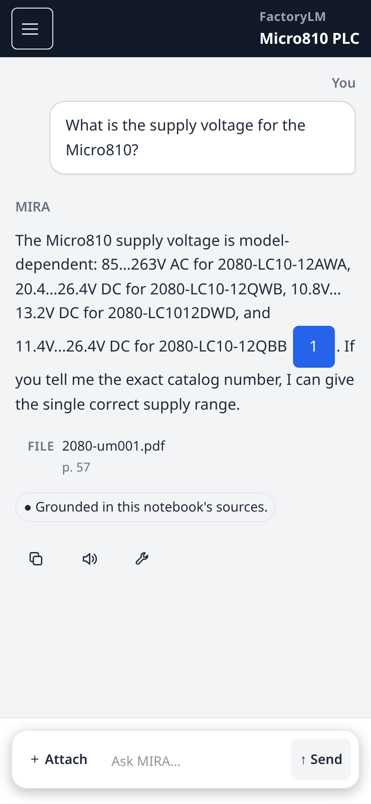

# FactoryLM MIRA: your crew's machines, your manuals, the page cited

**Built around your crew's machines, not a generic chatbot.**

MIRA gives each of your machines its own notebook with its OEM manual.
A technician asks a question in plain words.
MIRA answers from that manual and shows the page, so the tech can check the source before acting.
If the manual doesn't cover it, MIRA says so instead of guessing.

<!-- hero-desktop.png: prod v3.416.11, Oct 23, 2026, sidebar cropped out. Fallback: docs/assets/cited-page-57-desktop.png -->
![MIRA on desktop: a Micro810 supply-voltage question, the answer with citation [1], and the manual open at page 57 of 126](docs/assets/hero-desktop.png)

**[Talk to Mike about a pilot →](mailto:mike@factorylm.com?subject=MIRA%20pilot%20inquiry)**

---

## Why it's different

**Your documents, not the internet.**
A generic chatbot answers from anywhere and can't show its source.
MIRA answers from the manual attached to that machine and cites the page.

**Checked before day one.**
We load your manuals and check them before your crew starts, so answers come from your documents with the page cited.

**Honest when the manual is silent.**
If the answer isn't in the manual, MIRA says so. It doesn't make something up.

## What we've shown on the live app

These are specific tests, not accuracy rates.

- **Cited answers.** On a Rockwell Micro810 manual, the same question asked 5 times got the right answer citing page 57 all 5 times.[^p1]
- **No guessing.** On 5 questions the manual doesn't cover, MIRA said so every time, with no citation.[^p7]
- **One click to the page.** On a desktop browser, the citation opens the manual at the cited page.[^p8]
- **Browser to Android app.** A conversation started in the browser continued in the Android app and back, with cited answers (tested on an Android emulator).[^p9]
- **Manuals tested so far:** Rockwell, Festo and ABB.[^p5]
- **No passwords.** Sign in with an emailed link.[^p2]

## See it: ask, then check the page

1. Open the machine's notebook. Its manual is already attached (example: Rockwell Micro810 user manual, 126 pages).
2. Ask about the supply voltage, for example *"What is the supply voltage for the Micro810?"*
3. MIRA answers with the supply voltage range for each model and cites **page 57**.
4. On a desktop browser, click the citation. The manual opens at page 57, so you can see the answer for yourself.

<!-- answer-phone.png: prod v3.416.11, Oct 23, 2026. Shows the answer and its citation only, not the opened page (phone citations: R4). -->

*Phone-width view: the answer names its source file and page. To open the page itself, use a desktop browser for now.*

## The pilot

- **One crew.** Your maintenance team, not the whole company.
- **Your machines.** A few machines you choose.
- **Your manuals.** We load and check them before day one.
- **Real questions.** Your crew uses it on the job and you decide whether it earns a place in your shop.

Mike Harper, the founder, works with plants onsite in Central Florida or remotely.[^p6]

**[Talk to Mike about a pilot →](mailto:mike@factorylm.com?subject=MIRA%20pilot%20inquiry)**

Email works best if you include your machines and manuals.

## What MIRA is (and isn't) for

**For:** finding what your machine's manual says, fast, with the page to prove it.

**Not for:**
- **Safety, fault-reset, restart or lockout procedures.** Use your site procedure and qualified people.[^r3]
- **Replacing your CMMS** or reading PLC data. It doesn't write work orders.[^p3][^p4]
- **Any manual off the shelf.** We check yours first. Scanned PDFs without text aren't supported yet.[^r1]

**Good to know:**
- Ask again and the wording can change, or MIRA can decline. Check the cited page.[^r7]
- For now, check citations on a desktop browser. Phone citations are still being improved.[^r4]
- The Android app has been tested on an emulator. There's no app-store listing yet.

**Coming later, not in a pilot today:** crew invites, equipment history across shifts, guided troubleshooting, automatic manual finding, nameplate photo lookup, OCR for scanned PDFs.

Passing our own tests isn't the same as working in your plant. A pilot is how we find out together.

---

## For developers and contributors

Setup, architecture, runbooks and contribution guidelines are in **[docs/DEVELOPMENT.md](docs/DEVELOPMENT.md)**.

## License

Proprietary. Copyright (c) 2026 Cranesync. All rights reserved. See [LICENSE](LICENSE).

---

**Evidence.** Each claim above links to a proof. The public claims registry is being added in [#4570](https://github.com/Mikecranesync/MIRA/pull/4570) at `mira-web/src/capabilities/marketing-claims/capabilities.json`.

[^p1]: Prod, Oct 23, 2026, build v3.416.11: 5 of 5 fresh threads cited page 57 (first shown Oct 19 and 21; [#4607](https://github.com/Mikecranesync/MIRA/issues/4607)).
[^p7]: Prod, Oct 23, 2026, build v3.416.11: 5 of 5 out-of-manual test questions (first shown Oct 21; [#4607](https://github.com/Mikecranesync/MIRA/issues/4607)).
[^p8]: Prod, Oct 23, 2026, build v3.416.11, desktop browser. Screenshot above.
[^p9]: Android emulator round trip: prod, Oct 21, 2026, build v3.410.0, with the real app build, ABB ACS150 manual cited page 130. Web side re-checked on prod v3.416.11, Oct 23, 2026. [Proof](docs/proofs/2026-10-21-golden-conversation-prod-web-emulator.md), [#4619](https://github.com/Mikecranesync/MIRA/pull/4619).
[^p5]: Rockwell Micro810/Micro820, Festo, and ABB ACS150 test runs, Oct 17–21, 2026. [#4619](https://github.com/Mikecranesync/MIRA/pull/4619).
[^p2]: Sign-in at [app.factorylm.com](https://app.factorylm.com), audited Oct 18, 2026.
[^p6]: Founder statement.
[^p3]: Product scope. See [factorylm.com/limitations](https://factorylm.com/limitations).
[^p4]: Product scope. See [factorylm.com/limitations](https://factorylm.com/limitations).
[^r3]: Staging retest, Oct 23, 2026: 0 of 7 fault-reset questions got safety framing. [#4565](https://github.com/Mikecranesync/MIRA/issues/4565).
[^r7]: Staging, Oct 21 and Oct 23, 2026: the same question was answered, then refused.
[^r1]: Staging and prod measurements, Oct 18–23, 2026.
[^r4]: Staging, Oct 21, 2026, 390 px wide screen.
