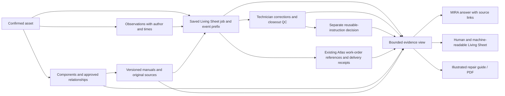

# FactoryLM Asset Memory North Star

**Version:** 1.0 — Proposed

**Date:** November 6, 2026

**Status:** Strategic direction; implementation and acceptance pending

Implementation status is tracked separately in the
[capability inventory](discovery/2026-11-06-asset-memory-inventory.md)
and [mission #5238](https://github.com/Mikecranesync/MIRA/issues/5238).
This extends the maintenance-context wedge in [NORTH_STAR.md](../NORTH_STAR.md);
it does not replace the commercial strategy or existing safety/release doctrine.

## The result a technician needs

Give every industrial machine a trustworthy, continuously growing maintenance
memory. FactoryLM connects the evidence scattered across equipment, technicians,
documents, maintenance systems and operational data. MIRA makes it understandable
and useful for the technician working on this specific machine.

A technician asks MIRA about one specific machine: what happened, what work was
actually done, which evidence supports it, and what remains unknown. MIRA can
answer with links to the original evidence. The Living Sheet and illustrated
repair guide present the same saved facts and review decisions.

FactoryLM connects records owned by existing systems. MIRA explains the evidence;
it does not become a new CMMS, historian, asset registry or source of physical
safety authority. One machine with a trustworthy history is the first proof.

## The five foundations

| Foundation | Product responsibility |
|---|---|
| Asset identity | Stable machine identity connects components, manuals, tags, faults, work orders and observations despite renaming or replacement. |
| Living Sheet | Primary capture interface for work as it happens, including observations, photographs, actions, completion claims, corrections and reviews. |
| Meaning layer | Existing equipment graph connects authoritative systems with sourced, dated relationships and explicit validity/review information. |
| Evidence-based intelligence | MIRA reconstructs the record while distinguishing source evidence, technician reports/corrections, approved instructions, hypotheses and unknowns. |
| Human and machine outputs | The same evidence supports chat, sheet, illustrated guide, handover, CMMS references, history analysis and read-only interfaces. |

The Living Sheet captures, the existing graph relates, and MIRA reasons. Atlas,
manuals and industrial connectors retain authority for their own records.

## One connected record, several outputs

An edge is an assertion with its own source, state and time. A drawn link or an
AI suggestion is not an approved relationship. An imported work-order number
is not proof of delivery to Atlas or a canonical Atlas asset association.

## Sources of truth

| Information | Existing owner | Rules for consumers |
|---|---|---|
| Operational asset | `cmms_equipment`, confirmed notebook binding and existing KG bridge | Keep the captured job key. Distinguish domain key, KG UUID and external provider ID; never join by display name. Legacy confirmed keys can be tags such as `PUMP-01`, not necessarily UUIDs. |
| ISA-95 placement / UNS | Existing namespace and approved entity placement | An address can change. Capture the address known at the time, or unknown. Never rewrite historical identity from today's notebook binding. |
| Component relationship | Existing graph / installed-component records | Preserve both endpoints, relationship ID and explicit admission state. Missing review metadata stays unknown. Do not silently equate two identity spaces. |
| Documents and original bytes | Workspace-file/document stores, existing ingestion and citation contracts | Preserve content hash when available, document/revision/page and original-file links. Membership, source-line match and approved retrieval are different assertions. |
| Technician observation | Existing observation records and pure projection | Preserve observation ID, author, observed time, recorded time, uncertainty and supersession. Reports are not machine measurements or OEM specifications. |
| Work performed | Living Sheet append-only events and reducer | Pin job ID and sequence. Preserve corrections and original event attribution. A draft instruction or source-job checkmark is not evidence of execution in a new job. |
| Technician closeout QC | Append-only server-authored candidate revisions | Pin exact candidate ID, actor, time and source snapshot hash. Job finish and event sequence do not identify later QC revisions. |
| Accepted reusable instruction | Explicit later approval policy and revision | Not yet implemented by the current intake/QC drafts. Technician closeout, legacy template review and imported approval flags do not supply this decision. |
| Atlas work order / delivery | Existing provider and transactional outbox/receipts | Distinguish requested, saved, queued, delivered, reconciled and blocked. A captured UNS or description match is not proof of provider asset linking. |
| MIRA answer | Existing viewer-owned notebook turn and evidence frame | Preserve the actual served answer and evidence selection. Private turns never become asset-wide shared knowledge automatically. |
| Equipment telemetry | Existing read-only collector/relay/historian and approved-tag boundary | Keep producer identity, timestamp, quality/freshness and simulation status. Reuse one ingest pipeline. No PLC/OPC UA/MQTT command writes. |

The TypeScript/Postgres JSONB event/revision implementation already fits the
job/instruction contract. The existing Python `materialized_evidence` contract
provides producer/hash/lineage semantics; it remains canonical for its producers.
Integration should adapt existing representations, not create another writable
registry or event store. A universal cross-runtime contract is not claimed today.

Standards compatibility supports adoption: ISA-95, UNS and CESMII i3X inform the
semantic model without requiring every customer to implement a complete UNS
before using MIRA. Preserve the machine's existing confirmed key and an unknown
UNS address when that is all the evidence establishes. This product direction
does not waive identity confirmation or existing industrial read-only controls.

## Provenance and time are part of every fact

Preserve stable asset, component, relationship, source, job, event, step,
observation, candidate and decision identities wherever the producer records
them. Preserve original values and citations alongside corrections. If an older
record has only a citation string or actor label, retain it with the missing
identity explicitly unknown. Do not manufacture a document ID, reviewer or time.

Keep these times distinct: when something was observed; when it was recorded;
when a review happened; when a source revision was captured; and when current
context was read. A job event prefix is not a graph-wide historical timestamp.

Historical context must identify the job sequence/hash and exact QC candidate.
A replay promise also requires the admitted inputs or an immutable version of
them, projector/adapter version, source IDs/hashes, limits and omissions. Requerying
today's graph with yesterday's IDs does not prove yesterday's values or approvals.
Live values may accompany historical records only as a separately dated overlay.
If a notebook is rebound from A to B, A's old job remains A's old job.

## Review states and safety

The record must distinguish unknown, proposed/inferred, source-matched,
technician-reported, graph-admitted, technician-closeout-checked and accepted for
reuse. These assertions are independent; they are not one universal confidence
score or a ladder that automatically promotes a record. An exclusion remains
visible with its decision source, actor and time after subsequent confirmation.

No review described here grants physical safety clearance, root-cause certainty,
ride/equipment readiness or permission to perform energized work. Existing
identity, authorization, hazardous-answer and industrial read-only controls
continue to apply. Failed or unavailable evidence causes explicit uncertainty.

## Technician journeys

1. Receive verbal direction or a formal work order. Confirm the machine;
   identify components and relevant existing instructions. Capture photos and
   sources within the data owner's authorized boundary.
2. Work and update the Living Sheet as events occur. Record readings, questions,
   actions and corrections with source and time. MIRA assembles a draft guide,
   preserving unresolved questions and proposed steps separately from work done.
3. At closeout, the performing technician reviews the exact saved job and
   proposed guide with MIRA. Corrections produce an append-only draft candidate.
4. A later authorized reviewer decides what can become an accepted reusable
   instruction. A changed step must not inherit old execution or approval.
5. A future technician reuses the selected revision, with execution marks reset.
   They can inspect original sources, changes and unresolved applicability.
6. A technician or service manager downloads an illustrated Chilton-style PDF.
   Length follows job complexity. Missing images or insufficient source material
   are explicit; a two- or three-page example is not a universal product promise.

Capture exact questions/answers and benchmark exposure only with appropriate
permissions. Workplace material remains private absent specific authority and
permission for its use. Developer-exposed synthetic fixtures are not clean
benchmark holdouts or representative human acceptance.

## Measurable first-machine acceptance

Use one existing confirmed test asset and one representative saved job. Record
the exact code/environment, IDs, source manifest and test evidence. A missing
mandatory item keeps the slice partial; no readiness percentage substitutes.

1. Asset and component references resolve by recorded identities. Rebinding,
   wrong-tenant and wrong-asset controls cannot contaminate the record.
2. Original observations, repeated and interrupted updates, corrections and
   exclusions retain chronology, actor/source and supersession. Conflicting
   reports remain contested, and missing evidence remains unknown.
3. Manuals and work orders link to their original authorized sources. The view
   distinguishes imported claims from admitted documents and provider receipts.
4. MIRA describes what happened and what was actually done, cites the saved
   record and states unresolved questions without supplying a guessed cause.
5. Sheet, chat and illustrated guide identify the same job prefix and exact
   candidate; effective values and correction sources agree beside the right
   steps in screen and print. Structured JSON retains complete lineage.
6. Repeated retrieval of a selected historical record survives later candidate
   edits and notebook reassignment. Current overlays are labelled with read time
   and do not alter the historical hash. An answer replay uses its original
   evidence frame rather than recomputing it.
7. Source match, observation, closeout QC, reusable acceptance and safety status
   stay distinct in positive and negative tests. New-job execution is reset.
8. Tenant/viewer isolation, source permissions, bounded input sizes and explicit
   truncation/unavailability remain enforced. Prompt data stays in the existing
   hardened evidence channel, never promoted into system instructions.
9. The read slice emits no graph promotion, CMMS dispatch, execution reopen,
   duplicate finish event or industrial write. Existing release gates pass on
   the exact candidate before separately authorized promotion.

Representative device/job validation and actual human acceptance are separate
from local unit, integration, browser/PDF and CI evidence.

## Initial demonstration and priorities

Use one existing confirmed test asset with verified source connections; CV-101
is a candidate only if those connections are established. The audited PUMP-01
job is a useful historical control with explicit missing component/manual/UNS
and provider-asset links; those gaps are not filled from display names or seeds.

The demonstration selects the asset, opens its job, records an observation,
links a component and supporting manual, records inspection and a correction,
associates the appropriate Atlas work order, preserves the historical state,
asks MIRA to reconstruct it, displays evidence/unresolved questions, and produces
the consistent illustrated record. Reported work and independently verified
completion must remain distinct throughout.

| Priority | Capability | Direction |
|---|---|---|
| P0 | Living Sheet corrections and provenance | Finish existing work. |
| P0 | Asset-to-job identity | Connect existing systems. |
| P0 | Historical event replay | Reuse and validate. |
| P1 | Atlas and manual source links | Complete the bounded integration. |
| P1 | Evidence-backed MIRA answers | Prove the end-to-end journey. |
| P1 | Consistent illustrated guide | Verify screen and PDF. |
| Later | Fleet-wide graph intelligence | Defer until one machine is proven. |

## Product North Star metric

Primary measure: the percentage of evaluated real maintenance-history questions
for which MIRA gives a correct, source-supported, asset-specific answer without
unsupported material claims. Record the number and composition of evaluated
questions, applicable source state, independent expected answers, reviewers and
benchmark exposure. Do not substitute synthetic developer tests for this rate.

Report asset/job resolution, original source-link validity, historical replay,
correction/review-state accuracy, chat/sheet/PDF consistency, technician task
completion/usefulness and safety/authorization violations alongside it. Report
answer coverage and appropriate abstention separately so refusing answerable
questions cannot make the primary rate appear successful. Establish targets
from a representative baseline; no numeric target is invented here.

Once one machine is proven, extend carefully to lines and facilities: knowledge
transfer, evidence-backed handover, repeated-failure analysis, component/repair
history, reviewed procedure improvement and cross-system maintenance context.
Advanced diagnostics, recommendations and prediction require their own evidence
and validation. The guiding question remains: what happened, what did we do,
how do we know, and what should we check next?

## Current delivery boundary

The [inventory](discovery/2026-11-06-asset-memory-inventory.md) records what is
implemented, connected, tested, deployed, proposed or unknown. Drafts #5235,
#5236 and #5239 extend the canonical Living Sheet; they do not prove a deployed
full loop. The first integration should be a bounded read view, preserving
historical identity and existing source/review rules. Protocol expansion,
automatic source writes and a whole-plant model are deferred.

Mike authorized research, documentation, scoped implementation/local tests and
reviewable GitHub work. This mission excludes production deployment, database
migrations, destructive changes, new paid services, safety weakening and merge
without existing valid authorization. See [environment doctrine](environments.md)
and [SDLC](architecture/mira-sdlc-v1.md) for the existing promotion gates.
