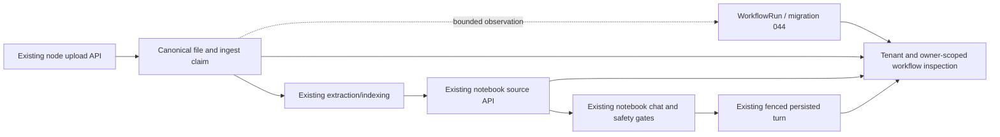

# WF-01: Manual-to-answer workflow visibility

Status: implementation in progress; dependent on PR #5319. No deployment or field acceptance.

## Work claim and authority

- Slice: Phase 1 shared workflow contract, observable manual upload, and a tenant/owner-scoped projection of upload → extraction/indexing → notebook source → persisted answer.
- Owner/session: Codex, MIRA workflow Phase 1, 2026-11-19.
- Branch: `codex/workflows-phase1`.
- Worktree: `/private/tmp/mira-workflow-phase1` (temporary; remove after publishing).
- Base/R0: `d866ceb0e9392e26361bae0155c87465a7a9537a`, PR #5319 `fix/5318-ingest-finalize-recovery`.
- Status: ACTIVE.
- Authority: Mike's Phase 1 mission and explicit approval to build a dependent draft atop #5319. No takeover, merge, deployment, shared migration, device operation, or paid model evaluation.
- Expected changes: `mira-hub/src/lib/workflow{,-contract,-versions}.ts`, additive manual-workflow capability/tests, an observational adapter around the node upload handler, workflow inspection API, and this architecture record. Preserve the dependency's claim/finalization/cleanup behavior. No PDF layout/table/retrieval, notebook safety/prompt/provider, or shared-shell changes.

## Baseline and governing decisions

The preceding read-only audit inspected main `d1b9ad8183290f55697d901a0206fbbaf5ee8bd6`. This branch deliberately starts at the approved unmerged recovery dependency, not at that newer main. Its older extraction and application code must not be described as the current pilot composition. Reconcile the stack with main after #5319 is accepted; preserve its owner's frozen review history.

Read: DELIVERY.md at main `d1b9ad8183290f55697d901a0206fbbaf5ee8bd6`; [delivery record](https://github.com/Mikecranesync/MIRA/issues/5232#issuecomment-6883373082). This specialist slice supports trustworthy context and recoverable technician work; it does not replace an existing delivery-lane owner or its status comment.

- ADR-0011: reuse the existing application, no agent-framework rewrite.
- ADR-0017: domain state machines retain their own vocabulary and authority.
- ADR-0029: reference canonical sources/evidence and the existing run ledger; no second registry. Its future Temporal direction remains deferred for this bounded phase.
- Unified UI Cutover: existing notebook capabilities remain authoritative; no new presentation tree.
- Migration 044: run visibility is fail-open and is not an execution lock or retry engine.
- Migrations 077/089: file and notebook-request claims remain the execution authorities.

## Shared contract (implementation target)

Versioned observations contain definition/version, tenant and operation/attempt identity, stage/state, domain ownership references, evidence IDs/hashes, classified failures, domain-owned retry/recovery instructions, cancellation scope, and observation time. Customer document text, filenames, questions, answers, credentials, claim tokens and arbitrary exceptions do not belong in the shared observation.

The generic table's existing `running | ok | degraded | failed` values remain unchanged. Rich states live in the versioned JSON contract. Every independent request gets its own observation attempt. A duplicate observation must never grant permission to rerun domain effects. Only the canonical file/request claim decides execution and replay.

Client cancellation is distinct from execution cancellation. A client can stop waiting while accepted extraction finishes and its bytes/index remain recoverable. Report the actual domain outcome and the cancelled delivery separately; do not advertise that extraction was cancelled when it was not.

## Vertical slice and ownership

The inspection projection reads domain facts, including live/stale claims, actual indexed chunks, source membership and this technician's keyed turn. It must survive a lost observation or process restart without becoming a second business-state authority. Recovery points to the existing upload-again or same-request chat APIs. It never performs a retry itself.

## Behavior lock and R0

At the exact dependency head, the selected existing workflow, file/recovery, upload, notebook answer-gate, stop/persistence, lifecycle, tenant-scope and safety tests passed: **534 tests, zero failures/skips**. Local report: `/private/tmp/mira-workflow-phase1-baseline.json`; no provider or shared database access. The branch/base SHA is the addressable pre-change checkpoint. No application schema change is planned; disposable integration fixtures will use existing migrations only.

CodeGraph 1.6.3 indexed this isolated checkout, but its canary still reported zero callers after force-reindex. Call-graph results are untrusted. Ground affected symbols and callers directly in source and contract tests; record this tooling limitation rather than claim a healthy graph.

## Required deterministic evidence

- Shared contract rejects malformed identity, unbounded/unknown payloads and unsupported lifecycle claims.
- Live run checkpoints survive final failure; observation failure does not rerun or fail domain work.
- Actual manual upload, extraction and chunk persistence, notebook attachment, retrieval, gated response and fenced answer persistence form one tested path; model responses are deterministic fixtures.
- Duplicate and concurrent requests retain canonical file/index/turn identity and do not duplicate accepted side effects.
- Client stop is visible and preserves accepted work; notebook stop preserves existing safety/persistence semantics.
- Interrupted claim and completed-index/finalization recovery reuse existing claims and #5319 reconciliation after simulated restart.
- Inspection enforces tenant, notebook/file relationship, user/request scope and evidence linkage; no mutation or inference on GET.
- Existing behavior/safety suites, architecture checks, lint and applicable type checks remain passing or have separately reproduced baseline failures.

## Rollback and promotion

Revert only this dependent increment to R0. Domain rows, original bytes, claims, notebook sources, turns and outbox state remain owned by their existing systems. Observation rows are additive operational metadata; they do not require deletion or schema rollback. This branch supplies no production migration, merge or deployment authority. Exact-head independent review, hosted CI, composed-candidate qualification and field verification remain separate gates.

## Remaining gaps / Phase 2

Other Ask paths, graph identity/review correctness, telemetry delivery IDs, autonomous ingestion scheduling, server Work Packet revisions, broader evidence-contract adoption and eventual orchestration-engine decisions remain outside this phase. Expand only after the manual slice's deterministic evidence and review support it. Never transfer local fixture success into a production or technician-acceptance claim.
