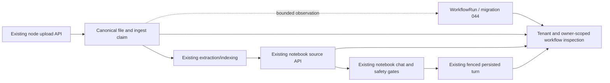
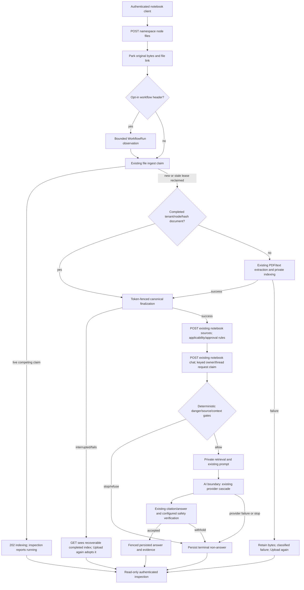

# WF-01: Manual-to-answer workflow visibility

Status: implemented and locally verified in dependent draft [PR #5647](https://github.com/Mikecranesync/MIRA/pull/5647); promotion blocked on the gates below. Depends on PR #5319. No deployment or field acceptance.

## Work claim and authority

- Slice: Phase 1 shared workflow contract, observable manual upload, and a tenant/owner-scoped projection of upload → extraction/indexing → notebook source → persisted answer.
- Owner/session: Codex, MIRA workflow Phase 1, 2026-11-19.
- Branch: `codex/workflows-phase1`.
- Worktree: `/private/tmp/mira-workflow-phase1` (temporary; remove after publishing).
- Base/R0: `d866ceb0e9392e26361bae0155c87465a7a9537a`, PR #5319 `fix/5318-ingest-finalize-recovery`.
- Status: RELEASED to the dependent draft for review; no other execution lane claimed.
- Authority: Mike's Phase 1 mission and explicit approval to build a dependent draft atop #5319. No takeover, merge, deployment, shared migration, device operation, or paid model evaluation.
- Expected changes: `mira-hub/src/lib/workflow{,-contract,-versions}.ts`, additive manual-workflow capability/tests, an observational adapter around the node upload handler, workflow inspection API, and this architecture record. Preserve the dependency's claim/finalization/cleanup behavior. No PDF layout/table/retrieval, notebook safety/prompt/provider, or shared-shell changes.

## Baseline and governing decisions

The preceding read-only audit inspected main `d1b9ad8183290f55697d901a0206fbbaf5ee8bd6`. This branch deliberately starts at the approved unmerged recovery dependency, not at that newer main. Its older extraction and application code must not be described as the current pilot composition. Reconcile the stack with main after #5319 is accepted; preserve its owner's frozen review history.

Read: DELIVERY.md at main `d1b9ad8183290f55697d901a0206fbbaf5ee8bd6`; [delivery record](https://github.com/Mikecranesync/MIRA/issues/5232#issuecomment-6883373082). This specialist slice supports trustworthy context and recoverable technician work; it does not replace an existing delivery-lane owner or its status comment.

- ADR-0011: reuse the existing application, no agent-framework rewrite.
- ADR-0017: domain state machines retain their own vocabulary and authority.
- ADR-0029: reference canonical sources/evidence and the existing run ledger; no second registry. Its future Temporal direction remains deferred for this bounded phase.
- Unified UI Cutover: existing notebook capabilities remain authoritative; no new presentation tree.
- Migration 044: run visibility is fail-open and is not an execution lock or retry engine.
- Migrations 077/089: file and notebook-request claims remain the execution authorities.

## Shared contract (implemented)

Versioned observations contain definition/version, tenant and operation/attempt identity, stage/state, domain ownership references, evidence IDs/hashes, classified failures, domain-owned retry/recovery instructions, cancellation scope, and observation time. Customer document text, filenames, questions, answers, credentials, claim tokens and arbitrary exceptions do not belong in the shared observation.

The generic table's existing `running | ok | degraded | failed` values remain unchanged. Rich states live in the versioned JSON contract. Every independent request gets its own observation attempt. A duplicate observation must never grant permission to rerun domain effects. Only the canonical file/request claim decides execution and replay.

Client cancellation is distinct from execution cancellation. A client can stop waiting while accepted extraction finishes and its bytes/index remain recoverable. Report the actual domain outcome and the cancelled delivery separately; do not advertise that extraction was cancelled when it was not.

The implementation is [workflow-contract.ts](../../../../mira-hub/src/lib/workflow-contract.ts), with a strict runtime parser and exported TypeScript types. It has no dependency on a new library. Unknown fields at every level are rejected, references are bounded, UUIDs/hashes/versions/timestamps are validated, and invalid success/cancellation assertions are rejected. This phase supports the three owners used by this slice; adding another domain is a reviewed contract extension, not arbitrary metadata.

| Contract field | Meaning in WF-01 |
|---|---|
| `contract`, `definition` | `mira.workflow.v1`; separately versioned `manual_upload` and `manual_question`, both `1.0.0` |
| `identity` | Authenticated tenant, canonical file operation ID, and observation attempt ID. Upload attempts use fresh UUIDs; the inspection projection uses the authorized turn ID when present. These IDs do not grant execution/replay authority. |
| `owner`, `stage`, `state` | Domain record responsible for the observed stage; `running`, `waiting`, `succeeded`, `partial`, `failed`, `cancelled`, `interrupted`, or `refused` |
| `evidence` | File/document/notebook/turn references, file hash and cited page numbers; no source or answer text |
| `failure` | Classified code plus retryability; no arbitrary exception, credential or customer content |
| `retry`, `recovery` | Advice to the caller, including the existing domain API that owns recovery. No automatic execution. `afterMs` is polling guidance, not a scheduler. |
| `cancellation` | A requested client wait cancellation, or a positively acknowledged execution cancellation |
| `observedAt` | Snapshot time, not a promise that later facts have not changed |

`WorkflowRun` retains its existing behavior for legacy callers. Observation mode adds ordered progress checkpoints and bounds each metadata write to one second by default (maximum two seconds). A recorder timeout/failure neither retries nor fails the domain body. A late successful INSERT is finalized from the cached terminal snapshot; a late checkpoint cannot overwrite a terminal row. Failed steps preserve timing and a classified error, stripping arbitrary artifacts and unsafe labels. These guarantees do not make a timed-out PostgreSQL query cancel itself, and do not replace the existing pool's connection bounds.

Compatibility with migration 044: `running`/`waiting` map to `running`; `succeeded` to `ok`; `failed`/`interrupted` to `failed`; the other states to `degraded`. The rich state remains in `input.workflow`/`output.workflow`. A request waiting on another file claimant leaves a nonterminal row (`finished_at = NULL`); the domain projection below is the source of current truth. No sweeper closes old rows in this phase.

## Vertical slice and ownership



The inspection projection reads domain facts, including live/stale claims, actual private page-anchored chunks, source membership and this technician's keyed turn. It survives a missing observation and simulated producer loss without becoming a second business-state authority. Recovery points to the existing upload-again or same-request chat APIs. It never performs a retry itself. Extraction and indexing are one existing synchronous domain operation; WF-01 does not invent independently resumable page/parse stages.

Observed execution path (this branch, rather than a proposed engine):



The AI creates the answer within existing notebook logic. Header opt-in, claim acquisition/reclaim, tenant/source selection, gate routing, inspection status, retry guidance and evidence-reference validation are deterministic code. Neither AI output nor a workflow row can approve a source or authorize another side effect. A persisted answer is recognized only for the authorized request, selected document and cited document evidence; later source removal does not erase historical answer persistence.

## Workflow inventory and historical reconciliation

Inventory is grounded in the pinned dependency plus this increment. `VERIFIED` means a locally exercised code path at that revision, `PARTIAL` means existing implementation or adoption with stated gaps, `MISSING` means absent from this increment, `LEGACY` means retained older path, and `UNKNOWN` means not established. None of these labels asserts deployment or field behavior.

| Workflow | Entry / implementation | Runtime wiring / existing state authority | Durability / verification | Phase 1 status / remaining gap |
|---|---|---|---|---|
| Node manual → notebook answer | [files API](../../../../mira-hub/src/app/api/namespace/node/[id]/files/route.ts), [sources API](../../../../mira-hub/src/app/api/equipment-notebooks/[id]/sources/route.ts), [chat API](../../../../mira-hub/src/app/api/equipment-notebooks/[id]/chat/route.ts) | Existing notebook callers retained; additive upload header and inspection GET. File claim (077), source rows and keyed turn claim (089) remain authoritative. | Durable original/index/source/turn records; request-driven reclaim; real-PDF/SQL/fixture-provider tests and existing gates | VERIFIED locally; observation opt-in and inspection API only. No UI adoption, autonomous recovery or field proof. |
| Cloud/OAuth document and photo ingest | [upload-pipeline.ts](../../../../mira-hub/src/lib/upload-pipeline.ts) | Existing `document_ingest` WorkflowRun; fire-and-forget fetch/forward domain pipeline and `hub_uploads` | Existing status/retry and coarse run ledger; a run row does not resume a lost process | LEGACY observation contract retained; shared-contract adoption PARTIAL. Do not merge this executor into WF-01. |
| Notebook photo interpretation / equipment clues | [chat API](../../../../mira-hub/src/app/api/equipment-notebooks/[id]/chat/route.ts), [photo-source.ts](../../../../mira-hub/src/capabilities/photo-source.ts), [photo-provenance.ts](../../../../mira-hub/src/capabilities/photo-provenance.ts) | Existing photo/file ownership, notebook turns, reviewed-reading publication and evidence paths | Existing domain fences/tests; AI interpretation and technician-confirmation boundaries retained | PARTIAL common visibility; this slice does not observe photo upload or alter image interpretation/identity. |
| Notebook creation / identity / source applicability | [notebooks API](../../../../mira-hub/src/app/api/equipment-notebooks/route.ts), [identity confirmation API](../../../../mira-hub/src/app/api/equipment-notebooks/[id]/identity/confirm/route.ts), [equipment-notebooks.ts](../../../../mira-hub/src/lib/equipment-notebooks.ts) | Existing notebook and namespace ownership, identity review and source state | Domain transactions and approval vocabulary retained | KEEP simple operations synchronous. Identity/provenance contract adoption remains PARTIAL. |
| Other Ask paths (node/asset/public/Python) | [manual-rag.ts](../../../../mira-hub/src/lib/manual-rag.ts), [Python engine](../../../../mira-bots/shared/engine.py) | Distinct callers, context builders and gates; WF-01 deliberately does not redirect them | Their existing domain/test evidence is not this vertical slice's proof | PARTIAL architecture coherence; common observation/evidence adoption MISSING here. |
| Work Packet draft/edit/verify | [work-packet API](../../../../mira-hub/src/app/api/equipment-notebooks/[id]/work-packet/route.ts), [draft.ts](../../../../mira-hub/src/capabilities/work-packet/draft.ts), [verify.ts](../../../../mira-hub/src/capabilities/work-packet/verify.ts), [job-record.ts](../../../../mira-hub/src/capabilities/work-packet/job-record.ts) | Existing gated deterministic draft, applicability and verification; no server packet revision write in this route | Existing verify-before-return; client-side job/edit records are a separate ownership concern | KEEP draft logic. Server revision/run/recovery integration MISSING here; #5204 ownership preserved. |
| PLC/connector import | [PLC import API](../../../../mira-hub/src/app/api/connectors/plc/import/route.ts), [plc-import.ts](../../../../mira-hub/src/lib/plc-import.ts) | Existing parse preview, optional pending proposals; no automatic approval | Existing parser/tenant tests; import is distinct from live connector ingestion/state | PARTIAL common visibility; live connector delivery/recovery not qualified by this slice. |
| Knowledge graph / relationship review | [graph API](../../../../mira-hub/src/app/api/kg/graph/route.ts), [sync API](../../../../mira-hub/src/app/api/kg/sync/route.ts), [proposal state ADR](../../../adr/0017-proposal-state-machine-mapping.md) | Existing graph, evidence, proposal ownership and review vocabulary | Domain records retained; a workflow observation does not verify graph truth | PARTIAL cross-surface evidence contract; broader correctness audit/review remains separate. |
| Recorded fix → CMMS delivery | [existing outbox dispatcher](../../../../mira-hub/src/capabilities/cmms-dispatch/dispatcher.ts), [ADR-0039](../../../adr/0039-notebook-event-outbox-and-cmms-write-contract.md) | Existing transactional event/outbox, delivery claims, receipts and read-back | Suitable durable delivery mechanism already exists; enablement/vendor capability not observed here | KEEP; reuse this pattern when a genuine external delivery needs it. Deployment state UNKNOWN in this investigation. |

The [June durability audit](../../../research/2026-06-06-workflow-durability-audit.md) recommended a versioned run ledger before replacing orchestration. Migration 044 and the TS/Python wrappers subsequently implemented that ledger; its old “no run records” conclusion is historical, not current proof. WF-01 fills one additional visibility/reconciliation gap. It does not equate ledger persistence with durable execution.

The [duplicate systems audit](../../../discovery/duplicate-systems-audit.md) documents separate retrieval/orchestration families. They remain separate here. ADR-0011's no-framework-rewrite direction and ADR-0017's domain ownership are preserved. [ADR-0029](../../../adr/0029-materialized-evidence.md) supplies the evidence/reference direction; its larger engine ambition is deferred by this mission. PR #5319 supplies canonical finalization recovery, while [PR #3300](https://github.com/Mikecranesync/MIRA/pull/3300) owns a separate channel-neutral execution/migration design. This observation contract neither implements nor supersedes that design. Closed issues and these design documents are context; current code/tests determine the claims above.

## Inspection and recovery guide

An authenticated API client can opt a supported PDF/text request into run metadata with `X-Mira-Workflow: mira.workflow.v1` on the existing `POST /api/namespace/node/<node-id>/files`. Accepted bytes are parked first. The original response body/status is retained, with `X-Mira-Workflow-Run-Id` added. Without the header the original domain operation runs without new observation writes. No presentation code or environment flag was added, and no pilot client was switched over.

`GET /api/workflows/manual-question?notebook_id=<uuid>&file_id=<uuid>&client_request_id=<uuid>&thread_id=<thread>` returns the contract, document readiness, stage booleans, last upload observation and visibility gaps. Request/thread parameters are optional; omit both for upload/source inspection. For a keyed answer, supply the original request UUID and thread (or omit thread only for the existing legacy thread). The existing Hub base path still applies, e.g. `/hub/api/...` when configured.

- Tenant and user come exclusively from the authenticated session. The file must be linked to the notebook's node; an unrelated or foreign file/notebook returns 404. A keyed turn additionally requires the exact tenant/notebook/owner/thread/request. UUID spelling is canonicalized. This API performs no mutation, model call, retry or notebook-recency update.
- `visibility.uploadRecorded=false` is not domain failure. A missing/malformed/unavailable recorder or unavailable cancellation trace is reported separately; inspect canonical facts. The generic `/api/workflows?workflow_name=manual_upload` and existing `/workflows` dashboard show attempt metadata, not a current end-to-end state machine.
- Live file/turn claim: wait and inspect. Stale file claim or completed index without canonical finalization: use the existing **Upload again** request for the same bytes and node; #5319 adopts the completed document under its own claim. No GET repairs a file.
- Indexed but unattached: use the existing notebook source attachment API. Rejected/candidate/disabled/superseded sources are not made chat-ready by inspection; use the existing review/approval flow.
- Interrupted/failed question: preserve the original question/source/thread/request contract and use the existing chat endpoint. Its claim/payload checks decide whether to replay, reject, or reclaim. Guidance never overrides source/safety checks. A refused safety result is terminal; no automatic replay is advertised.
- Client stop during upload is only `client_wait`, with `acknowledged=false`; accepted extraction may finish. Notebook execution stop is reported `cancelled` only through the closed lifecycle of that already owner-authorized turn. Missing lifecycle evidence is a visibility gap, not proof of cancellation.

Pre-park authentication/validation/file-rejection failures have no file operation ID and no new workflow row. Request-driven lease recovery is supported; automatic scheduling, page-level resume, an actual process kill/reboot and unattended file replay are not implemented or verified.

## Behavior lock and R0

At the exact dependency head, the selected existing workflow, file/recovery, upload, notebook answer-gate, stop/persistence, lifecycle, tenant-scope and safety tests passed: **534 tests, zero failures/skips**. Local report: `/private/tmp/mira-workflow-phase1-baseline.json`; no provider or shared database access. The branch/base SHA is the addressable pre-change checkpoint. No application schema change is planned; disposable integration fixtures will use existing migrations only.

CodeGraph 1.6.3 indexed this isolated checkout, but its canary still reported zero callers after force-reindex. Call-graph results are untrusted. Ground affected symbols and callers directly in source and contract tests; record this tooling limitation rather than claim a healthy graph.

## Deterministic evidence and limits

- Shared contract rejects malformed identity, unbounded/unknown payloads and unsupported lifecycle claims.
- Live run checkpoints survive final failure; observation failure does not rerun or fail domain work.
- Actual manual upload, extraction and chunk persistence, notebook attachment, retrieval, gated response and fenced answer persistence form one tested path; model responses are deterministic fixtures.
- Duplicate and concurrent requests retain canonical file/index/turn identity and do not duplicate accepted side effects.
- Client stop is visible and preserves accepted work; notebook stop preserves existing safety/persistence semantics.
- Interrupted claim and completed-index/finalization recovery reuse existing claims and #5319 reconciliation after simulated restart.
- Inspection enforces tenant, notebook/file relationship, user/request scope and evidence linkage; no mutation or inference on GET.
- Existing behavior/safety suites, architecture checks, lint and applicable type checks remain passing or have separately reproduced baseline failures.

The fixture suite [manual-workflow.integration.test.ts](../../../../mira-hub/src/capabilities/__tests__/manual-workflow.integration.test.ts) uses actual route handlers, PDF extraction, private lexical retrieval and PostgreSQL persistence. Only authentication, declared parse/finalization timing/fault injection, and network provider responses are controlled. Every unexpected fetch fails. A generated two-page fictional PDF is retrieved and cited on page 2, then a duplicate request replays without another provider call or turn. Failure, duplicate/concurrent upload, upload-wait stop, acknowledged notebook stop, immediate danger refusal, stale file/request leases, losing-token fencing, finalization adoption, default-path preservation and tenant/owner/linkage/read-only negatives are covered.

Restart evidence is a **simulated producer loss with a persisted expired lease and a fresh handler invocation**, not an OS/process reboot or deployed recovery. The fixture uses a lexical-only PostgreSQL stand-in for the unused vector column; embeddings/vector retrieval are not exercised. Semantic AI review is disabled only in this fixture; the unchanged semantic safety behavior is exercised by the full Hub unit suite. The model's factual performance and any field outcome are unverified.

Local check counts and final exact revision are recorded in the draft PR. Selected R0 checks passed 534/534. The full type check retains **76 diagnostics identical by diagnostic line to independently checked R0**, with no added diagnostics; the shared-package dependency link documented by CI is installed in both owned checkouts. The capability-closure validator retains the same eight expired review-date findings as R0; the new blocked entry adds none. Existing dates/decisions are not silently renewed by this phase. CodeGraph's zero-caller canary remains a recorded limitation.

Both the implementation-tree build and the independently executed exact R0 build compile, complete Next's production type/page generation, then **exit 1 at Next 16.4.1's security-advisory check**. This is not a passing production-build claim. No dependency update, advisory override or retry to suppress the gate was performed. Resolve the unchanged dependency's security assessment in its owning lane before promotion. The closure test suite likewise has one baseline failure for those same eight expired reviews (36 other closure tests pass); architecture and security-filter tests pass separately.

Reproduction (existing dependencies and a fresh, explicitly disposable local PostgreSQL database only):

```sh
# From mira-hub, after the repository's normal dependency setup:
bun run test
node scripts/sitemap.mjs --check
bun run build

# Set TEST_DATABASE_URL to a loopback-only mira_wf01_test database;
# never reuse shared dev/staging/production databases. Setup applies EXISTING
# integration migrations only to that disposable database.
export MIRA_TEST_DB_CONFIRM=DISPOSABLE
export MIRA_INTEGRATION_EXTRA_MIGRATIONS=044_workflow_runs.sql,076_namespace_uploads_source_reconcile.sql,077_ingest_claim.sql,082_namespace_uploads_node_nullable.sql,032_decision_traces.sql,055_decision_trace_confidence_and_feedback.sql,070_decision_traces_tenant_text.sql,080_decision_traces_provider_usage.sql,090_decision_traces_turn_packet.sql,091_decision_traces_turn_lifecycle.sql,092_decision_traces_lifecycle_append_only.sql,093_turn_ingress.sql,094_decision_traces_lifecycle_invariant.sql,003_kb_hardening.sql,049_grant_app_knowledge_entries_insert.sql
node scripts/setup-integration-db.mjs
bun run test:integration --maxWorkers=1 --minWorkers=1 --cache=false src/capabilities/__tests__/manual-workflow.integration.test.ts
```

Run tests with provider credentials/shared database URLs removed from the process environment. The SQL fixture refuses connection before pool creation unless both explicit confirmation and the literal loopback/database-name guards pass; it also verifies the existing fixture ledger before writing. It adds fixture-only lexical/vector-placeholder columns, not a production migration. Its deterministic model configuration must not be exported into the full unit suite, which tests normal defaults. New unit tests are automatically included in the existing `mira-hub-unit` CI job and `ci-gate`; the real-SQL suite is currently local-only, with CI adoption explicitly outstanding. No new infrastructure/framework was installed.

## Rollback and promotion

Revert only this dependent increment to R0. Domain rows, original bytes, claims, notebook sources, turns and outbox state remain owned by their existing systems. Observation rows are additive operational metadata; they do not require deletion or schema rollback. This branch supplies no production migration, merge or deployment authority. Exact-head independent review, hosted CI, composed-candidate qualification and field verification remain separate gates.

## Remaining gaps / prioritized Phase 2

| Priority / decision | Work and dependency |
|---|---|
| Pilot-critical — KEEP | Canonical bytes, existing file/request leases and tokens, notebook safety/source gates, fenced turn persistence, tenant boundaries and transactional CMMS outbox. Keep deterministic/simple operations in their domain APIs. |
| Pilot-critical — FIX / qualify | Resolve #5319's own review/acceptance gates, the unchanged Next dependency's build security advisory and the eight baseline registry-review expirations; compose with then-current main without changing its owner's review history, run exact-head independent review/hosted CI, and qualify the combined pilot candidate. This old dependent base is not that candidate. |
| Pilot-critical — ADD | Put this real-SQL slice into an existing suitable gated integration job with its disposable fixture guard, then verify one identified staging technician flow and recovery on the approved artifact. No production/default enablement is implied. |
| Pilot-critical — CONSOLIDATE | Let one existing notebook client consume this inspection contract before expanding adapters. Reuse the existing shared shell, canonical file/turn IDs and inspection path; do not create a second dashboard or retry controller. |
| Next — FIX | Reconcile abandoned `running` observation rows using domain facts in an existing operational worker if operational evidence justifies it; bound inspection/recorder query execution using existing DB policies. Neither is a domain retry engine. |
| Next — CONSOLIDATE | Adopt the same reference-only contract in the existing TS cloud ingest and Python wrapper, preserving their executor ownership; coordinate with #3300. Retain historical contract/version parsing and define a reviewed evolution policy before adding new owners. |
| Next — ADD | Broader evidence/applicability identity, graph review, connector delivery identity, server Work Packet revisions and interruption policy, each in its owning domain. Preserve #5204 and GS10 scopes. |
| DEFER | Universal workflow engine, Temporal/DBOS integration, broker replacement, per-function workflow wrappers, automatic AI replay and speculative page-level checkpointing. No demonstrated need in this increment. |

Capability closure is explicitly **blocked** in [CAPABILITY_CLOSURE.yaml](../CAPABILITY_CLOSURE.yaml). The smallest target is a shared observation/evidence contract and reconciled status adapters over existing domain execution, adding an outbox/claim only where a domain genuinely needs durable delivery. A future queue is not justified by a missing status view. Expand only after this slice's deterministic evidence and review support it; local fixture success is not production or technician acceptance.
