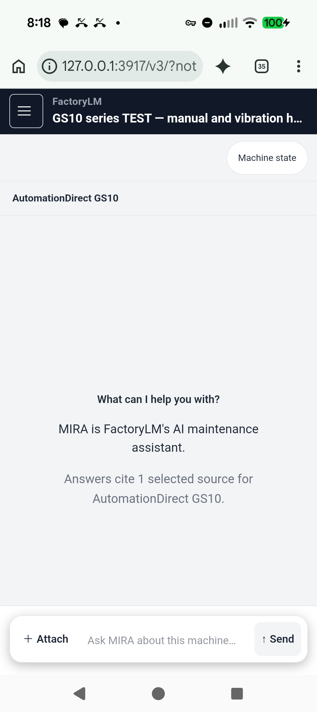
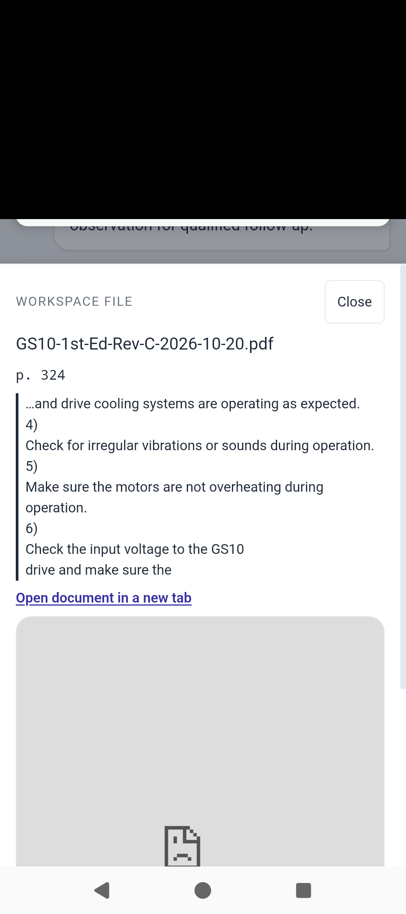

# Codex CLI — Level 3 consolidation and Pixel findings, November 2, 2026

**Verdict: NOT YET ACCEPTED. No complete customer lane has demonstrated Level 3.**

The latest integrated local candidate inspected is **`fe8c282865992ea2c7c93c841139c01c8e59bb5a`**. It is available for Mike's narrow GS10 documentation/observation test on the connected Pixel. Durable state, isolation, retry and selected physical-phone behavior have useful proof. Opening the full supporting manual page, useful complete handover and representative human acceptance remain incomplete. Level 4 repeat customer use/value has not been tested.

Event: Canaveral Port Authority Reverse Trade Show, **November 4, 2026, 9 a.m.–noon America/New_York**. Frozen candidate and completed rehearsal target: November 3 noon Eastern; final go/no-go: 4 p.m.

This is a findings-only publication by **Codex CLI**. It contains no implementation changes and requests no merge, deployment, shared migration, access change or paid review. Claude remains the implementation owner. The GitHub PR is opened through the existing `Mikecranesync` account; the findings commit author/committer is `Codex CLI <codex@openai.com>`.

## Tested scope and current entry point

- One declared **AutomationDirect GS10-series TEST asset**, documentation-only monthly-inspection question, and explicitly simulated vibration/repair/conflict reports. The garage conveyor's exact drive/nameplate, CV-101 gateway, PLC and live telemetry are **not verified by this run**.
- Real OEM manual: DURApulse GS10 User Manual, 1st Edition Rev C, October 20, 2026; 454 pages, 33,039,142 bytes. SHA-256 `43a66d756b9c53f216316eeb78d13db26f9698859d08b5f70d2ed3715e9602af`. Target: **PDF page 324 / printed 6-2, Monthly Inspection**. [OEM manual landing page](https://cdn.automationdirect.com/static/manuals/gs10m/gs10usermanual.html).
- Build ID: `zU-b87lwMU12Kj2Qz_sxd`. An immutable copy of Claude's already-built standalone artifact is serving on Charlie loopback `127.0.0.1:3917`, using task-owned PostgreSQL `127.0.0.1:55493/consent`. Source/build receipt and server hash are in `evidence-index.json`.
- Physical device: Pixel 9a, USB authorized, Chrome 156.0.8078.79. **No APK, OTA, security setting or installed app data was changed.** This is the shared web UI in actual Pixel Chrome, not a phone-sized desktop viewport.
- Verified phone entry, left open in a fresh thread:
  `http://127.0.0.1:3917/v3/?notebook=5b4f7724-2c26-4aca-bbcb-35fc761e4585&thread=391366b5-20a2-44fa-81dc-c83cadccb4b0`
  This URL requires the Pixel to remain USB-connected to Charlie with reverse port 3917. It is not a public URL or shared deployment. Phone control finished after Mike requested a five-minute limit; the temporary debugging forward was removed.
- The fresh thread contains no newly generated answer. Historic answers retain their original revisions. No automated provider request was made while bringing up this preview.
- The overall local health endpoint correctly remains **503**, missing `INGEST_URL`; it reports the exact fe8 revision. The real file path previously used actual in-process PDF ingestion. This thin test environment is not being presented as a fully healthy staging environment.



## Acceptance basis

Actual inputs on Charlie are under `/Users/charlienode/Documents/Codex/2026-11-01/task`:

1. `MIRA-VISION-BENCHMARK-2026-11-01.md` (Level 3: defined representative acceptance; Level 4: repeatable customer use with demonstrated value).
2. `docs/superpowers/plans/2026-11-01-first-customer-level-3.md` (acceptance matrix and protocol).
3. `level3-integration/HANDOFF.md` and the revision-specific integration/evidence handoffs.

Their hashes are recorded in the evidence index. This report does not replace their gates. The plan calls for five representative technicians, including someone who did not build the product. Automated accounts/personas are not technicians. A two-technician rehearsal is useful but is not the five-technician result. The 90% citation, 80% usefulness and 30-case bars are explicitly **proposed**, not approved or passed. The plan's 4/5 completion and 3/5 measured-benefit bars are unrun; no favorable result is inferred. Work Packets remain outside the selected event promise.

## Readiness table

PASS below applies only to the named test and revision, not to the complete customer lane.

| Required behavior | Exact evidence / revision / environment | Result | Existing owner | Smallest next action and dependency |
|---|---|---|---|---|
| Correct asset/manual ready | `867fa85e8`: real HTTP upload/index/attach into disposable DB, 1,104 private chunks; file GET 200 with exact OEM hash. fe8 source sheet points to p.324. | PASS for declared GS10 TEST; UNVERIFIED for actual garage variant | Claude integration; Mike for physical identity | Confirm actual drive nameplate/variant and permitted task before garage-specific claims. |
| Useful, safe answer supported by an applicable source that opens | Real provider at `709b3babb` and owner's `2c8b29a57`; correct p.324 content. At fe8 on actual Pixel, cited text excerpt is visible but PDF frame remains blocked. | FAIL full-page opening; human usefulness UNVERIFIED | Claude | Make the actual supporting page inspectable on the offered surface and rerun this exact gate. Excerpt/file download alone does not satisfy full-page opening. |
| Confirm observation → canonical scoped event → justified state, once | `867fa85e8` real Pixel UI confirmations; own real-store receipts: three A reports, then one B conflict; 4 reports / 4 events; correct `enterprise.test.gs10`; control unchanged. fe8 owner real-PG/Pixel receipts separately retained. | PASS tested local software cases; staging UNVERIFIED | Claude; BRAVO retains #5091 review/CI/merge lane | Carry exact schema/flag authorization and trace into staging. No external broker/PLC or live-comms claim follows from this test. |
| Persist and inform later answer | `709b3babb` real answer uses prior repair, recurrence, absence, author/time and uncertainty in observed-time order. Owner real answer at `2c8b29a57` uses names/conflict. | PASS selected report use; FAIL complete history as specified | Claude | Retain original symptom in useful handover, or obtain an explicit bounded scope decision without relabeling the full learning loop accepted. |
| Separate technician handover/private-thread/tenant isolation | `867fa85e8`: B sees 0 A-private turns; other-tenant GET/POST 404, wrong asset 409, unconfirmed save 400; duplicate retry 200 with no extra event; control empty. | PASS these local cases; human handover UNVERIFIED | Claude; Mike supplies participants | Have actual technician B recover the recorded facts and unresolved issues unaided, on the frozen candidate. |
| Pixel continuity, keyboard, Back, retry/restart | Own `867fa85e8`: native keyboard/Back and restored draft; force-stop Chrome + ordinary launcher restart recovered same thread/source/stateVersion. Owner fe8 Pixel journey uses stub provider. Own final fe8 entry/source/state inspected on actual Pixel; no new model call. | PASS named physical subsets; full latest live-answer journey UNVERIFIED | Claude | Complete exact-head real-answer + restart + separate-technician run. Native APK/OTA and phone→web→phone parity require their own identities/proof. |
| Pilot offer, consent and approval-gated free 30-day intake | Selected terms are five approved organizations, up to five seats, 30 days from approval, separately agreed continuation. fe8 login displays free 30-day/manual approval copy, but this run did not execute all intake/consent/access states. | UNVERIFIED complete lane | Existing pilot/consent owner through Claude; Mike approves participants | Verify displayed-version consent plus new/invited/pending/declined/expired access and seat concurrency in the offered environment. No automatic paid continuation. |
| Exact candidate review/CI/staging | fe8 local build and owner test receipts; local fixes are not published by this PR. #5091 and #5062 CI receipts apply to their own heads, not fe8. | UNVERIFIED release gates | Claude implementation; existing release owners | Provide exact-head review dispositions, required actual CI runs, authorized schema/flag rollout and runtime SHA. Do not infer them from local green tests. |

## Reproducible failures and limits for Claude

**F1 — Full manual page does not open on the physical Pixel.** Expected: inspect the applicable supporting page and its surrounding conditions. Observed: file GET is `200 application/pdf`, correct bytes/hash, but the inline frame is blocked; the fallback downloads rather than demonstrating page 324 open. The earlier file receipt includes `X-Frame-Options: DENY`. At fe8, the source sheet shows a 240-character cited excerpt above a broken PDF frame. Native screenshot below preserves this distinction. Mike specifically approved a PDF-only SAMEORIGIN proposal; it remains unapplied. Claude reports that header probes did not make Android Chrome render the frame. No broader security relaxation is authorized, and this report does not prescribe one.



**F2 — Complete history is not retained in the handover context.** Expected: a later technician understands original symptom → reported repair → recurrence → conflicting absence, with provenance and unknowns. The fe8 owner ledger states the bounded projection carries the prior repair/current/conflicts but omits the initial symptom, and the actual model described the first retained report as the repair. The panel/context still preserve important uncertainty, but this is not proof of complete history or human-useful handover. Owner: Claude. Evidence: owner's `VERDICT.md`, `gs10/evidence/B-last-shift-realcall.*`, our earlier report/real-answer receipts.

**F3 — Broader wording is unqualified.** The retained original R1 conversational question misses are not erased by success on the narrowly topic-anchored question. The owner also observed an unrelated p.219 retrieval for vague “last shift” wording. That real answer did not rely on it, but this is not broad retrieval qualification. Owner: Claude/retrieval owner. Smallest next action: retain those cases and test the exact offered wording without silently replacing the frozen case set.

**F4 — UI captions still misstate context.** The owner ledger lists `No machine · evidence not applicable` under turns despite a GS10 notebook. Its independent read-only review also found the old “General guidance” caption while streaming, before the final saved report caption appears. The owner classified the latter as medium-high and deferred its gated lifecycle-file change. These are owner-recorded limits, not a fresh parallel paid review or a clean final-head review. Owner: Claude and the existing lifecycle authority.

**F5 — No measured physical maintenance outcome or live communications proof.** All reports are explicitly simulated, self-reported and unverified. Root cause, machine health and safe-to-operate status remain unestablished. USB browser access is not proof that Ignition/PLC data reaches the UNS or that telemetry is fresh. Observation→state can be qualified without PLC connectivity; the separately requested live CV-101 segment remains unverified. Owner: existing integration/gateway owner through Claude; Mike confirms permitted physical setup.

**F6 — Human acceptance remains open.** No real participants have completed the defined acceptance protocol in this evidence. Do not adopt an implementer's “accepted known limit” as Mike's acceptance decision. Owner: Mike and Claude. Smallest next action now: Mike performs the bounded phone walkthrough, then a separate real technician tries handover; retain the wider plan's remaining human gates honestly.

## Revision and action ledger

| Revision | Work / proof | Boundary |
|---|---|---|
| `0346981a2fe83d643426d7afcfaf8f3660cbe3b6` | Original last-verified local integration candidate. | Historical starting point. |
| `2012a74ed1550f941779a28901758f07d8d1d7df` | Earlier authorized local writer work: preserve server-proven asset across Preview/Confirm; scoped draft/request-ID recovery; retain prior repair through recurrence/conflict in bounded projection and context. | Local application work, not included/published in this findings PR. |
| `867fa85e8a3b8499ef0a59431054e0a5518bfc5a` | Earlier local writer repaired prompt that supplied reports but told the model to use only numbered manual excerpts. Actual OEM upload, native phone input, observations, restart, boundaries and first real-model trial exposed remaining PDF, documentary-wording and chronology failures. | Physical proof at this exact revision is not renamed fe8 proof. |
| `709b3babbee2097791ed1906238a5741bed107a7` | Earlier local writer sorted report evidence oldest-first by observed time and preserved documentary intent; meaningful chronology regression failed before repair; 1,454 focused checks and Next build passed. Real retest used desktop sessions after the phone returned to ChatGPT. | Writer stopped here; no further application edits after Claude ownership handover. |
| `469fa9662` → `2c8b29a571c14d16bda7c14a6a329d667ec5be96` | Claude integrated provider-free labelled state summary, same-tenant display names and cited source excerpt. Four actual OpenAI requests at 2c8, including safety. | Owner implementation/receipts. Not actual fe8 provider execution. |
| `fe8c282865992ea2c7c93c841139c01c8e59bb5a` | Claude's current clean freeze: completed-answer report captions. Inspected clean head, build source receipt, build ID and identical copied server bytes. Owner local suite: 12,348 pass, 53 skip, 0 fail; owner real-PG and actual Pixel stub-provider journeys. | Those local tests are not actual CI or live-model/human acceptance. Owner claims provider-facing prompt hash `c3a034967fc7` unchanged from 2c8; component equivalence is not an exact-head model run. |

Codex also used disposable task-owned DB/server fixtures, actual HTTP manual ingestion and normal password sign-in; tested native keyboard/Back, interrupted draft, cold restart, duplicate save, wrong asset, unconfirmed input, conflict, private thread and other tenant; retained old failures and repair evidence; prepared but did not apply the approved PDF-only patch; stopped its own writer/provider at handover; and finally copied the immutable fe8 build into one private preview, reused its own DB and USB route, set synthetic `Demo technician A/B` display names only in that disposable DB, signed into a fresh test thread, then stopped phone control. Temporary debugging forwarding was removed; private preview/server and DB remain running for Mike. No customer data or shared schema was changed.

Canonical migrations 003/049/077 were applied only to the disposable 55493 fixture so real upload could run. The observation migration remains proposed at `mira-hub/db/proposed/113_asset_observations.sql`; this run did not promote/apply it to shared storage. Shared deployment needs the authorized migration/grants, flag forwarding and runtime proof; setting `MIRA_OBSERVATION_STATE=1` in a private fixture is not that rollout. Optional background relationship-proposal storage was absent/unqualified. No CMMS/OT writes, hardware operation, flag/access change, implementation push/merge/deploy, additional paid review or unrelated provider evaluation was performed by this phase.

## Refreshed shared references (read-only)

- **#5091, BRAVO-owned:** merged head `cab91fbbc3037e772e7afae83234c3f7d17107a0` → merge `af2c7bd78d2888687275d6ac3c6ef405a08cb62b`, November 1 22:29:47Z; merge is an ancestor of inspected main. [Actual CI run 41356083200](https://github.com/Mikecranesync/MIRA/actions/runs/41356083200) is successful for that head. The [existing authorized round-4 receipt](https://github.com/Mikecranesync/MIRA/pull/5091#issuecomment-6564690993) matches the head and current body SHA `bc3c8f56524b1dd7d8997934d7c0ac0899641801ea8ae50148840758c817a93a`; it says ISSUES_FOUND, one MEDIUM dense-conflict projection finding. This is a receipt at cab, not a newly asserted fe8 defect. BRAVO retains its disposition; no duplicate review/merge was attempted.
- **#5062, Work Packet:** now merged head `7cd06ab9ff49b46d8395e8fcec9967542c4cd1f7` → inspected main `c6f15b8d357722308ee2e4fc1ebb65483e679488`, November 2 15:39:56Z. The [exact-head round-18 receipt](https://github.com/Mikecranesync/MIRA/pull/5062#issuecomment-6571220132) is GREEN, current body SHA `4afdbc09d5d2cea7ca3c1ca3ccf7581c31912d4c1621b0763e0f96bed68d1987`, and explicitly says the prior HIGH is fixed. [Actual CI run 41403328518](https://github.com/Mikecranesync/MIRA/actions/runs/41403328518) succeeds at that head. Do not repeat the stale HIGH verdict. Its body still excludes physical-phone Save-as-PDF proof; Work Packets remain outside this selected GS10 event promise and are not accepted by this run.
- **#5094:** open, head `809a6877e73dd42385c87b36af27c1663cec8111`; package/pains/acceptance reference.
- **#5086:** open, head `e4ba51a4879b7c829a7cd171454559030e10926f`; chart/plan reference.
- Check rollups contain historical cancelled/failed guard runs. The specific successful CI runs above were pinned by their actual `head_sha`; no claim that every historic run is green, and no merge approval is given here.

## Paid-call accounting

Mike approved **$0.50 total**, not a fresh allowance on each restart/handover. Before the interactive preview: Codex's 8 actual requests (answers plus safety, including repair retest) booked **$0.022179**; Claude's 4 actual requests booked **$0.0130275**. Combined **$0.0352065**, remaining **$0.4647935**, as recorded at preview start. These are application-booked token costs, not a provider invoice.

The private interactive preview allows only the same GS10 test, OpenAI `gpt-5.4-mini`, at most **4 further provider requests including safety** (two intended questions), with persistent dispatch count and the remaining application cap. Input/model/output/host are bounded; all other providers and optional metered lanes are disabled. No canned-answer fallback is present. Zero new automated requests were dispatched during preview setup. The key stays only in process memory; credentials, raw provider logs, full manual and private fixture files are not published here. The existing owner must continue the single combined allowance if later authorized work resumes.

## Five-minute walkthrough (human test, not a passed result)

1. **0:00–0:45:** On the already-open GS10 TEST notebook, ask: “In the GS10 monthly inspection checklist, what does it say about irregular vibration or sounds? I only want to record an observation for qualified follow-up.” Check the actual claim and caution, tap the source and inspect p.324. Record the full-page failure if it remains; do not tick it passed from the excerpt.
2. **0:45–2:00:** Machine state → enter one clearly labelled `SIMULATED TEST` observation → Preview → review asset/fact/time/self-report status → Confirm once. It must change only the intended test fact, with author/time/uncertainty. Do not perform maintenance or invent an actual machine measurement.
3. **2:00–3:00:** Close/reopen Chrome normally and return to the same thread. Confirm the observation/source/state persist. Use an already-established second authorized test session for B, preserving A's private chat.
4. **3:00–4:30:** B asks: “For this GS10 monthly inspection, summarize the confirmed irregular-vibration reports for this asset: who reported them, when, what was tried, and what remains unverified.” B must recover the facts and disagreement without A's private chat, invented repair details, causal certainty or safety clearance.
5. **4:30–5:00:** Compare B's summary against the recorded facts and source; record omissions, help, time and corrections. A failed mandatory step remains failed. This rehearsal does not count as the five-person acceptance protocol.

## November 1–3 critical path and fallback

1. **November 1 foundation (historical):** chart/plan and observation contract established; #5091 merged. Treat that as infrastructure, not customer acceptance.
2. **November 2 consolidation (this evidence):** freeze fe8 local candidate; retain failed cases; give Mike the single private Pixel entry. Claude owns the smallest confirmed integration repairs and each review-finding disposition. Mike confirms physical variant and recruits representative participants. Intake owner verifies exact terms/consent/access cases independently; BRAVO's existing review/CI lane is not duplicated.
3. **November 3 morning, before noon Eastern:** run one exact-head live answer → correct source page → confirmed event/state → restart → separate-technician handover rehearsal. Match source/build/backend/phone entry, proposed migration and effective flag in any authorized offered environment. Actual required CI and final review dispositions must correspond to that head. Freeze candidate **and complete rehearsal by noon** only if these gates actually pass.
4. **November 3 noon–4 p.m.:** preserve the freeze, collect remaining human acceptance evidence and make the final **go/no-go by 4 p.m. Eastern**. If a mandatory gate remains failed/unverified, report NO-GO for that promise; no deadline-driven threshold change or fresh paid allowance is inferred.

Fallback: demonstrate only the honestly qualified software subset with clearly simulated TEST reports and the known source-view limitation; use the genuine OEM page separately for explanation without calling the app's full-page gate passed. An existing recording is a recorded demo, not live communications. If live/model/device access fails, stop that claim and use the recording/manual discussion. Pilot interest can use the agreed free 30-day, approval-required offer with versioned consent and separately agreed continuation, but intake activation stays gated until its own tests pass. CMMS migration, photo recognition, offline reasoning and Work Packets are not prerequisites or promised substitutes.

Only Mike decisions still needed: confirm the physical GS10 variant/permitted task if the garage conveyor is the advertised asset; provide representative technicians and resolve whether the exact observed limitations are acceptable for a narrower demonstration (not a retroactive Level 3 pass); authorize any later shared deployment/schema/flag/security action separately. Spending and local publication already authorized are not asked again. **Single next action: Mike runs step 1 on the ready Pixel; Claude receives the recorded failure/acceptance result and owns any repair.**

## Evidence and reproduction

Shared local report: `/Users/charlienode/Documents/Codex/2026-11-01/task/level3-answer-successor-evidence/phone-preview/INTERACTIVE-ACCEPTANCE.md`. Detailed historical logs remain in the revision-specific task directories. `evidence-index.json` publishes their hashes and selected safe receipts; it contains no credentials. The two screenshots are actual device captures; the source capture's incidental browser-account area was redacted and its raw file removed.

Read-only verification commands (on Charlie):

```sh
cd /Users/charlienode/Documents/Codex/2026-11-01/task/handover-l3-claude-2026-11-02/wt-history
git rev-parse HEAD
git status --porcelain
curl -sS http://127.0.0.1:3917/api/health/
gh pr view 5091 --repo Mikecranesync/MIRA --json headRefOid,mergeCommit,state
gh api repos/Mikecranesync/MIRA/actions/runs/41356083200 --jq '{head_sha,conclusion}'
gh api repos/Mikecranesync/MIRA/actions/runs/41403328518 --jq '{head_sha,conclusion}'
```

For the existing offline chronology regression, run the candidate's Vitest on `src/capabilities/observations/__tests__/handover-repair-attempt.test.ts` and `src/capabilities/observations/__tests__/observed-state-chat.route.test.ts` from `mira-hub`, with provider keys absent. Build scripts/receipts use cached loopback fonts and block offsite access; do not blindly rebuild over the frozen owner's artifact. Phone/real-answer harnesses write only the named disposable fixture and can dispatch paid calls: they are not invoked by this publication. No full suite, paid reviewer or provider test was started to create this docs-only PR.
