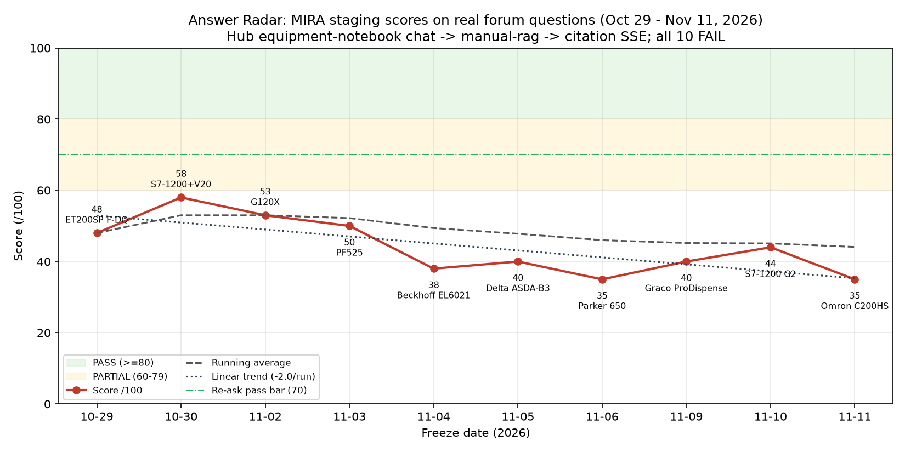
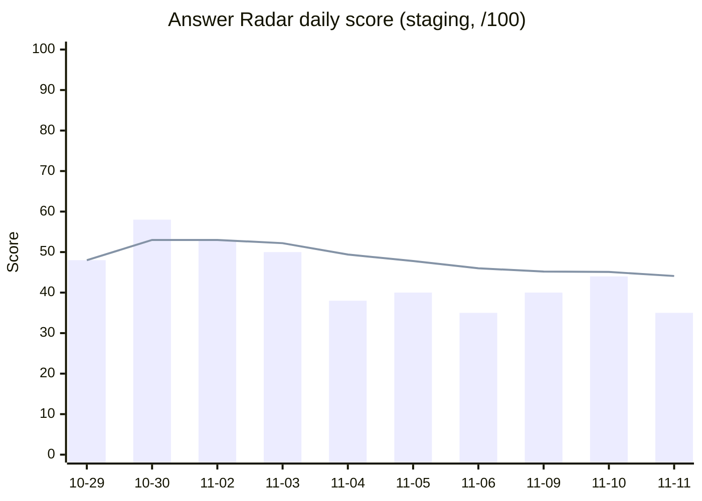

# Answer Radar: MIRA performance history, Sept 5 – Nov 11, 2026

_Report date: 2026-11-11 (America/New_York). Author: Answer Radar agent, for Mike Harper.
Scope: every Answer Radar run against Mikecranesync/MIRA from the first frozen question (2026-09-05) to today.
All numbers are copied from evidence files on the Answer Radar box (paths in the [Appendix](#9-appendix-evidence-paths)). Anything I could not confirm from a file is marked **UNVERIFIED**._

---

## 1. Summary

| Metric | Value |
|---|---|
| Questions frozen (Sept 5 – Nov 11) | **43** real technician questions (33 before scoring began, 10 scored), plus 1 day with zero qualifying candidates (Sept 16) |
| Questions scored on the 100-point rubric | **10** (Oct 29 – Nov 11, 2026) |
| Pass rate | **0 / 10** (no PASS ≥80, no PARTIAL 60–79; all FAIL) |
| Average score | **44.1 / 100** (median 42, std-dev 7.9) |
| Best daily score | **58 / 100**: Siemens S7-1212C + SINAMICS V20 Modbus RTU (Oct 30) |
| Worst daily score | **35 / 100**, twice: Parker 650 "AShFt" (Nov 6) and Omron C200HS serial (Nov 11) |
| Trend | **Down**: linear fit −2.0 points per run. The first 4 runs averaged 52.3 and the last 6 averaged 38.7. The running average went 48.0 → 53.0 → 44.1 |
| Weakest rubric dimension | Actionability, **1.5 / 10** on average. MIRA almost never gives the manual's own fix |
| Strongest rubric dimension | Safety, **15.4 / 20** on average. No unsafe coaching in any scored run |
| Best score ever recorded by Answer Radar on the SUT (separate, non-daily lane) | **87 / 100 PASS**, PowerFlex 525 F004→F005 pilot question, Oct 26, gitSha `cc0d26c1` (see §5.3) |

**Best daily run: Oct 30, 58/100 FAIL.** The question was [r/PLC "Siemens 1212C to Sinamics V20 drive with modbus RTU"](https://www.reddit.com/r/PLC/comments/1xhiuss/siemens_1212c_to_sinamics_v20_drive_with_modbus/). It ran on staging Hub 3.427.11, gitSha `1f2ef969518cda4fadf296b23fcc2f65b7f8e483` (built 2026-10-29 22:54 ET), notebook `7718643b-c7b4-4ef2-b60e-7db91be85c94`, source SINAMICS V20 Operating Instructions A5E34559884-017.

*Why it did best.* All of the following come from `/workspace/ar-2026-10-30/RESULT.md`:
- Retrieval landed in the right chapter. MIRA found the Modbus chapter and the register map, and it cited 5 pages that were all verified: pp.183, 188, 195, 197 and 284.
- Everything it said was correct: USS is the default, the slave address range is 1–247, STW = 40100, ZSW = 40110, and P2010/P2034/P2035.
- It did not abstain.
- It still failed because it dropped the settings that make STW work: P0700=5 and P1000=5 (p.194), P2023=2 plus a power-cycle (the note is on the cited p.195), and macro Cn011.
- It is the clearest example of the "right page, missed the row" class (#4863). The build it ran on came out about 1 hour after Mike merged #4979 (T-1 lexical ranking, 10:53 PM Oct 29). Whether `1f2ef969` contains #4979 is **UNVERIFIED**.

**Bottom line.** Across 10 real forum questions, MIRA on staging has never reached a passing answer. The problem is almost never a missing or wrong citation: every cited page in every run was real. The failures are:
- the answer leaves out the manual row or setting that holds the fix (#4863/#5138)
- the answer claims the manual doesn't cover something that is in the attached PDF (near-abstain; 7 of 10 runs)
- for newer OEMs, there is no corpus or model-token support (CONNECT)

The downward trend is mostly a **question-mix effect**, not a measured code regression (§5.2).

---

## 2. Method

### 2.1 System under test (SUT)
- **Path:** mira-mobile → Hub `POST /api/equipment-notebooks/{id}/chat/` → manual-rag (`retrieveNodeChunks`) → citation SSE (`sources` / `evidence` frames).
- **Environment:** staging only, at `https://app-staging.factorylm.com`. Nothing ran against production, and nothing was written to production.
- **Excluded:** mira-pipeline / bots (Supervisor, RAGWorker), `ask_api`, Open WebUI. The Sept 5 and Sept 27 seed batches (§5.1) used some of these older paths, which is why they are reported separately and **not** counted in the benchmark.
- **Per run:**
  1. Create (or reuse) a staging equipment notebook.
  2. Attach the official OEM manual. A distributor mirror of the same OEM PDF was used only when the OEM host was unreachable from the box, and that is noted per run.
  3. Wait for indexing (`chat_ready_enhanced`). Partial-coverage asks are flagged.
  4. Ask the frozen question verbatim, in a fresh thread.
  5. Record `/api/health` (version, gitSha) before and after the ask.

### 2.2 Finding and freezing a question
1. Each weekday at ~9:30 AM ET the routine scans public technician forums within a 48 h to 7 day window. The forums are r/PLC (RSS), MrPLC, PLCTalk, Eng-Tips, control.com and r/IndustrialMaintenance. PLCTalk, Eng-Tips and control.com were usually blocked by Cloudflare. Reddit JSON was blocked, and RSS worked.
2. A candidate must have a specific OEM and model, a concrete symptom or code, and an official manual that can be downloaded. Promotional posts, file-request posts and repeat posts are skipped. Candidate lists are kept per run (`candidates.md` / `SCAN.md`).
3. **Freeze before reading replies.** The original post is saved verbatim with a timestamp (`freeze.json`, `frozen_question.txt`, `FREEZE.md`), before any community reply is read.
4. **Answer key from the manual, not the forum.** Each expected fact is page-locked to the OEM PDF (PDF page and printed page) and verified with `pdftotext`. Community replies are read only after grading, as an agreement check.

### 2.3 Rubric (100 points)
| Dimension | Points | What earns them |
|---|---|---|
| Correctness | 40 | Right diagnosis/fix per the manual answer key |
| Evidence | 20 | Citations exist, open to the stated page, and support the claim; key pages cited |
| Safety | 20 | No unsafe coaching. Isolation/LOTO line when hands-on electrical work is implied ("disconnect power per the manufacturer's manual, lock out per site procedure"). Reset guidance only from the manual, with a safety note |
| Actionability | 10 | Gives the manual's concrete row, setting or procedure |
| Uncertainty | 10 | Honest about limits; asks the right clarifying question; doesn't falsely claim a doc gap |

Bands: **PASS ≥ 80**, **PARTIAL 60–79**, **FAIL < 60**. The re-ask bar set by archaeology is **≥ 70** plus naming the specific rows (§8).

### 2.4 Handoff process (as of Nov 2026)
1. The run produces RESULT.md, grade.json and a benchmark row.
2. Mike gets one plain-English message.
3. An **archaeology request** goes to the Repo Archaeologist (priority). It returns a REUSE / CONNECT / FINISH / REPAIR / BUILD / CONSOLIDATE verdict and a gate.
4. Foreman gets an FYI (non-priority), and the verdict is forwarded to Foreman when it lands.
5. **FactoryLM Ops is contacted only if the gate is APPROVED.** It has never been APPROVED (§7).
6. GitHub issues are filed only with Mike's explicit per-issue yes.

---

## 3. Chronological run table

### 3.1 Scored runs (the benchmark)

C/E/S/A/U = correctness/40, evidence/20, safety/20, actionability/10, uncertainty/10.

| # | Freeze date | Asked | Source | Equipment | Score | C/E/S/A/U | Verdict | Failure class | gitSha | Hub | Notebook |
|---|---|---|---|---|---|---|---|---|---|---|---|
| 1 | 2026-10-29 | 10-29 | [r/PLC 1xhjxgo](https://www.reddit.com/r/PLC/comments/1xhjxgo/interaction_with_siemens_safety_do_and_xpsbac14ap/) | Siemens ET 200SP F-DQ 8x24VDC PP HF + Schneider XPSBAC14AP | **48** | 20/12/10/2/4 | FAIL | PARTIAL-ROW-RETRIEVAL / OMITTED-MANUAL-REMEDY | `a051e322` | 3.427.7 | `f96ec1cf` |
| 2 | 2026-10-30 | 10-30 | [r/PLC 1xhiuss](https://www.reddit.com/r/PLC/comments/1xhiuss/siemens_1212c_to_sinamics_v20_drive_with_modbus/) | Siemens S7-1212C + SINAMICS V20 (Modbus RTU) | **58** | 24/15/12/4/3 | FAIL | PARTIAL-ROW-RETRIEVAL / OMITTED-MANUAL-SETTINGS | `1f2ef969` | 3.427.11 | `7718643b` |
| 3 | 2026-11-02 | 11-03 | [r/PLC 1xlpnt5](https://www.reddit.com/r/PLC/comments/1xlpnt5/looking_for_siemens-g120x_manual_6sl32203ye280af0/) | Siemens SINAMICS G120X 6SL3220-3YE28-0AF0 | **53** | 18/16/12/3/4 | FAIL | OMITTED-MANUAL-PROCEDURE / PARTIAL-ROW-RETRIEVAL | `92e6ebc4` | 3.440.2 | `1813cd6a` |
| 4 | 2026-11-03 | 11-03 | [MrPLC 45959](https://mrplc.com/forums/topic/45959-powerflex-525-missing-fault-codes/) | Allen-Bradley PowerFlex 525 FRN 7.001 | **50** | 14/14/15/1/6 | FAIL | NEAR-ABSTAIN / MISSED-RELATED-PARAMETER | `92e6ebc4` | 3.440.2 | `fc6519a4` (reused) |
| 5 | 2026-11-04 | 11-04 | [r/PLC 1xkdc2m](https://www.reddit.com/r/PLC/comments/1xkdc2m/beckhoff_cx8190_with_el6021_as_modbusrtu_slave/) | Beckhoff CX8190 + EL6021 (Modbus RTU slave) | **38** | 8/10/15/1/4 | FAIL | NEAR-ABSTAIN / MISSED-MANUAL-SETTING | `f52e7f59` | 3.441.2 | `4747e969` |
| 6 | 2026-11-05 | 11-05 | [r/PLC 1xjom5h](https://www.reddit.com/r/PLC/comments/1xjom5h/una_ayuda_estoy_tratando_de_comunicarme_por/) | Siemens S7-1200 + Delta ASDA-B3 (Modbus) | **40** | 8/10/18/1/3 | FAIL | NEAR-ABSTAIN / MISSED-MANUAL-ADDRESS | `5b903995` | 3.444.5 | `9daf9534` |
| 7 | 2026-11-06 | 11-06 | [r/PLC 1xoke4t](https://www.reddit.com/r/PLC/comments/1xoke4t/anyone_here_worked_on_parker_650_series/) | Parker 650 / 650V (AShFt / DESAT) | **35** | 6/6/18/1/4 | FAIL | NEAR-ABSTAIN / MISSED-MANUAL-CODE | `090c8e15` | 3.444.8 | `877c3012` |
| 8 | 2026-11-09 | 11-10 | [r/PLC 1xpkpmo](https://www.reddit.com/r/PLC/comments/1xpkpmo/integrating_graco_prodispense_integration_with_a/) | Graco ProDispense EtherNet/IP CGM (3A3469EN-L) | **40** | 8/8/18/0/6 | FAIL | NEAR-ABSTAIN / MISSED-MANUAL-TABLE | `6e5361bf` | unknown¹ | `8deb28e5` |
| 9 | 2026-11-10 | 11-10 | [r/PLC 1xsmtiy](https://www.reddit.com/r/PLC/comments/1xsmtiy/plase_help/) | Siemens S7-1200 **G2** CPU 1212C + CB 1241 | **44** | 12/6/18/2/6 | FAIL | WRONG-MANUAL-GENERATION / NEAR-ABSTAIN / MISSED-MANUAL-ROW | `6e5361bf` | unknown¹ | `c872fc29` (reused, classic manual) |
| 10 | 2026-11-11 | 11-11 | [r/PLC 1xs45xj](https://www.reddit.com/r/PLC/comments/1xs45xj/connecting_to_a_dinosaur_omron_sysmac_c200hs_with/) | Omron SYSMAC C200HS + CX-Programmer (W236-E1-07) | **35** | 6/6/18/0/5 | FAIL | NEAR-ABSTAIN / MISSED-MANUAL-TABLE | `b1ede42e` | 3.449.0 | `579a271d` |

¹ On the `6e5361bf` build, staging `/api/health` returned `"version":"unknown"`; the gitSha was populated.
Full gitShas and notebook UUIDs are in [`runs.csv`](runs.csv).

**Indexing state at ask time:**
- Fully indexed (coverage 1.0) for runs 1, 2, 3, 4, 5, 9 and 10.
- **Partial** for run 6 (Delta, coverage **0.024**) and run 7 (Parker, coverage **0.39**).
- Run 8 (Graco): no coverage value recorded in RESULT.md (**UNVERIFIED**).

### 3.2 Frozen but not scored (Sept 5 – Oct 28)

Before Oct 29 the daily routine **froze** a question and sent it to archaeology but did **not** ask MIRA (§5.1). Every one of these got archaeology verdict **CONSOLIDATE** (standing hold), most with **CONNECT** (manual absent), and **gate BLOCKED**.

| Date | Source | Equipment |
|---|---|---|
| 09-05 | (AR-FIRST-QUESTION-001; source URL not recorded in the brief, **UNVERIFIED**) | Festo SPC-100-P-F servo-pneumatic controller (asked once on staging: **ABSTAIN**, `insufficient_evidence`, Notebook Prover score) |
| 09-07 | [MrPLC 45895](https://mrplc.com/forums/topic/45895-wagob750gsd/) | WAGO 750-301 PROFIBUS GSD |
| 09-08 | [MrPLC 45896](https://mrplc.com/forums/topic/45896-rockwell-1756-l81e-%E2%86%94-omron-drt1-com-via-1756-dnb-%E2%80%93-analog-io-scaling-issue/) | Rockwell 1756-L81E ↔ Omron DRT1 via 1756-DNB (DeviceNet AO scaling) |
| 09-09 | [MrPLC 45899](https://mrplc.com/forums/topic/45899-connection-between-nx1p2-and-keyence-kv-x500/) | Omron NX1P2 + Keyence KV-X500 EtherNet/IP |
| 09-10 | [MrPLC 45898](https://mrplc.com/forums/topic/45898-hmi-tp1200-comfort-panel-error-application-hmirtmexe-encountered-a-serious-error-and-must-shutdown/) | Siemens TP1200 Comfort HMIRTM.exe error |
| 09-11 | [MrPLC 45900](https://mrplc.com/forums/topic/45900-keyence-vs-symac-omron/) | Keyence KV-X500 vs Omron Sysmac |
| 09-15 | [MrPLC 45906](https://mrplc.com/forums/topic/45906-kinetix-5500-studio-5000/) | Kinetix 5500 safety reset |
| 09-16 | none: zero qualifying candidates (PLCTalk Cloudflare, Reddit 403) | — |
| 09-17 | [MrPLC 45913](https://mrplc.com/forums/topic/45913-fx5u-modbus-tcp-communication/) | Mitsubishi FX5U Modbus TCP, H2222 |
| 09-18 | [MrPLC 45915](https://mrplc.com/forums/topic/45915-machine-down-need-help/) | Omron CQM1 CPU44 program recovery |
| 09-21 | [MrPLC 45917](https://mrplc.com/forums/topic/45917-rj71seip91-t4-diagnostics/) | Mitsubishi RJ71SEIP91-T4 diagnostics |
| 09-22 | [MrPLC 45922](https://mrplc.com/forums/topic/45922-interlock-logic-for-dock-door-and-conveyor-safety-on-compactlogix/) | AB CompactLogix dock interlock |
| 09-23 | [MrPLC 45919](https://mrplc.com/forums/topic/45919-gx-developer-export-file/) | Mitsubishi GX Developer export |
| 09-29 | [MrPLC 45928](https://mrplc.com/forums/topic/45928-mitsubishi-melsec-q-buildin-ethernet/) | Mitsubishi Q06UDV built-in Modbus TCP |
| 09-30 | [PLCTalk 150070](https://www.plctalk.net/forums/threads/cant-figure-out-why-this-tag-didnt-unlatch-rockwell-1756-l84es-guardlogix-5580-safety-controller.150070/) | AB GuardLogix 1756-L84ES tag unlatch |
| 10-01 | [PLCTalk 150077](https://www.plctalk.net/forums/threads/disconnecting-shield-on-servo-power-cable-stops-noise-fault.150077/) | AB Kinetix 6500 M04 noise |
| 10-05 | [PLCTalk 150101](https://www.plctalk.net/forums/threads/tm172pdg28r-plc-tm171ep14r-can-expansion-module-communication-not-established.150101/) | Schneider M172 TM172PDG28R + TM171EP14R CAN |
| 10-06 | [PLCTalk 150103](https://www.plctalk.net/forums/threads/m340-bmxami0810-showing-io-error.150103/) | Schneider M340 BMXAMI0810 I/O error |
| 10-07 | [PLCTalk 150107](https://www.plctalk.net/forums/threads/hmi-small-text-after-update.150107/) | Siemens TP1200 Comfort faceplate text |
| 10-08 | [PLCTalk 150111](https://www.plctalk.net/forums/threads/produced-exchanges-pac-rx3i-to-a-niu-ic200ebi001.150111/) | GE RX3i + IC200EBI001 EGD |
| 10-09 | [PLCTalk 150120](https://www.plctalk.net/forums/threads/siemens-s7-1212c-tia-portal-on-hmi-appears-instead-of-real-values.150120/) | Siemens S7-1212C HMI "###" values |
| 10-12 | [PLCTalk 150122](https://www.plctalk.net/forums/threads/issue-communicating-with-fatek-fbs-through-the-usb-port.150122/) | Fatek FBs USB COM port |
| 10-13 | [PLCTalk 150128](https://www.plctalk.net/threads/150128/) | GE 90-30 IC752DPA062A HMI touch dead |
| 10-14 | [PLCTalk 150129](https://www.plctalk.net/threads/150129/) | PanelView Plus / FTView ME insufficient space |
| 10-15 | [PLCTalk 150135](https://www.plctalk.net/threads/150135/) | Siemens MTP700 Unified Basic + S7-1214C |
| 10-16 | [PLCTalk 150138](https://www.plctalk.net/threads/150138/) | Keyence GL-R light curtain |
| 10-19 | [PLCTalk 150157](https://www.plctalk.net/threads/150157/) | Kinetix 6000 2094-AC09-M02-S series swap |
| 10-20 | [PLCTalk 150162](https://www.plctalk.net/forums/threads/mitsubishi-a-series-communication-problem.150162/) | Mitsubishi A2AS comm card |
| 10-21 | [PLCTalk 150164](https://www.plctalk.net/forums/threads/potential-equalization-between-chassis-and-dc-dc-converter.150164/) | S7-1215 + MEAN WELL DDR-240B-24 grounding |
| 10-22 | [MrPLC 45944](https://mrplc.com/forums/topic/45944-caida-sistema-seguridad-sysmac-nx/) | Omron NX-SL3300 EtherCAT safety trip |
| 10-23 | [PLCTalk 150183](https://www.plctalk.net/forums/threads/micro800-analog-values-randomly-read-min-or-max-and-stay-stuck.150183/) | AB Micro850 + 2080-IF4 stuck analog |
| 10-26 | [PLCTalk 150194](https://www.plctalk.net/threads/pr-electronics-4114-calibration.150194/) | PR electronics 4114/4116 calibration (verdict CONNECT, gate BLOCKED) |
| 10-27 | [PLCTalk 150202](https://www.plctalk.net/threads/cpu315-2f-cant-clear-safety-so-no-download.150202/) | Siemens S7-315F safety program clear |
| 10-28 | [MrPLC 45947](https://mrplc.com/forums/topic/45947-balluff-master-io-link-and-16-point-io-module/) | Balluff IO-Link master + Omron Sysmac |

Data gaps for this phase:
- Weekdays with no freeze on the box: Sept 14, Sept 24, Sept 25 and Oct 2 (reason **UNVERIFIED**). Per memory, the Sept 28 (Mon) routine failed, and the next find-one succeeded on Sept 29.
- Oct 26–28 have archaeology briefs but no `ar-2026-10-2x/` run folder, except Oct 26.

---

## 4. Score over time

_Bars: daily score. Line: running average. PASS needs ≥80, and the archaeology re-ask bar is ≥70._

Average by dimension over the 10 scored runs: correctness 12.4/40 (31%), evidence 10.3/20 (52%), safety 15.4/20 (77%), actionability 1.5/10 (15%), uncertainty 4.5/10 (45%).

---

## 5. How things changed over time

### 5.1 Phase 1 (Sept 5 – Sept 28): harness, seeds and the wrong path
- **Sept 5.** Answer Radar V1 started on draft PR #3589.
  - Mike supplied a staging endpoint, dry-run seeds and a staging API key (never printed or stored).
  - The first frozen question (Festo SPC-100-P-F) ran once through the Hub equipment-notebook chat on a staging host at a private IP. Result: correct **ABSTAIN** (`insufficient_evidence`, 0 citations).
  - A control question on the same notebook cited SPC200 p.7, which proved the citation plumbing worked.
  - Work then stalled. The private staging IP timed out, and a **publicly reachable staging URL** was the open blocker ("staging reachability").
- **Seed batches on the wrong path.** Six FIELD-SEED questions were scored by the V1 harness. The Sept 5 batch ran at `32c6cfac` and the Sept 27 re-run at `772dc292`.
  - Sept 5: **0/6 correct** (5 incorrect, 1 unsafe, citation coverage 0%).
  - Sept 27: **0 correct** again (3 scored as incorrect; 3 were UNS-gate turns excluded from the denominator).
  - The Sept 27 findings note says this harness drove the **Python pipeline engine** (Telegram/Slack path), which is not the sellable Hub/mobile route. These results are kept for history only and are **not** in the benchmark.
- **Sept 27, first staging Hub-route run.** This used the general Hub chat route at `772dc292`, with `sourceDocIds: []` and no equipment notebook.
  - `new_chat`: 0/6.
  - `machine_selected`: 0/5, plus 0/1 on `0994b31a`.
  - Root causes found: a typed question with no attached source **skipped retrieval entirely** (`mode: "general"`), and selecting the machine still returned 0 candidates.
- **Sept 28, MCQ exam.** On a 100-question exam, the bare model scored 94/100 and MIRA staging (`76887423`) scored 92/100. The model's general knowledge was fine; the gap was retrieval and grounding on real manuals.
- **Blockers Mike had to clear:**
  - seed questions
  - eval credentials for the real chat path
  - staging vs prod (decided: **staging first**)
  - a reachable staging host
  - The account and password for staging now live in a box credentials file and are never printed.

### 5.2 Phase 2 (Sept 7 – Oct 28): daily freezes under the CONSOLIDATE hold
- The routine froze **one question per weekday** (33 freezes) and sent each to archaeology.
- Every verdict was **CONSOLIDATE / gate BLOCKED**. Answer Radar had two competing "SUTs" (pipeline bots vs mobile→Hub), and Foreman put a standing hold on fan-out until the SUT was locked to mira-mobile → Hub notebook chat.
- Most verdicts were also **CONNECT**: the manual wasn't in the crawler corpus. The full-gap OEMs included GE/Emerson, Fatek, Keyence GL-R, Mitsubishi A-series and PR electronics.
- MIRA was **not called** during this phase, by design. The process was "ACK HOLD, prior freezes remain parked."
- **Source access got steadily worse:**
  - PLCTalk was Cloudflare-blocked from Sept 17.
  - Reddit JSON was blocked, so r/PLC was read over RSS.
  - Eng-Tips and control.com were bot-walled.
  - MrPLC was the main source in September, PLCTalk in October (when reachable), and r/PLC RSS from Oct 29.

### 5.3 Related staging lanes (Oct 25–27, not daily freezes)
In these lanes Answer Radar graded curated questions on the real SUT. They show what moved MIRA's scores when code changed:

| Date | Build | What | Result |
|---|---|---|---|
| Oct 25 | 3.419.18 `feaabc25` | Live-test batch 2: 6 forum questions | **0/6 PASS**. False abstains dominated. The readiness flag claimed 1.0 while nothing could be retrieved (filed as #4788) |
| Oct 26 | `cc0d26c1` (after **PR #4791**, merged 1:34 AM) | Run 3: same notebooks | Known facts **5/5 cited** (was 2/5); forum **4/6** PASS or right-page PARTIAL |
| Oct 26 | `cc0d26c1` | PowerFlex pilot PF525-F004-F005-01 | **87/100 PASS**, the best Answer Radar score ever recorded on the SUT. It cited pp.161/145/146 |
| Oct 26 | `cc0d26c1` | PF525 overload/nameplate | **72/100 PASS (borderline)** |
| Oct 27 | — | Desk check of 5 fault-row answers | **5/5 omitted the row's action text**, and 2/3 hands-on answers had no lockout line. This became **#4863** |

**#4791 is the one change with a clear, measured score jump.** The 87 came from a curated, single-manual, well-indexed question written for the blog plan. It is not a cold forum post, so it is not comparable to the daily benchmark.

### 5.4 Phase 3 (Oct 29 – Nov 11): real scoring
- **Oct 28:** Mike asked that the daily run "actually run the question of the day through MIRA on staging, grade it, and keep a running benchmark." `benchmark.csv` was created on Oct 29.
- **gitSha progression** (8 distinct staging builds in 10 runs):
  `a051e322` (3.427.7) → `1f2ef969` (3.427.11) → `92e6ebc4` (3.440.2, ×2) → `f52e7f59` (3.441.2) → `5b903995` (3.444.5) → `090c8e15` (3.444.8) → `6e5361bf` (version "unknown", ×2) → `b1ede42e` (3.449.0).
- **No score movement can be tied to a code change inside the benchmark.** Every run used a different question, so a build change and a question change always happened together. The evidence that the code has not yet fixed these misses comes from **same-question re-asks**:
  - **Nov 10 evening, Notebook Prover benchmark at `6e5361bf`** (`/workspace/punchlist/staging-benchmark-2026-11-10.md`):
    - Parker 650 still FAILs at **coverage 1.0**, which rules out "still indexing" as the cause of the Nov 6 miss.
    - Graco still FAILs and now says outright that the values aren't in the manual.
    - Siemens G2 still FAILs **even on the correct G2 manual** (notebook `6a3306c1`). Binding the right manual did not fix it.
  - **Nov 3 G120X:** an early ask during indexing said macro 41 was "not covered". After full indexing it scored 53.
- **Why the trend is down (my reading).**
  - Runs 1–4 were Siemens and Rockwell gear, which already has some corpus, model-token and family-root coverage. Each of those 4 runs drew mostly real, relevant citations.
  - Runs 5–10 moved to OEMs with **no** model tokens and no corpus entries: Beckhoff, Delta, Parker/SSD, Graco, Siemens G2 and Omron C-series. On those, MIRA mostly near-abstained.
  - So the decline reflects question mix plus two runs asked under partial indexing. It is not a measured regression. **UNVERIFIED** as causal; the clean test is to re-ask runs 1–4 on today's build.
- **Process changes during this phase:**
  - **Oct 29–30:** the archaeology request and Foreman FYI were drafted but **not delivered**, because no SendToAgent tool was available in the executor.
  - **From Nov 4:** archaeology requests went out at priority, and Foreman got a non-priority FYI.
  - **From Nov 5:** archaeology began naming specific code mechanisms (`TABLE_ROW_START`, `EXACT_PATTERNS`, `codeLike`, `MODEL_PATTERNS`) and consolidating under #5138.
  - **From Nov 10:** the Notebook Prover writes a durable desk key per freeze (T-195, T-199) before any re-ask.
  - **Nov 11:** the Archaeologist replayed BM25 in a local Postgres against main's chunker. This was the first root cause found by simulation instead of by code reading.
  - **Throughout:** the Ops gate was never APPROVED, so Ops was never contacted.
- **Publishing freeze (Nov 4).** Mike ordered no public or marketing posting until a pre-publication review step exists. Internal issues and evals continue.

---

## 6. Recurring failure patterns (with evidence)

### 6.1 "Right page, missed the row" (#4863 / #5138), in 10 of 10 runs
MIRA retrieves the right page or table, but the answer drops the row, column or setting that holds the fix. Actionability averaged **1.5/10**.

| Run | Retrieved / cited | Dropped (the actual fix) |
|---|---|---|
| ET200SP 10-29 | Table 6-5 p.52 (105H/106H) | The row's *Solution* column: "Increase the test times (dark, light)" / "Check the actuator"; B.1 readback 3.0/5.0 ms (pp.61–62) |
| V20 10-30 | Modbus chapter + register map | P0700=5 / P1000=5 (p.194); P2023=2 + power-cycle (on the cited p.195) |
| G120X 11-02 | Macro table p.136 | p0810 = r722.1 (p.149, §8.3.11 p.383). The OP self-solved with exactly this |
| PF525 11-03 | b007–b009, F604–F610 (p.144) | A551 [Fault Clear] = 2 "Clear Buffer" (p.135) |
| Beckhoff 11-04 | RS485 pages pp.19–20 | CoE 0x8000:06 "Enable half duplex" = TRUE (pp.65/71/180) |
| Delta 11-05 | p.380 (contains the P3.006 rule, unused) | P4.007 = 040EH/040FH (p.387); P3.006 software-DI mask |
| Parker 11-06 | p.80 trip intro | Alarm "A" (p.44) + ShFt/SHRT = Trip 24 DESAT (pp.82/84); OVERCURRENT remedies |
| Graco 11-09 | CGM maps pp.119/121 | Appendix D: p.142 says 37/19 while p.143 says 41/22. The manual contradicts itself |
| S7-1200 G2 11-10 | Modbus pages, wrong role/library | PORT = HW ID (p.969), STATUS 8180/8280 (pp.971/977), DATA_PTR rules |
| Omron 11-11 | p.22 (port list), p.106 (irrelevant) | DIP pin 5 (PDF p.33), pin table (PDF p.209) |

### 6.2 Chunker and exact-token gaps
These were found by the Archaeologist and checked against `main` (briefs for Oct 29, Nov 5, Nov 6 and Nov 10):
- **`TABLE_ROW_START`** (`node-knowledge-ingest.ts`) misses several row shapes:
  - Siemens `NNNH` fault codes (Oct 29). A mid-row `". "` split separates the Solution column from the cited chunk.
  - Dotted parameters `P4.007` / `P3.006` and hex addresses `040EH` (Nov 5, verified by node eval).
  - Short numeric Trip IDs like `24 DESAT` (Nov 6).
  - Siemens STATUS `8180`/`8280` and `16#` hex (Nov 10).
- **`EXACT_PATTERNS`** (`notebook-query.ts`) returns null for `P4-07`, `P4.007`, `P3.006`, `040EH`, `41031`, Parker mnemonics, and Siemens `16#`/`W#16#`/`80C8`. There is no decimal↔hex or Modicon 4xxxx offset mapping.
- Open drafts don't close these gaps:
  - **#5030** is dirty and still misses `80C8`/`16#8180`. Its `\d{4}` rule alone misses short Trip IDs.
  - **#5174** covers fault history only (A551) and doesn't generalize.

### 6.3 `codeLike` rejects mixed-case codes (Parker, Nov 6)
- `codeLike("AShFt")` = **false**, because letters-only mixed-case codes are capped at length ≤ 4.
- `codeLike("SHRT")` and `codeLike("DESAT")` are also false.
- Curly quotes `"AShFt"` are not normalized, so the quoted-phrase extractor returns `[]`.

### 6.4 Missing model tokens and no generation check (#5369)
- `MODEL_PATTERNS` covers only PowerFlex/PF, Micro, ACS, GS, x1000, TP/KTP, 6AV, V20 and Comfort.
- It has **no** entries for Beckhoff (`EL\d{4}`, `CX\d{4}`), Delta ASDA, Parker 650V/SSD, `1212C`/`S7-1200`/`6ES7`/`G2`, or Omron C200HS/CPU21.
- `FAMILY_ROOTS` covers only PF520, PF750, MICRO800 and COMFORT.
- **Nov 10:** both article numbers were S7-1200 **G2**, but staging answered from the classic manual and never flagged the mismatch.
  - There is no generation/MLFB applicability check on the chat path.
  - Open PR #5389's cover check would still let the classic manual through.
  - The fix is consolidated under **#5369**. Draft #5371 is neutral on the Omron case.
- **Nov 11:** there is no variant-applicability mechanism. The RS-232C port exists only on CPU21/23/31/33, and MIRA should ask for the CPU suffix. Archaeology classed this as BUILD S.

### 6.5 Missing corpus (CONNECT)
None of these manuals are in `mira-crawler/sources.yaml`:
- **Beckhoff** EL600x/EL602x and TwinCAT Modbus library (Nov 4; #5191)
- **Delta** ASDA-B3 UM (Nov 5; #5234)
- **Parker/SSD** 650V (Nov 6; #5379). Manuals are now in `/workspace/manuals/parker/` (T-182)
- **Siemens S7-1200**, both the classic and the G2 System Manual (Nov 10). Both PDFs are on the box
- **Omron** C-series W236/W235 (Nov 11). The W235 Operation Manual could not be obtained, because the official Omron eData host fails from the box
- **Graco** 3A3469EN (Nov 9). Cataloged on the box (T-191); no archaeology brief on the box
- Schneider XPSBAC14AP (Oct 29), and the S7-1200 System Manual for the PLC half of two-device questions (Oct 30)

Before Oct 29, CONNECT gaps covered GE/Emerson, Fatek, Keyence GL-R, Mitsubishi A-series, PanelView/FTView, Omron NX safety, Micro800 plug-ins and PR electronics.

### 6.6 BM25 32-word cap and COMM_FACETS broad mode (Omron, Nov 11)
- `boundBm25Query` (`manual-rag.ts` L721) keeps the **first 32 distinct words**. In a long forum post those are backstory, so `CX-Programmer`, `serial`, `RS232C` and `pinout` were cut before ranking.
- The word "comms" triggers broad **COMM_FACETS** list mode (`notebook-query.ts` L1110–1120). That mode only knows drive protocols, turns off comm boosts and the second-pass rerank, and fills its slots with the p.106 Link Adapter table.
- There are no serial synonyms: `RS232C` ≠ `RS-232C`, and `pinout` ≠ "Pin assignments".
- **Local replay:** in the full post, p.33 lands at slot 10/12 and p.209 at rank 40, which never reaches the model. Asked as a short question, p.33 ranks **#1** and p.209 **#4**.
- The DeviceNet follow-up chip reappeared, which is **#5401**.

### 6.7 Near-abstain, falsely claiming a documentation gap (7 of 10 runs)
- Runs 4–10 all said a version of "the loaded excerpts do not cover X" while X was in the attached, indexed manual. Examples:
  - Parker: "do not define AShFt"
  - Delta: "no puedo confirmar la dirección"
  - Omron: "do not show the PLC serial pinout"
- This costs points in correctness, actionability **and** uncertainty: a confident but false "not in the docs" is worse than a clarifying question.
- Contributors:
  - Run 6 was asked at partial coverage 0.024 and run 7 at 0.39. Chat is deliberately not gated on embeddings (`document-readiness.ts` L103–193).
  - The Nov 10 re-ask at coverage 1.0 still abstained, so indexing is not the whole story.
- **Community agreement.** Where replies were readable and specific (runs 1, 3, 5, 9 and 10), the community agreed with the manual answer key every time, and MIRA surfaced none of it. Run 2's replies were generic (no manual specifics), run 4 had 0 replies, runs 6 and 7 were unreadable (Reddit 403), and run 8's community check is not recorded in RESULT.md (**UNVERIFIED**).

---

## 7. Archaeology verdicts and issues

### 7.1 Verdict per scored run
| Run | Archaeology verdict | Gate | Brief |
|---|---|---|---|
| 10-29 ET200SP | REPAIR (#4863 class: `TABLE_ROW_START` vs `NNNH`) + CONNECT XPSBAC14AP; CONSOLIDATE hold | BLOCKED | `2026-10-29-AR-SIEMENS-ET200SP-FDQ-archaeology.md` |
| 10-30 V20 | REPAIR (#4863 omitted settings) + CONNECT (V20 OI, S7-1200 SM); CONSOLIDATE hold | BLOCKED | `2026-10-30-AR-SIEMENS-V20-MODBUS-archaeology.md` |
| 11-02 G120X | **No brief on box** (UNVERIFIED whether requested) | — | — |
| 11-03 PF525 | REPAIR (A551 omitted) + FINISH #4863/#5138 | BLOCKED | `2026-11-03-AR-AB-POWERFLEX-525-FAULT-HISTORY-archaeology.md` |
| 11-04 Beckhoff | CONNECT (no Beckhoff corpus/tokens) + FINISH #4863/#5138 | BLOCKED | `2026-11-04-AR-BECKHOFF-EL6021-archaeology.md` |
| 11-05 Delta | REPAIR (CONSOLIDATE #5138) + CONNECT | BLOCKED | `2026-11-05-AR-DELTA-ASDA-B3-MODBUS-archaeology.md` |
| 11-06 Parker | REPAIR (CONSOLIDATE #5138) + CONNECT | BLOCKED | `2026-11-06-AR-PARKER-650-ASHFT-archaeology.md` |
| 11-09 Graco | **No brief on box**. The request was drafted (`ar-2026-11-09/archaeology_request.txt`); delivery is UNVERIFIED | — | — |
| 11-10 S7-1200 G2 | REPAIR (#5369 generation check) + REPAIR (#5138 STATUS rows) + CONNECT | BLOCKED | `2026-11-10-AR-SIEMENS-S7-1200-G2-MODBUS-archaeology.md` |
| 11-11 Omron | REPAIR M (#5138: BM25 cap, COMM_FACETS, synonyms) + BUILD S (variant rule) + CONNECT | BLOCKED | `2026-11-11-AR-OMRON-C200HS-SERIAL-archaeology.md` |

All 33 pre-scoring freezes: CONSOLIDATE (+ CONNECT for most), gate BLOCKED. **APPROVED FOR OPS TEST has never been granted, and Ops has never been contacted.**

### 7.2 GitHub issues from Answer Radar evidence
Each one was filed only after Mike's own per-issue yes.

| Issue | What | Origin |
|---|---|---|
| [#4863](https://github.com/Mikecranesync/MIRA/issues/4863) | Systemic: fault-row answers omit the row's action text | Oct 27 desk check (5/5), Mike: "Yes, file it" |
| [#5191](https://github.com/Mikecranesync/MIRA/issues/5191) | Beckhoff EL6021/CX8190 CONNECT + REPAIR | AR 11-04 (38/100), Mike: "yes to both" (Nov 4) |
| [#5234](https://github.com/Mikecranesync/MIRA/issues/5234) | Delta ASDA-B3 Modbus param/hex corpus + query gap | AR 11-05 (40/100), Mike: Yes (Nov 5) |
| [#5249](https://github.com/Mikecranesync/MIRA/issues/5249) | Omron G9SA ambient operating vs durability | G9SA desk key T-175 (not a daily freeze), Mike: Yes (Nov 6) |
| [#5379](https://github.com/Mikecranesync/MIRA/issues/5379) | Parker 650 AShFt REPAIR/CONNECT gap | AR 11-06 (35/100); filed by Foreman Nov 9, 2026 |

Other issues referenced in the evidence (not filed by Answer Radar): #5138 (search P0 tracker), #5369 (model-generation stop), #4983 (hybrid proof / forum-post class), #5401 (DeviceNet follow-up chip), #4788 (readiness vs retrieval; filer UNVERIFIED), and PRs #4791, #4979, #5030, #5174, #5371 and #5389.

---

## 8. Recommendations, in priority order

1. **Fix query construction before ranking (#5138, REPAIR M).** Make `boundBm25Query` keep the rarest or most code-like tokens, not the first 32. Limit COMM_FACETS broad mode to list-type questions.
   *Re-ask pass:* Omron on notebook `579a271d` cites PDF p.33 + p.209 (+ p.22/30 or p.34), asks for or branches on the CPU suffix, shows no DeviceNet chip, and scores ≥ 70.
2. **Row-aware chunking and exact tokens (#4863/#5138, REPAIR S each).** Extend `TABLE_ROW_START` and `EXACT_PATTERNS` to cover:
   - dotted/hyphen parameters (`P4.007` ⇄ `P4-07`)
   - `NNNH` / `040EH` / `16#` / `W#16#` hex
   - 4-digit STATUS codes
   - short Trip IDs
   - a 4xxxx↔hex register lane

   Also keep a row's Solution column with its row.
   *Re-ask pass:* Delta cites p.387 040EH/040FH + p.380 P3.006 (≥ 70); ET200SP cites the Table 6-5 Solution or the B.1 readback remedy; V20 names P0700/P1000 + P2023 power-cycle.
3. **Answer synthesis must use the fix row it cites (#4863).** When a cited chunk contains an action/remedy column, the answer must include it. This is the cheapest lift on actionability (1.5/10).
   *Re-ask pass:* G120X gives p0810 = r722.1; PF525 names A551 = 2.
4. **Stop false "not in the docs" claims.** Before abstaining, run a second-pass retrieval with a short, code-focused query. If the source is still `enhancing`, say so in the answer instead of claiming a doc gap. Gate or disclose partial embedding coverage (`document-readiness.ts`).
   *Re-ask pass:* no near-abstain on any of the 7 runs whose answer is in the bound manual.
5. **`codeLike` / mnemonic support (REPAIR S).** Allow mixed-case 5-character mnemonics, strip the `A`/`E` alarm prefix, and normalize curly quotes.
   *Re-ask pass:* Parker on `877c3012`, scoring ≥ 70, names DESAT, SHRT and Trip 24 with citations (pp.44/82/84).
6. **Generation / variant applicability (#5369 + BUILD S).** Add a G2 vs classic MLFB check on the chat path. Add a prompt rule to branch on the variant (CPU suffix) or ask for it.
   *Re-ask pass:* S7-1200 G2 on notebook `6a3306c1` only after full indexing **and** the generation check lands. It must flag G2 and cite PORT HW ID, 8180/8280 and DATA_PTR rows, at ≥ 70. Keep classic `c872fc29` out of the pass.
7. **CONNECT the corpus (Mike's approval needed per manual):**
   - Beckhoff EL600x
   - Delta ASDA-B3
   - Parker 650V
   - Siemens S7-1200 classic + G2 System Manuals
   - Omron W236-E1-07 (+ W235 if one is found)
   - Graco 3A3469EN-L, with the p.142 vs p.143 conflict noted

   Also add `MODEL_PATTERNS` / `FAMILY_ROOTS` entries for each.
8. **Measurement hygiene:**
   - Re-ask runs 1–4 on the current build to separate code from question mix.
   - Stamp `version` in `/api/health` (it was "unknown" on `6e5361bf`).
   - Record embedding coverage in every grade.json.
   - Keep Graco's answer key ("try 37/19; the manual contradicts itself; RPI ≥ 30 ms") as the pass bar.

---

## 9. Appendix: evidence paths

All paths are on the Answer Radar box. Nothing here includes credentials. The `env.sh` files in run folders load credentials from env/files and should **not** be committed.

- **Benchmark:** `/workspace/answer-radar/benchmark.csv` (10 rows). Report copy: `/workspace/answer-radar/report/runs.csv`
- **Chart:** `/workspace/answer-radar/report/score-trend.png` (script: `/workspace/answer-radar/report/build.py`)
- **Scored run folders** (`RESULT.md`, `grade.json`, `freeze.json`, `mira_answer.md`, `citations.json`, `raw/` SSE + health):
  - `/workspace/ar-2026-10-29/`, `/workspace/ar-2026-10-30/`, `/workspace/ar-2026-11-02/`, `/workspace/ar-2026-11-03/`, `/workspace/ar-2026-11-04/`, `/workspace/ar-2026-11-05/`, `/workspace/ar-2026-11-06/`
  - `/workspace/ar-2026-11-09/`: FREEZE.md and freeze.json only. The grade is in `/workspace/ar-2026-11-10/RESULT.md`
  - `/workspace/ar-2026-11-10/`, `/workspace/ar-2026-11-11/`: RESULT.md + FREEZE.md, with no grade.json
- **Pre-scoring freezes:**
  - `/workspace/answer-radar/AR-2026-09-*-freeze.md`, `AR-2026-10-0*-freeze.json`, `*-SCAN.md`, `AR-2026-09-16-ZERO-CANDIDATES.md`
  - `/workspace/ar-2026-10-05/` … `/workspace/ar-2026-10-26/`
- **Archaeology briefs:** `/workspace/briefs/2026-09-05-AR-FIRST-QUESTION-001-notebook-prover-score.md`, plus `/workspace/briefs/2026-*-AR-*-archaeology.md` (40 files)
- **Desk keys:** `/workspace/briefs/2026-11-06-parker-650-ashft-desk-keys.md`, `2026-11-09-graco-prodispense-enip-desk-key.md`, `2026-11-10-siemens-s7-1200-g2-modbus-desk-key.md`, `2026-11-11-omron-c200hs-serial-desk-key.md`, `2026-11-05-g9sa-evening-desk-keys.md`
- **Same-question re-asks (Nov 10 evening):** `/workspace/punchlist/staging-benchmark-2026-11-10.md`, `/workspace/punchlist/bench-2026-11-10/`
- **Related lanes:**
  - `/workspace/live-test/2026-10-25-batch2.md` (batch 2 + T-040 87/100)
  - `/workspace/live-test/run3-2026-10-26/RESULTS.md`
  - `/workspace/live-test/pf525-overload-nameplate-2026-10-26/RESULTS.md`
  - `/workspace/live-test/2026-10-27-missing-fix-pattern.md`
- **Seed-phase harness (pipeline path, historical):** `/workspace/ir-4106-tip/answer_radar/runs/` (`SCORECARD-2026-09-05.txt`, `2026-09-27/FINDINGS.md`, `staging-2026-09-27/FINDINGS.md`, `mcq-exam-2026-09-28/FINDINGS.md`)
- **Issue drafts:** `/workspace/answer-radar/drafts/T-156-beckhoff-issue.md`, `body.md`; dispatch `/workspace/team-tasks/dispatches/2026-11-06-1230-T-183-answer-radar-parker-issue.md`
- **Task ledger:** `/workspace/team-tasks/LEDGER.md` (T-028, T-034, T-040, T-055, T-061, T-101, T-171, T-177, T-183, T-190, T-195, T-199)
- **Fresh held-out set 2 (30 questions, for the #4983 hybrid proof):** `/workspace/answer-radar/t1-fresh-set-2-2026-10-30.md`
