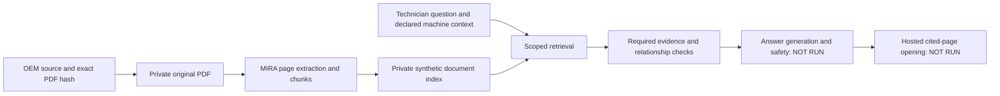

# Repeatable OEM manual-to-evidence pilot

Tracks [#4967](https://github.com/Mikecranesync/MIRA/issues/4967), [#4965](https://github.com/Mikecranesync/MIRA/issues/4965) and [#4966](https://github.com/Mikecranesync/MIRA/issues/4966). Start with [the discovery record](DISCOVERY.md).

This is a non-runtime reproducibility package: actual MIRA extraction, chunking, PostgreSQL persistence and lexical retrieval in a disposable local schema, followed by an offline evidence scorer. It is not a deployed upload/chat demo. **Generated answers, semantic safety verdicts and hosted source-page opening have not run.** No API/provider budget is authorized. No shared configuration or application database is used.

## What is pinned

- Three OEM PDFs in `manifest.json`:403 pages total. Downloaded bytes must match SHA256.
- MIRA source `2cd7cb3aa55bdea0343087652bbe695471eb8cd5`; `source-lock.json` verifies every copied production source file. The relevant ingestion/retrieval files remained byte-identical on later main `08e345f1`.
- `dependencies.json`: observed direct dependency versions. Existing dependency installation must match; the tool does not install or update packages. This is not a complete transitive environment lock.
-16 frozen questions in `cases.json`; seven evidence-bearing cases and nine identity/unsupported/safety cases. `acceptance-cases.json` adds stricter evidence requirements without rewriting original observations.
- Database adapter and test-only schema are explicit (`adapters.json`, `schema.sql`), not presented as the complete application schema. Upload lifecycle/proposals are fail-fast stubs; tracing is a no-op. The tested seam begins at `writePdfChunksForNode`, not the browser upload route.

## Prerequisites

Python3.12+, Node with a working dependency directory matching `dependencies.json`, and local PostgreSQL tools (`initdb`, `pg_ctl`, `psql`) on PATH. Original runs used PostgreSQL18.6. This recipe supports a Unix-socket host; Windows needs an explicitly reviewed equivalent. Use an ordinary OS account, not root. No provider keys, Doppler environment, hosted credentials, OCR or embedding services are needed.

Read `replay.py` before running it. The prepare phase alone can access the three public OEM URLs. The run phase uses a clean environment and test guards rejecting HTTP/fetch and TCP connections; only its private PostgreSQL socket is allowed. PDF bytes are private and never sent to a model.

## Reproduce from a fresh directory

From the repository root, fetch the historical source object if missing:

```sh
git fetch origin 2cd7cb3aa55bdea0343087652bbe695471eb8cd5
```

Use absolute paths for the existing dependency directory and a new output location **outside the git checkout**. Replace `/absolute/...` placeholders; do not run them literally.

```sh
python3 docs/evals/oem-manual-pilot/replay.py prepare \
  --repo "$PWD" \
  --output /absolute/private/oem-replay-01 \
  --node-modules /absolute/existing/mira-hub/node_modules \
  --download

python3 docs/evals/oem-manual-pilot/replay.py run \
  --output /absolute/private/oem-replay-01
```

To avoid re-downloading, replace `--download` with `--pdf-dir /absolute/private/pdf-cache`; filenames are each `corpus_id + .pdf` from the manifest. The same hash checks apply. Never commit that cache.

Preparation refuses existing output paths and source/dependency/PDF mismatches. Run refuses an existing cluster and rechecks prepared production source, test adapters, recipe files, source identity and direct dependency versions before database creation. It initializes only the new task-local cluster, creates its synthetic test role, uses a private short `/tmp/mira-oem-*` socket with TCP disabled, and stops the cluster on exit after a successful start. It preserves files and database evidence. It never changes host/system PostgreSQL settings. If process policy denies shared memory/socket creation, use the environment's normal approval mechanism; do not relax security settings or target an existing database.

## Expected outcome, not a green customer gate

The baseline is intentionally **not accepted**. `observed-summary.json` records the fresh replay without source text or private runtime IDs. A successful replay prints that the database stopped and returns exit1 because the evidence packet fails. Inspect `run.log` to distinguish execution failure from an expected failing score.

| Observation | Baseline |
|---|---:|
| PDFs / pages |3 /403|
| Stored chunks: PLUS / VM R / APSX |273 /427 /75|
| Source-page mismatches |0 /775|
| Executed queries |16|
| Foreign-tenant hits / cross-document leaks |0 /0|
| Strict retrieval evidence |5 pass /1 fail /10 inconclusive|
| Paid calls / attempted outbound calls during proof |0 /0|
| Generated-answer or hosted acceptance |Not run|

The original any-page metric found at least one expected page for all seven evidence-bearing questions. That is not completeness. The PLUS changeover question misses PDF51, including required compatibility/lifting evidence. APSX PDF42/printed37 is a sparse troubleshooting matrix whose blank-cell/action/rank relationships are lost in plain text. Nine safety/identity/unsupported questions cannot pass just because retrieval returned something.

## Outputs and trace map

| Output | What it proves / contains |
|---|---|
| `prepared.json`, `source-sha.txt` | Source/dependency snapshot, hash-checked private PDFs |
| `results.json` | Exact questions are joined by ID to `cases.json`; synthetic tenant/node/document IDs, returned chunks/pages/ranks, diagnostics and isolation outcomes |
| `page-provenance.json` | Each stored chunk matches an extracted source page, plus page hashes; not visual table correctness |
| `acceptance.json` | Fail-closed evidence checks; separate not-evaluated answer/applicability/viewer stages |
| `run.log`, `postgres.log`, `pgdata/` | Execution and preserved disposable database; contains private evidence |



Corpus identity in this harness is a synthetic document-scoping fixture, not confirmed real-plant applicability. The writer returns uploaded evidence as `verified=false`; the harness's `user_confirmed` identity status must not be misrepresented as a verified nameplate/serial/options match. Scope controls do not establish content correctness.

## Acceptance scorer and tests

The scorer is a standalone derivative of the locally reviewed tool from the repair lane (local commits38322a0/f0e8ac2), included here so this recipe does not depend on an unpublished branch. This package adds required-chunk fingerprint checks and six synthetic tests (38 total), so prerequisite text need not be published. It is not wired into runtime or CI and makes no provider calls. Future canonical-tool integration should remove duplication after the separately reviewed tool lands.

```sh
python3 -m unittest discover -s docs/evals/oem-manual-pilot -p test_oem_manual_acceptance.py
```

All declared pages and same-page required evidence must be present. Public `required_chunk_hashes` bind required chunks to a PDF page using SHA256 of UTF-8 text normalized by Python `" ".join(content.casefold().split())`. These were derived privately from the inspected prerequisite spans; they contain no source text. A changed extraction/chunk boundary may conservatively fail a hash even when meaning is preserved: review that candidate against the original page and approve a separately versioned rubric, never silently regenerate gold from candidate output. Optional private `required_evidence` span checks remain supported. Empty safety/identity targets, missing observations and unverified table relationships are inconclusive; failed/stale envelopes, contradictory supplied metadata and duplicate/missing/unexpected IDs cannot pass. Isolation/table-verification fields are trusted observations, not authenticated by this script. Supplied chunk subsets do not independently prove every summarized page. Generated answer, real-machine applicability and citation opening always remain unevaluated.

## Repair history and continuation

Independent investigation found the prerequisite query classified as generic. A narrow classifier candidate passed100 unit tests but worsened the real frozen result: baseline pages84,65,66,66,35,52 became53,84,76,67,101,91. It was rejected/restored, not shipped. Generic imperative-word density rewards unrelated instructions; simply boosting a phrase can also confuse a section with an assembly name. Both prerequisite pages span multiple chunks, so all-page checks alone are insufficient.

Next runtime experiment: section-specific evidence and required companion chunks, with opposite controls and frozen replay. Matrix work must preserve geometry or explicitly withhold unverified ranked advice, coordinated with existing #4551/#4555 work. Existing-document changes must follow #4859/#4914 owners. Nothing here closes either defect.

Before declaring customer readiness, run the real hosted upload→first answer, applicable machine identity/options, complete final-answer rubric, required safety checks and actual source-page viewer on a named release. These remain blocked by scope/access/spending constraints; this recipe does not synthesize a substitute pass.

## PR and spending boundary

All files in this package are documentation/evaluation artifacts under `docs/`; no runtime files or workflows are changed. Existing `code-review.yml` excludes `docs/**`; `staging-gate.yml` classifies docs-only changes as non-runtime and skips provider evaluation. This uses the established documentation path, not a change to or bypass of gates. Local replay results do not replace required review/acceptance for a future runtime fix. Do not widen this PR to runtime paths under the current $0 instruction.

## Verification of this recipe

The final package was exercised on29 October2026 with the three hash-matching private PDFs, a fresh output and a newly initialized private PostgreSQL18.6 cluster. It reproduced775chunks,16queries,zero provenance mismatches and the expected5pass/1fail/10inconclusive evidence verdict, with0 attempted outbound calls in the proof. The database stopped. A deliberately changed prepared source file was refused before database creation, then restored for the successful replay.38 synthetic evaluator tests and Ruff checks passed. Independent review identified and resolved user-psqlrc loading (now `psql -X`) and stale prepared-source identity (now revalidated at run).

This is local evidence. A successful docs-only Staging Gate may mean its model evaluation was intentionally skipped; it must not be cited as a new hosted answer-quality result.
