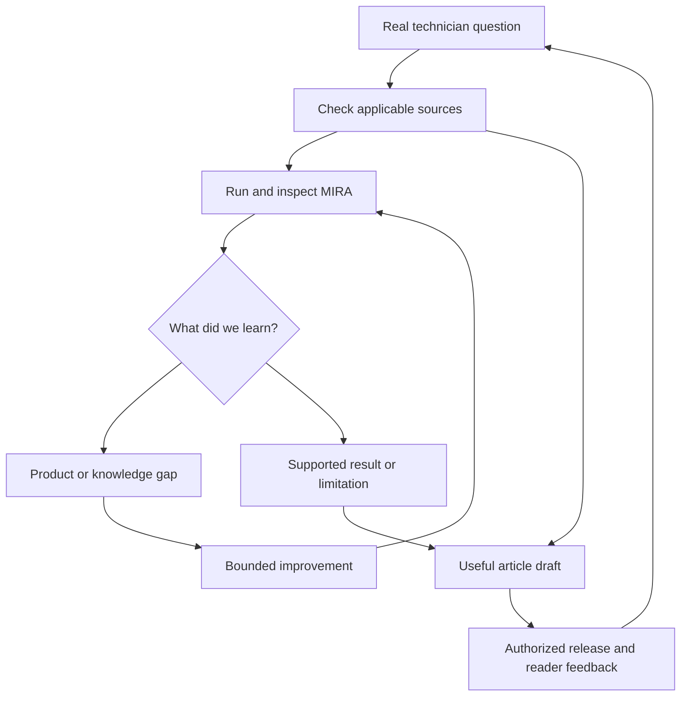

# FactoryLM learning pilot: questions, product tests and useful content

Version 0.3, 2026-10-25 (America/New_York). **Start gate: develop and test the process.** The three reviewed articles are development inputs. No MIRA run on these cases, product repair, reader study or automated publishing deployment is established by this document.

## 1. What we are trying to build

Use real maintenance questions to improve MIRA and FactoryLM while producing useful technical content. Each question should leave behind evidence that the next question can reuse: an applicable source, an evaluation case, an observed product result, a specific improvement when warranted, and an explanation a technician can use.

The first decision is whether this process produces useful, traceable learning at reasonable effort. Article volume and a polished style guide are secondary. Treat the style, workflow and prioritization rules as working hypotheses; revise them after the first complete cycle.

| Output | How it could help | Evidence needed |
|---|---|---|
| Better MIRA answers | Reveal gaps in source coverage, extraction, retrieval, citations, reasoning and handling uncertainty. | A recorded product run compared with an independently checked reference. |
| Better FactoryLM experience | Reveal friction in identifying equipment, uploading a manual, recognizing readiness, opening a citation and finding the next step. | An observed user-path result; API results alone do not demonstrate interface usability. |
| Reusable knowledge and evaluations | Preserve exact editions, meaningful questions and regression cases. | Source identity, applicability and a frozen case/result relationship. |
| More useful content | Explain a real question with clear limits and an appropriate next decision. | Reviewed technical content and, when available, observed technician usefulness. |
| Better product priorities | Show which gaps recur and which workflows matter to independent users. | Deduplicated questions, observed severity, actual feedback and relevant demand context. |
| Credible demonstrations and inquiries | Show what the product actually did and invite relevant conversations. | Scoped run evidence for demonstrations; a real person's expressed interest for an inquiry. |

Initially, “learning” means improving sources, extraction, retrieval, answer behavior, interface design and explanations. Model training is not a prerequisite. A public forum question is not permission to train on it or proof of a customer relationship.

**First proof:** one PowerFlex question completes the cycle with an inspectable outcome. Then try Micro820 and S7-1200 to see whether the process handles different problems. Three selected cases demonstrate workflow feasibility, not overall MIRA reliability or market demand.

## 2. The working loop

The article can explain the OEM evidence while a MIRA limitation remains open. A product success story requires its own supporting run. A source conflict holds the affected assertion; it need not stop independent research, unrelated tests or useful content.

Keep the actual technician problem separate from the reference answer. Keep software improvement separate from equipment repair: a better answer does not prove anyone repaired a machine.

## 3. Reuse what already exists

Inspected repository source at [main f1e53e0d30a317b1863d401df34609c90cea0d8b](https://github.com/Mikecranesync/MIRA/tree/f1e53e0d30a317b1863d401df34609c90cea0d8b). The table describes committed code and historical artifacts, not a live health check.

| Existing component | Reuse | Small addition or limit |
|---|---|---|
| [Answer Radar records](https://github.com/Mikecranesync/MIRA/blob/f1e53e0d30a317b1863d401df34609c90cea0d8b/answer_radar/schema.py) | QuestionRecord, EvaluationRecord and OutcomeRecord already distinguish questions, runs, rights, splits, grades and public outcomes. | Map blog cases to these records. Do not create a competing evaluation database. |
| [Batch runner](https://github.com/Mikecranesync/MIRA/blob/f1e53e0d30a317b1863d401df34609c90cea0d8b/answer_radar/batch.py) and [staging wrapper](https://github.com/Mikecranesync/MIRA/blob/f1e53e0d30a317b1863d401df34609c90cea0d8b/tools/qa/answer_radar_staging.sh) | Run questions through the deployed staging Hub, record its build, stop if the build changes, and retain separate runs. The wrapper provisions and cleans up a temporary test account. | The function accepts QuestionRecord objects; the CLI and wrapper currently select only six built-in seeds. Add a small reviewed-case input. Current staging access/health was not tested here. |
| [Hub runner](https://github.com/Mikecranesync/MIRA/blob/f1e53e0d30a317b1863d401df34609c90cea0d8b/answer_radar/hub_runner.py) | Blank-chat and machine-selected conditions; answer, citations, passage excerpts, status and trace references. | Both currently send an empty sourceDocIds list. They do not test a supplied manual, browser citation clicks or a physical phone. |
| [Retrieval acceptance client](https://github.com/Mikecranesync/MIRA/blob/f1e53e0d30a317b1863d401df34609c90cea0d8b/tools/qa/retrieval_acceptance.py) | Existing notebook, manual-attachment and chat operations. Answer Radar already reuses its HTTP client. | Reuse these operations for a separately labelled supplied-manual condition. Confirm ingestion readiness from the product; a fixed delay alone is not evidence of readiness. |
| [Grader packets](https://github.com/Mikecranesync/MIRA/blob/f1e53e0d30a317b1863d401df34609c90cea0d8b/answer_radar/grader_packet.py) and [scorer](https://github.com/Mikecranesync/MIRA/blob/f1e53e0d30a317b1863d401df34609c90cea0d8b/answer_radar/score.py) | Separate grading from answering; bind grades to the answer, supplied evidence and reference notes. | Supply reviewed OEM facts through the existing references input. A hash of reference text does not archive or verify the linked OEM file. Preserve its identity and inspect the actual pages. |
| [Issue intake helper](https://github.com/Mikecranesync/MIRA/blob/f1e53e0d30a317b1863d401df34609c90cea0d8b/tools/qa/create_issue.sh) | Existing duplicate search and verification requirements for crew/dogfood findings. | It searches only the top ten keyword matches and suppresses search errors. Before unattended filing, make failed search stop creation and add a stable case/failure reference. Prepare findings for review until that behavior and authority are established. |

There is a concrete precedent: [the September 29 staging findings](https://github.com/Mikecranesync/MIRA/blob/f1e53e0d30a317b1863d401df34609c90cea0d8b/answer_radar/runs/staging-2026-09-29-ae03a3877/FINDINGS.md) link frozen questions, graded runs, issues and a rebenchmark after changes. Use that artifact structure. Its scores and defects are historical, not today's product measurement; current code already includes citation passages that the old report described as missing.

Automatic handoff to the machine-local repair watcher is a follow-up integration: its owner and queue contract were not established in this review. Use the existing issue/PR/release process without claiming automatic repair execution already exists.

## 4. Three development cases

These are proposed normalized prompts derived from the reviewed drafts and their cited questions, not verbatim forum quotations. Confirm original context and applicable source rights at intake. Preserve uncertainty; do not add a firmware version or machine history that the source never supplied.

| Case and order | Reader problem | What this lets us test | Reference status |
|---|---|---|---|
| **PF525-F004-F005-01 — first** | A previously reliable PowerFlex 525 reports F004 followed by F005. What can that sequence establish, and what evidence would narrow the cause? | Code meaning, evidence collection, correct fault-history pairing, unsupported causal certainty and reset/restart qualifications when discussed. | Reviewed 520-UM001O-EN-E; explicit editorial corrections exist. Actual MIRA behavior is unmeasured. |
| **MICRO820-FLASH-01 — second** | A Micro820 fault LED flashes red after an interrupted download and CCW is unavailable. What does that establish, and what recovery options exist? | Fault class versus cause, conditional fault clearing, card/restore prerequisites and preserving the application. | Reviewed 2080-UM005H-EN-E. A failed draft is not a demonstrated product failure. |
| **S71200-RESET-01 — third** | A user wants to factory-reset an S7-1200 and understand what happens to its program and memory card. | Clarification, intentional erasure, version scope and honest handling of conflicting official sources. | AQ manual and STEP 7 V20 card/password notes have unresolved overlapping scope. Score undisputed facts; do not invent one answer for the disputed behavior. |

[README](README.md) contains the full source review and corrections. All three cases begin in **development**, because their solutions and failure patterns have already been examined. They are not sealed, fresh evaluation questions.

### First reference card: PowerFlex

- **Source question:** [original PowerFlex forum thread](https://www.plctalk.net/forums/threads/powerflex-525-f004-followed-by-f005.140604/). Re-open and normalize its actual context before freezing an executable case.
- **OEM:** [PowerFlex 520-Series User Manual](https://literature.rockwellautomation.com/idc/groups/literature/documents/um/520-um001_-en-e.pdf), 520-UM001O-EN-E, September 2025; pp.13,78-79,134,145,159-161. For the reviewed locations, printed and PDF page numbers align.
- **Reviewed file SHA-256:** b9445a63c78865037d22238ddedbb785b4309c9798da9da35029d628658636a6.
- **Expected substance:** distinguish DC-bus undervoltage from overvoltage; explain that the reported sequence does not prove one cause; identify useful recorded evidence and the relevant history indices. If clearing or restart is discussed, preserve the applicable OEM conditions.
- **Claims to reject:** the brake or photographed motor lead is the confirmed cause on the reader's machine; only Type 2 faults require cause correction before manual clearing; every automatic clear necessarily restarts; the b005 display range is a safe operating band or trip threshold.
- **Acceptable uncertainty:** ask for the missing operating context or exact equipment details; identify what cannot be concluded. A concise answer need not recite every parameter if it correctly answers the actual question.
- **Current state:** reviewed editorial reference; no baseline answer, product defect, repair or field outcome recorded for this case.

Use semantic assertions, not exact-phrase matching. An independent reference check owns the expected facts; a blog draft and a model's fluent answer are not the answer key.

## 5. One case through the process

### Intake and freeze

Preserve the normalized question, traceable source, equipment context and question ID in QuestionRecord. Reuse its rights fields; do not silently mark third-party material eligible for training, export or cross-tenant reuse. The default can retain a normalized technical question without copying a full thread or customer details.

Keep source lineage consistent with Answer Radar's manufacturer/model/platform split. Once a case family informs tuning, nearby paraphrases do not become fresh evidence. Independent later cases must respect the existing lineage partition, not merely have different wording.

Freeze the product question before the baseline. Keep the reference assertions, expected answer, corrected blog and graders' notes outside the prompt and retrieval corpus. An applicable OEM manual is legitimate product input through the normal source path; an evaluator's solution is not. Record any prior exposure or contamination.

The current [freezer](https://github.com/Mikecranesync/MIRA/blob/f1e53e0d30a317b1863d401df34609c90cea0d8b/answer_radar/freeze.py) hashes selected task fields but omits firmware_or_revision and OEM document identity. The adapter must bind material version scope and reference identity to the case/run, with a changed revision when they change. Do not describe those fields as already protected by the existing hash.

### Establish the tested condition

Run the same question under explicitly named conditions; compare like with like.

| Condition | Question it answers | Required evidence |
|---|---|---|
| Blank chat | What happens when a technician starts by typing the problem? | Exact prompt, build, visible answer/status, retrieved sources and trace where available. |
| Machine selected | Does identifying the actual manufacturer/model change retrieval or the next step? | Same prompt, confirmed identity, fresh notebook and separate result. |
| Manual supplied — small extension | Can MIRA use this applicable document when the technician supplies it? | Normal upload/attachment path, exact file identity, source ID, readiness and the actual chat request's document binding. |

A missing OEM manual can be an acquisition opportunity while an honest request for it is correct behavior. Record whether the relevant manual was available in each run. If a normal upload fails or the interface falsely says it is ready, investigate that user-path failure separately. If the harness sends the wrong source ID, repair the test before attributing an answer failure to MIRA.

The existing Hub API run gives staging answer-path evidence. Add one focused browser walk when the question concerns uploading, readiness or opening citations. Use actual device evidence for a physical-phone claim. Do not require every surface to be retested for a wording-only change.

### Inspect and classify

Retain the exact answer, citations and underlying passages, build, tested condition, document identity and trace references. Unknown diagnostics remain unknown; they are not zero retrieved chunks. Read the relevant full OEM context when a short citation excerpt omits a qualification.

Use the existing independent-grading mechanism, with reviewed references. Model disagreement or a missing grade is not a product defect. Review contested or consequential findings before routing them to repair.

| Primary outcome | What establishes it | Action |
|---|---|---|
| Content error | A draft, figure, summary or FAQ contradicts its evidence. | Correct content. A product bug requires a product run. |
| MIRA defect | A valid observed run violates a supported behavioral assertion. | Preserve evidence, distinguish observed once from reproduced, deduplicate and prepare a bounded repair. |
| Knowledge gap | The needed applicable source is absent or unusable. | Acquire or improve ingestion through the approved path, then rerun; preserve a correct abstention as correct behavior. |
| Source conflict / missing scope | Applicable sources disagree or required version/context is unavailable. | Hold the disputed assertion, ask for the missing context and score unaffected behavior. |
| Invalid test / environment failure | The intended comparison was not actually exercised. | Correct the setup and rerun. Report the blocked attempt rather than quietly dropping it. |
| Pass / supported limitation | The answer meets applicable requirements or appropriately asks/declines. | Preserve the result and useful next step. Do not manufacture a fix. |

For a suspected product defect, use trace evidence to distinguish source absence, search skipped, wrong source/ranking, missing context, unsupported generation, citation failure and a poor user-facing fallback. Those are hypotheses until isolated. Severity, recurrence and evidence determine priority; an evaluator's score alone does not.

### Improve, retest and explain

Search existing issues first. Link the question, run and observed failure to the right issue, or prepare one verified finding with a precise expected change. Several questions may reveal one defect; one question may reveal multiple defects. Do not equate the number of low scores with the number of software bugs.

A repair should change the smallest demonstrated cause. Rerun the frozen case on the named candidate build, with the same source edition and condition, plus relevant existing regressions. Use a small set of independently withheld natural variants when the change could overfit the wording; retain them as development/regression evidence for this exposed family. Do not call a changed question, source or grading standard a successful repair.

Record separately: code changed, staging retest passed, released, and production behavior observed. Existing release policy decides promotion. Synthetic Answer Radar traffic remains on its staging-only path.

Create the corrected article from the reviewed source record. Add a product demonstration only when a suitable run supports it and the applicable claim authority permits it. Reader confusion can generate a content revision, a UX question or a new evaluation case; it is not automatically a confirmed equipment or software cause.

### Keep the record small

Reuse existing records and artifacts. At the content layer, add only a cross-reference:

| Information | Home |
|---|---|
| Question, source provenance, scope, rights, split | Existing QuestionRecord and frozen snapshot. |
| Reviewed OEM edition/pages/hash, assertions and unresolved claims | Existing grader reference-notes input, with a retained source record. |
| Answer, condition, build, citations, trace, grades | Existing batch, grader and EvaluationRecord artifacts. |
| Article revision, question ID, reference entry, run, issue/PR and retest | A compact link section in the current editorial record; do not invent a second case store. |
| Release decision and actual public result | Existing publication record; use OutcomeRecord where applicable, without inventing engagement or leads. |

Keep private tenant evidence out of public articles and repository exports. General OEM knowledge, forum hypotheses and a particular plant's verified repair history remain different source types.

## 6. First implementation slice and exit criteria

**Implement a reviewed-case input to Answer Radar, then run one PowerFlex cycle.** This is an engineering-ready proposal; this documentation PR does not implement the adapter or execute the tests.

The bounded slice should:

1. Import the reviewed normalized question into QuestionRecord, preserving source, scope, rights and development assignment. Extend the existing batch/wrapper input rather than replacing the staging client.
2. Bind the exact question revision, material equipment/firmware scope and reviewed reference identity. Changed inputs must create a distinguishable run and invalidate stale grades.
3. Pass the source assertions only to the grader reference input, using the same references JSON for packet creation and scoring so the answer identities match. Capture both existing chat conditions and retain the existing build-change and cleanup protections.
4. Add the supplied-manual condition using the existing attachment path if it is needed to test document use. Verify readiness and actual source binding. Keep it distinct from corpus discovery.
5. Produce the compact article-to-run-to-finding link record and a corrected article draft. Prepare deduplicated issue evidence when a real gap is demonstrated; no issue is required for a pass.

Meaningful implementation checks cover input validation and rights, changed-input identity, separation of reference answers from product inputs, correct manual attachment, retained evidence, unchanged seeds behavior and staging cleanup. Do not build a generalized orchestration platform, new CMS or new analytics system for this slice.

**The first cycle is complete when:**

- One source-checked PowerFlex case and reference are frozen and inspectable.
- A valid named-build baseline exists, or a specific blocked prerequisite is recorded. A blocked result completes triage, not the end-to-end proof.
- Every material finding has a classification and supporting evidence; no blog error is silently relabelled a product bug.
- Any required repair links to its issue/PR and a comparable retest; otherwise the supported pass or limitation is recorded.
- The corrected article agrees with the evidence, including its figures, summaries and FAQs.
- The case reaches an explicit state: supported pass, repaired and retested on a named surface, or unresolved with the next evidence needed.
- Human review effort, execution effort and unresolved friction are recorded so the next iteration can simplify the process.

The end-to-end proof needs at least one valid run and disposition. It does not require finding a bug, releasing software or publishing an article merely to claim completion.

## 7. Automation and human decisions

Automate repeatable work within existing access, budget and authority: eligible-source collection, deduplication, edition checks, case preparation, permitted staging runs, evidence capture, draft classification, regression execution and draft generation. Reuse valid reviews when the relevant evidence has not changed.

Keep judgment at the points that need it: unresolved OEM scope, disputed or consequential grading, product tradeoffs, and existing release/publication authority. Present a concrete batch of evidence and proposed changes at those points; do not ask Mike to approve each search or draft.

| Stage | Initial operating mode | What permits broader automation |
|---|---|---|
| Case preparation | Assisted intake of the three known cases. | Source provenance/rights and version identity survive import without manual repair. |
| Product run and grading | Existing staging harness with reviewed references and independent grading. | Runs are attributable; failures and grader disagreements are classified consistently. |
| Repair intake | Draft a verified finding and search existing issues. | Reliable deduplication, explicit filing authority and verified handoff contract. |
| Product changes | Isolated fixes or draft PRs under current repository rules. | Existing review, test and release gates; no automatic production promotion from a grader score. |
| Public content and replies | Reviewed drafts, then the applicable authorized release. | Exact content revision and publication/posting authority; passing a test alone is not approval. |

This plan creates no recurring schedule, social posting, outreach, spend commitment or deployment. If the pilot is useful, make the next automation a small recurring intake and staging batch under the established controls, with visible failed/blocked runs. Choose its cadence after measuring effort; do not start with a daily article quota.

## 8. What to measure

There is no pilot baseline yet. Start with counts and named cases; do not invent success targets or imply precision from three examples.

| Outcome measure | Definition and source | How to read it |
|---|---|---|
| **Evidence-supported answer rate** | Cases meeting the predeclared answer, source, scope and uncertainty requirements / valid evaluated cases, from adjudicated Answer Radar records. | Report exact counts by build, condition and split. Separately show useful substantive answers, appropriate requests/abstentions, failures, and blocked/invalid attempts. A correct abstention is not delivered diagnostic coverage. |
| **Technician usefulness** | Readers who can identify the intended next evidence or decision / readers who attempt that specific task. Record actual response or observation and recruitment method. | Begin with a small, explicitly described sample. A helpfulness click or page view is supplementary; neither proves a field repair. |
| **Qualified pilot inquiries** | Distinct real inquiries expressing a relevant maintenance workflow and product interest, with source attribution when known. | Keep inquiries, meetings and committed pilots separate. Until traffic and attribution are adequate, report counts rather than a conversion percentage. |

For the first cycle, also log valid/blocked attempts, confirmed unique gaps closed and retested, source gaps, review minutes and measured tool usage. These are operating diagnostics to improve the process, not additional headline targets. Use total answer elapsed time where available; the current Hub runner's first-answer field is populated with total time and must not be reported as true first-token latency.

Two guardrails apply:

1. **No unsupported operational certainty.** An unsafe or critically unsupported instruction cannot be offset by a high aggregate score. Hold the affected claim or procedure, with its next evidence requirement, while independent work continues.
2. **No evidence inflation.** Separate development from independent evaluation, a software correction from equipment repair, source checking from hardware testing, and publication from customer demand. Preserve unresolved and negative outcomes.

Expansion should follow evidence: one inspectable cycle; then three different case types; then a small repeatable batch with acceptable review effort and useful findings. Set numerical operating targets after observing a baseline and the available capacity.

## 9. Content delivery during the pilot

[STYLE-GUIDE](STYLE-GUIDE.md) governs the editorial work. Retain the navy/amber identity while testing whether readers understand the next decision. Technical truth and attribution remain requirements; page count, FAQ count, image count and tone refinements are preferences to learn from.

Keep the concrete corrections: PowerFlex first, then Micro820, with the Siemens card/password assertion scoped or held. Fix absolute website links in the PDF exports, repeated figures and unsupported product wording. The detailed audit remains in [README](README.md).

The current PR snapshot contains mira-web/src/data/blog-posts.ts, mira-web/src/lib/blog-renderer.ts, mira-web/src/lib/blog-db.ts and mira-web/public/blog.css. Inspect current interfaces before implementation and reuse the existing renderer/publishing path. Historical deployment observations in Grokbot's original plan are not a new live-site check.

The editorial record needs the article identity and reader question; material equipment/software scope; exact sources; claim review and unresolved qualifications; consequences; useful visuals and rights; author/reviewer attribution; the case/run links above; product-claim authority; and the reviewed revision, release decision and eventual URL. No new CMS is required.

Preserve existing responsibilities: Content Studio drafts, the applicable technical reviewer checks the source and scope, Search Steward checks editorial/search/export consistency, Mike supplies the applicable publication authority, and Foreman packages an authorized release. AI-assisted source review is labelled accurately. The [weekly-batch proposal](STYLE-GUIDE-part4-proposed.md) can reduce overhead; it adds no second approval where an applicable decision already exists.

If scheduled publication is implemented, verify every public surface: direct routes, index, sitemap, feeds, related links and caches. Future/unapproved posts must not leak; due approved posts must become visible. **Filtering only at server startup will not make a future post appear when its time arrives.** Use an explicit timestamp with the America/New_York offset for that date and a request-time or documented refresh/rebuild mechanism.

Inspect the delivered web/PDF at readable sizes. Website links in PDFs must be absolute HTTPS, related targets available, and internal preview metadata omitted. A bot's successful URL response does not establish manual applicability; a bot challenge does not by itself invalidate an official source.

## 10. Expansion decisions

After the first cycle, ask: Did it teach us something actionable? Can another case reuse the records and decisions? Where did human judgment help, and where did avoidable manual work occur?

After three cases, choose the next narrow set using independent recurrence, supported equipment scope, technical consequence, answerability and observed product gaps. Keep difficult or safety-heavy questions in the research queue without forcing a publishable procedure. A relevant knowledge gap can outrank a high-volume topic.

After a useful small batch, consider a bounded recurring collector, source-change monitoring, regular staging regressions and consolidated draft content. Do not count reposts or generated variants as independent demand. Preserve failed and blocked runs so a scheduler cannot quietly manufacture a good score.

Use existing analytics for discovery and actual contact signals. Improve a useful existing article before producing a thin variation. Check whether the content teaches a decision, whether the product improved on tested cases, and whether anyone actually wants the workflow. Those are separate questions.

## 11. Retained topic backlog

This is a research backlog, not a calendar or thirty approved articles. The collection notes below are preserved from the original October 25 draft and were **not re-run in this review**. `T-013` and “on box” refer to Grokbot's external workspace, not a file verified in this PR. Verify the actual source and applicable manual before drafting; an indexed result is not an opened source. The old “drafted” marker records prior drafting only, not approval.

| Candidate | Product | Question | Source URL | Original collection note | Original manual note |
|---|---|---|---|---|---|
| 1 | Micro820 | Flashing red fault after failed download, clear without CCW (**drafted**) | https://www.plctalk.net/forums/threads/micro820-fault-help.106371/ | 200 | 2080-UM005 |
| 2 | S7-1200 | How to factory reset (**drafted**) | https://www.plctalk.net/forums/threads/siemens-s7-1200-factory-reset.122271/ | 301→200 | S7-1200 SM |
| 3 | TP700 | Comfort losing all touch (**drafted**) | https://www.plctalk.net/forums/threads/siemens-tp700-comfort-losing-all-touch.117233/ | 200 | Comfort OI |
| 4 | PowerFlex 525 | F004 followed by F005 | https://www.plctalk.net/forums/threads/powerflex-525-f004-followed-by-f005.140604/ | 200 | Drive pack (520-UM001) |
| 5 | S7-1200 | Unlock CPU protection / lost password | https://www.plctalk.net/forums/threads/unlock-s7-1200-cpu-protection.146988/ | 200 | S7-1200 SM §6.5 |
| 6 | Micro820 | Failed downloads "brick" the unit | https://www.plctalk.net/forums/threads/micro820-failed-downloads-lead-to-a-bricked-unit.134972/page-2 | T-013 200 | UM005 App. C |
| 7 | Conveyor/VFD | Conveyor motors humming, overload on start | https://www.plctalk.net/forums/threads/motor-seizing-on-startup.139619/ | 200 | general (non-PF drive; no named brand in post) |
| 8 | PowerFlex 525 | Beginner: drive overload on run (motor data) | https://www.plctalk.net/forums/threads/powerflex-525-beginner-help.149269/ | 200 | Drive pack |
| 9 | S7-1200 | HMI shows #### instead of values (1212C) | https://www.plctalk.net/forums/threads/siemens-s7-1212c-tia-portal-on-hmi-appears-instead-of-real-values.150120/ | 200 | S7-1200 SM / Basic Panels OI |
| 10 | Micro820 | New unit: what's its IP? Not found | https://www.reddit.com/r/PLC/comments/1nr4ba0/micro820_configuration_issues/ | T-013 indexed | UM005 [IPA] p.120 |
| 11 | S7-1200 | Flashing LEDs, can't reset or connect | https://www.plctalk.net/forums/threads/s7-1200-flashing-leds-cant-reset-it-cant-connect.110799/ | T-013 200 | S7-1200 SM |
| 12 | PowerFlex 4 | F012 HW overcurrent at power-up | https://www.plctalk.net/forums/threads/powerflex4-fault.52470/ | 200 | needs PF4 manual |
| 13 | TP700 | Factory reset without TIA after failed OS update | https://sieportal.siemens.com/en-ww/support/forum/posts/factory-reset-tp700-comfort-without-tia-portal/130297 | T-013 indexed | Comfort OI §5.7 + FAQ 19701610 |
| 14 | Micro850 | USB connection not working | https://mrplc.com/forums/topic/45935-micro850-usb-connection/ | 200 | 2080-UM001 (on box) |
| 15 | S7-1200 | MTP700 Unified Basic can't write to PLC | https://www.plctalk.net/forums/threads/mtp700-unifi-basic-hmi-cannot-write-commands-to-siemens-s7-1200-plc.150135/ | 200 | missing (Unified Basic) |
| 16 | Micro820 | Can't connect over Ethernet, flashing fault | https://www.reddit.com/r/PLC/comments/13su0o2/micro_820_cant_connect/ | T-013 indexed | UM005 |
| 17 | Conveyor | Cabinet of PowerFlex 4s won't power up | https://www.plctalk.net/forums/threads/power-flex-4-powerup-problems.60771/ | 301→200 | needs PF4 manual |
| 18 | S7-1200 | CPU went to STOP, won't take program | https://www.reddit.com/r/PLC/comments/1h8ank0/stop_on/ | T-013 indexed | S7-1200 SM (diag buffer) |
| 19 | TP700 | Stuck at SIMATIC HMI boot screen | https://sieportal.siemens.com/en-ww/support/forum/posts/tp700-comfort-the-os-does-not-boot/168455 | T-013 indexed | Comfort OI + FAQ |
| 20 | Micro820 | Wiring sensors to inputs | https://www.plctalk.net/forums/threads/allen-bradley-micro820-plc-sensors.134162/ | T-013 200 | UM005 |
| 21 | GS20 drive | Runs over EtherNet/IP? FWD lit but won't run | https://www.plctalk.net/forums/threads/command-over-ethernet-ip-sysmac-studio-and-automation-direct-gs20.139484/ | 200 | GS20 manual App. B (public PDF, fetch) |
| 22 | Micro800 + PF | Micro830 to PowerFlex comms | https://www.plctalk.net/forums/threads/micro830-to-powerflex-communications-i-though-this-was-supposed-to-be-easy.75028/ | 200 | UM001 + drive pack |
| 23 | TP700 | ProSave reset stuck "Please boot the HMI device" | https://sieportal.siemens.com/en-ww/support/forum/posts/-/251724 | T-013 indexed | FAQ 19701610 |
| 24 | GS-series VFD | VFD on high-leg delta supply | https://www.plctalk.net/forums/threads/vfd-and-high-leg.150105/ | 200 | needs GS4 manual; safety-heavy, catalog-only |
| 25 | Micro820 | Analog input for a discrete device | https://electronics.stackexchange.com/questions/298909/can-i-use-an-analog-input-for-a-discrete-signal-field-device-on-the-a-b-micro820 | T-013 indexed | UM005 |
| 26 | Conveyor | Sudden "motor fault" but overload not tripped | https://www.plctalk.net/forums/threads/question-about-sudden-motor-faults.72781/ | 301→200 | general + 3RV2 MSP manual (on box) |
| 27 | PowerFlex 755 | Reserved "web enable" parameter | https://mrplc.com/forums/topic/45860-powerflex-755-reserved-web-enable-parameter/ | 200 | missing |
| 28 | Comfort panel | TP1200 "HmiRTm.exe serious error" | https://mrplc.com/forums/topic/45898-hmi-tp1200-comfort-panel-error-application-hmirtmexe-encountered-a-serious-error-and-must-shutdown/ | 200 | Comfort OI |
| 29 | S7-1200 G2 | Bogus analog values | https://www.reddit.com/r/PLC/comments/1pn65nj/im_getting_bogus_values_from_reading_analog_card/ | T-013 indexed | G2 manual missing |
| 30 | GS20 | Control GS20 frequency over EtherNet/IP (beginner) | https://community.automationdirect.com/s/question/0D5PE00000HQXgf0AH/help-a-beginner-control-gs20-frequency-via-ethernet-ip | search index only | GS20 App. B |

Candidates 12, 15, 17, 24, 27 and 29 were already flagged as missing manuals in the collection. Acquire and verify the relevant OEM source or defer the topic. Candidates about factory resets, lost passwords, firmware recovery, line voltage or grounding need the consequential-change scope in STYLE-GUIDE section 4. Do not reuse an S7-1200 manual for S7-1200 G2 without establishing applicability.

The TP700 draft was not attached for this review. The original plan flagged its external-mouse and `CalibrateTouchScreen` claims as unverified; keep those open rather than treating this three-post review as their clearance.

## 12. Next concrete handoff

Use section 6 as the bounded engineering slice: connect one reviewed PowerFlex question to Answer Radar and preserve a baseline, disposition and article draft. Reuse the September run structure and current release process. Carry Micro820 and Siemens as the next development cases, not claims of present product failure.

The PR now includes the [phased technical-publishing handoff](../technical-publishing/PHASED-PLAN.md), approved-reference identity, reusable example input, judge contract and marketing study. The renderer, executable judge gate, Answer Radar adapter, live evaluations and distribution each require their own completion evidence. The present result is documented direction and a bounded implementation path, ready for the next agent.
