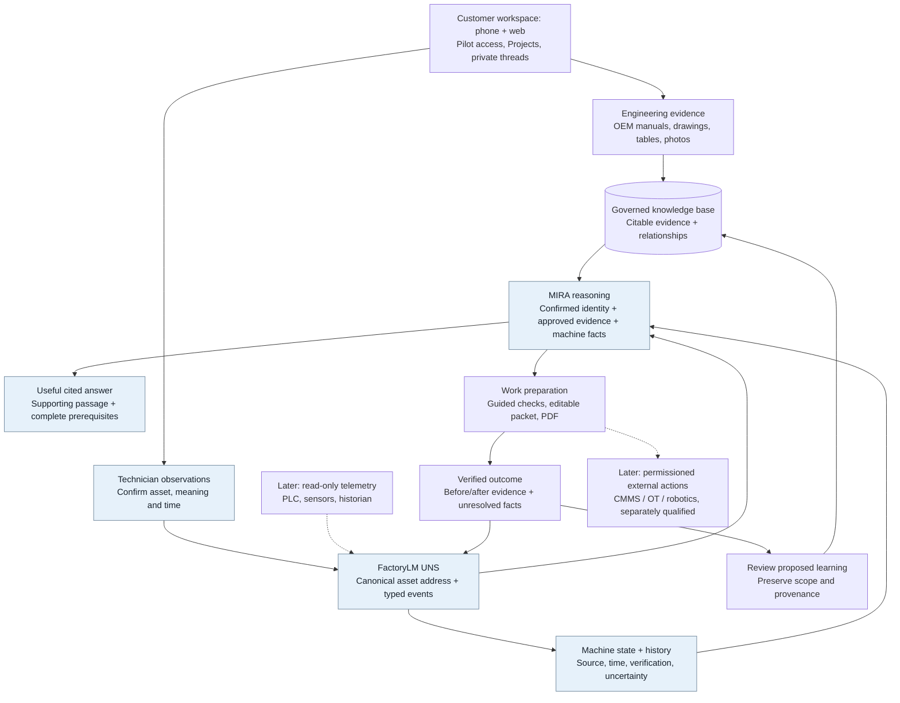
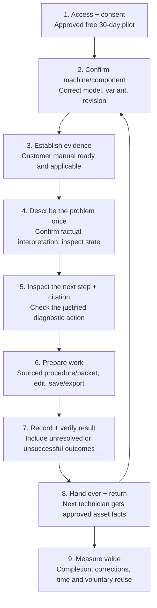
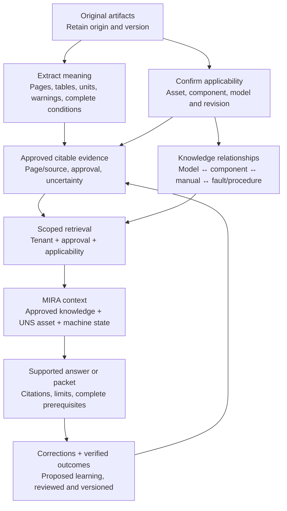

# Package and customer journey

Target design, not proof of live implementation. Shaded nodes mark Mission 001's focus; dashed connections mark separately qualified extensions. See [customer outcomes](CUSTOMER-VALUE-ACCEPTANCE.md) and the [interactive view](visuals/package-journey.html).

## Full package

Trust across all paths: tenant/role boundaries, private conversations, approved sharing, source applicability, safety gates, consent, durable cost bounds, audit, real CI/device evidence and rollback. A reported repair never establishes safety clearance automatically.

## Customer journey

Observation capture should reuse the question the technician already asked and add only necessary confirmation. A source-qualified manual question can yield a useful answer while machine-state details remain explicitly Unknown. Do not require redundant forms or CMMS setup before first value. Asset-specific advice still follows the confirmed-context rules.

## Knowledge lifecycle

The knowledge base holds engineering evidence and relationships. The UNS supplies canonical asset addressing and event scope. Machine state contains time-bound, provenance-bearing facts. Together they help the current job and preserve what the next technician needs.
