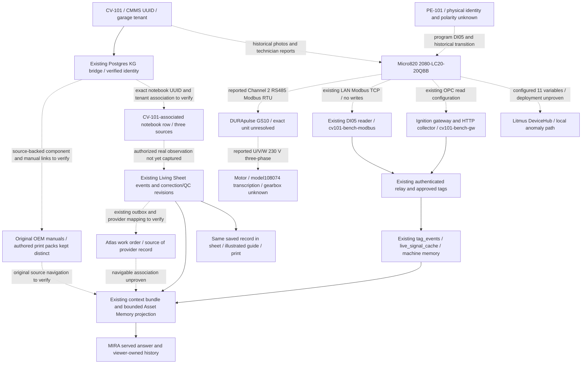

# CV-101 inventory, source map and remaining gaps

Audited repository `300685118582f14e5bef3c049939e5baf8fc3780`, November 6, 2026.
This is a source-linked inventory, **not a verified present-day as-built**.
See [acceptance status](README.md) and [executable procedure](procedure.md).
The existing [capability inventory](../../discovery/2026-11-06-asset-memory-inventory.md)
traces the broader graph, context, ingestion, chat, Living Sheet, Atlas, UNS/i3X
and approval implementations; it is reused rather than replaced.

## Identity and architecture

[ADR0035, including its amendment](../../adr/0035-cv101-canonical-uns-path.md),
and the [garage kit](../../dogfood/garage-cv101-kit.md) distinguish:

| Identity | Evidence / meaning |
|---|---|
| CMMS asset UUID | `64a24de7-2809-4c35-b4fe-202be80393d6`, re-read from production on November 6. |
| Tenant | `e88bd0e8-8a84-4e30-9803-c0dc6efb07fe`; a second tenant also has a CV-101. |
| Human handle / label | CV-101 / Discharge Conveyor. Never join records by label alone. |
| KG entity_id | Existing CMMS UUID, confirmed by the fresh identity probe. `cv_101` is a derived key, not a replacement UUID. |
| Canonical operational address | `enterprise.home_garage.conveyor_lab.conveyor_1`; address is metadata, not immutable machine identity. |
| Historical alternatives | `enterprise.garage.demo_cell.cv_101`, `enterprise.garage.demo_cell.bottling_demo.cv_101`, other builder/MQTT paths. Preserve original paths and reconcile explicitly. |
| CV-200 / Northwind | Presentation alias for the rig in another tenant, not permission to pool evidence across tenants. |

The diagram shows evidenced historical/design links and existing software
paths. **Dashed links and endpoints are unproven current relationships.** It
does not assert these are all current, connected, approved or live.

No graph seed, alias migration, new relationship, source upload or source-state
promotion ran. A seed's `verified` or confidence number is not a field receipt.

## Physical sources, assertions and contradictions

| Item | Evidence-backed historical statement | Unknown / conflicting / current status |
|---|---|---|
| PLC | July11 [panel photograph](../../../plc/conv_simple_electrical/review/photos/panel_full.jpg) supports Allen-Bradley Micro820 **2080-LC20-20QBB**; photographed MAC `5C:88:16:D8:E4:D7`. | July2 [transcription](../../onboarding/cv-101-evidence/wiring_evidence.md) instead has side-label MAC `5C:88:16:D9:75:DC`, serial `28556-1379`, shipped FW12.011; later CIP records say14.11. Originals for July2 are absent. A firmware update is possible but does not reconcile units/MACs. Current model/unit/firmware/IP unverified. QBB has DC sourcing outputs, not relay outputs. |
| Drive | July11 [photo](../../../plc/conv_simple_electrical/review/photos/gs10_full.jpg) supports DURApulse **GS10 family**. July2 transcription gives **GS11N-20P2**, barcode `GS1120P2+K25310021`, version1.03; 200–240V single-phase input, 0–230V three-phase output, ¼HP/0.2kW, CT1.6A/VT1.8A. | Exact July11 side-nameplate/frame not legible in inspected evidence. Barcode is not independently established serial. Family/model must not be conflated with the old seeded GS10-21P0. Current parameters unread. |
| Motor | July2 transcription: model108074, serialU340156C25040052, SHDC marking, 1HP,230/460V,3.8/1.9A,1725RPM,56C,TEFC,SF1.15. July11 [recorded technician correction](../../../plc/conv_simple_electrical/review/PHOTO_EVIDENCE_V7.md) says actual operation230V, correcting earlier “480”. | Original nameplate photo unavailable; manufacturer/gearbox/ratio not grounded. The motor1HP versus drive¼HP discrepancy is unresolved suitability evidence, not an approved setting/protection limit. SEW R47 demo identity is a different fixture. |
| PE-101 | [PLC source](../../../plc/Prog_init_ConvSimple_v2.1.st) and [context model](../../../plc/conv_simple_anomaly/context_model.cv101.json) assign a photoeye function to DI05. November2 owner evidence reports a hand-wave transition at coil23. | No physical make/model/serial, PNP/NPN, wire trace or confirmed polarity. Existing [open items](../../../plc/conv_simple_electrical/model/open_items.yaml) explicitly retain assumed sensor type/power. Do not promote Banner Q4X seed identity. |
| MLC / supply | July11 [photo](../../../plc/conv_simple_electrical/review/photos/mlc_full.jpg) supports Schneider **CA3KN22BD 24VDC control relay**, not the initially invented three-pole motor contactor. Mean Well24VDC1A supply visible; exact model unreadable. | Remote conductor destinations, switching suitability, breaker identity/rating, bonding and wire numbers remain open. Distribution block brand/polarity assignments unverified. |
| Power topology | [July11 technician account](../../../plc/conv_simple_electrical/review/PHOTO_EVIDENCE_V6.md) and corrected V7:230V1phase→breaker→MLC NO→GS10 R/L1,S/L2; U/V/W→230V3phase motor; O02→MLC24Vcoil. | Authored record of technician account, not raw transcript or end-to-end conductor inspection. No safety clearance is inferred. |
| Serial link | July2 wire transcription D+/D−/G and July11 purpleRJ45 photo support a historical PLC–drive RS485 relationship. [E007](../../../plc/conv_simple_electrical/model/e007_rs485.yaml) records Channel2 master→drive node1, GS10 pins5 SG+,4 SG−,3ground. | Cable colors/material differ across authored references/photos. May20 export38400/8N2, May26/newer code9600/8N1, older guide9600/8N2. Current readback absent. Do not change settings or attach another serial master. |
| Analog claim | [PHOTO_EVIDENCE_V5](../../../plc/conv_simple_electrical/review/PHOTO_EVIDENCE_V5.md) says analog connector populated. | Independent inspection of [control-terminal crop](../../../plc/conv_simple_electrical/review/photos/gs10_control_terminals.jpg) finds apparently empty openings; yellow ferrules appear on power strip below. **Disputed**, not an accepted hybrid analog-control edge. |
| Nearby devices | Panel photo also shows Siemens CPU1212C AC/DC/RLY and an obscured device. | Proximity does not establish membership in CV-101's control path. |

### Source identity and missing originals

July11 photo acquisition notes say staging Telegram→Google Drive retrieval;
original Drive IDs/URLs are not retained. EXIF `2026:07:11 06:52:35` has no
timezone. Git first tracks that package at `46756c95d` (July12), while July2
transcriptions first appear at `c7dd99064` (July4). Document date, camera clock,
commit date and current installation verification are different facts.

| Stored original | Recomputed SHA256 |
|---|---|
| panel_full.jpg | `fa30a51ef73345432b0e429ca63ec72f4665e5d7eb77a810e8292336040d2f32` |
| gs10_full.jpg | `930566e6408ec93551fcabafc86a17f3cec972f0a48977414fbc210292118242` |
| mlc_full.jpg | `a89e9381b82b9fc5ac3a1f7f5d281736cf0a2e2a1379ca90a5a3599d37ca7f82` |
| gs10_control_terminals.jpg | `febc0811ad22859151be799d98dae487172befc2df12c89272897708866c6405` |

Original July2 photographs, original manual bytes and raw technician transcript
links are absent from this checkout. Preserve transcriptions as transcriptions;
do not manufacture their hashes or say a missing original was independently read.

## Actual/configured PLC/VFD/tag mapping

**No map below is newly verified against today's flashed program.** June30
historical evidence confirmed eleven CIP-named globals: four BOOL and seven
UINT. Calling all eleven “registers” obscures the distinction. The Litmus mirror
configuration is in [mira_on_litmus.py](../../../plc/litmus/mira_on_litmus.py),
[provision.py](../../../plc/litmus/provision.py) and the
[context model](../../../plc/conv_simple_anomaly/context_model.cv101.json).
`provision.py` writes DeviceHub; it was not run.

| Signal | Configured Modbus read | 1-based reference → zero-based offset | Configured interpretation |
|---|---|---|---|
| motor_running | FC1 coil |000001→0 | BOOL, program report, not independently measured shaft motion |
| vfd_comm_ok | FC1 coil |000004→3 | BOOL / required trust input for cached drive values |
| e_stop_active | FC1 coil |000006→5 | BOOL / program interpretation, not safety-circuit certification |
| estop_wiring_fault | FC1 coil |000010→9 | BOOL / program interpretation |
| vfd_frequency | FC3 holding |400107→106 | raw÷100 Hz in newer source |
| vfd_current | FC3 holding |400108→107 | raw÷100 A in newer source |
| vfd_voltage | FC3 holding |400109→108 | raw÷10 V output voltage |
| vfd_dc_bus | FC3 holding |400110→109 | raw÷10 V DC bus |
| vfd_cmd_word | FC3 holding |400115→114 | read-only raw command mirror; never a command target |
| vfd_status_word | FC3 holding |400118→117 | raw status; deployed map unconfirmed |
| vfd_fault_code | FC3 holding |400119→118 | raw0x2100 monitor word in newer code; decode disputed |

Important revision limits:

- Direct Litmus `_HR` reads omit status_word, so that baseline reads only ten
  of the eleven configured signals. Status/fault mirrors are absent from the
  older `MbSrvConf_v4.xml`; newer source defines them. Repository presence is
  not proof of current flash.
- [Prog_init_ConvSimple_v2.1.st](../../../plc/Prog_init_ConvSimple_v2.1.st)
  uses9600/8N1/P09.04=12 and frequency×100; old
  [GS10 guide](../../../plc/GS10_Integration_Guide.md) says8N2/P09.04=13 and
  older frequency/current÷10. STOP/FWD/REV1/18/34 in newer code differs from
  older REV20. These values are historical code evidence, **not commands or
  instructions to configure equipment**.
- The newer `vfd_fault_code` copies the whole0x2100 word; a context description
  assumes low-byte codes. Keep the raw word until the installed program and
  OEM interpretation are verified. Do not label a historical byte as a current
  drive fault.
- Proposed extensions400120warning,400121frequency command,400122torque÷10%,
  400123RPM,400124power÷1000kW and400125lastfault are code, not present availability.
- [Ignition tag configuration](../../../ignition/tags/tags.json) misleadingly
  names400109 `VFD_DCBusVoltage_Raw`; that address is output voltage. Actual
  `VFD_DCBus_Raw` maps400110. Frequency/current tooltips retain older scaling.
  Do not fix historical source evidence by silently relabelling samples.
- [wiki correction](../../../wiki/hot.md) records ConvSimple1.8 Prog1ladder+
  Prog_init Channel2 on the bench; old v4.1.9ST/Prog2 was dead lineage. Current
  source-file version must not be treated as a fresh uploaded-program receipt.

### Newer DI05-only physical fallback

Merged [#5110](https://github.com/Mikecranesync/MIRA/pull/5110), merge
`dd2cc10fb`, already implements a bounded reader; no replacement is needed.
[cv101_relay_poller.py](../../../plc/live-plc-bridge/cv101_relay_poller.py)
reads **FC1, unit1, coil000023 / offset22**, `_IO_EM_DI_05` only. It publishes
`source_system=plc_bridge`, `source_connection_id=cv101-bench-modbus`,
`tag_path=micro820/_IO_EM_DI_05` through the existing authenticated canonical
ingest. These are not the eleven Litmus variables or full drive parameters.

The reader timestamps host-UTC acquisition/read completion, records PLC host,
unit, coil, variable, duration and clock metadata, samples250ms, sends changes
and5s heartbeats, bounds its queue and discards queued samples older than10s.
Read failure does not fabricate a cached physical value. Its coil23/100 probe
guards known map incompatibility, not physical unit identity. Do not execute
the poller here: its main path sends ingestion POSTs and could compete with an
existing reader.

Historical November2 bench transition evidence supports DI05 changing, but
`blocked=true` polarity was inferred and not operator-correlated acceptance.
That PR's staging proof and0.55/0.56s timings are historical. Its production
`HTTP200 accepted0/not_allowlisted` report is now superseded **only as to the
existence of persisted production source-group rows** by the November6 query.
Fresh source-specific tenant/tag/quality/value receipts and physical correlation
are still missing. Do not carry a staging result into production or today's state.

## Existing integration paths and current status

| Path | Existing implementation | Verified scope / gap |
|---|---|---|
| PLC→Ignition→HTTP collector→HMAC relay→Postgres | [gateway snapshot](../../../ignition/webdev/FactoryLM/api/tags/gateway_live_snapshot.py), [collector](../../../ignition/webdev/FactoryLM/api/tags/collector.py), [relay ingest](../../../mira-relay/tag_ingest.py) | Preserves QualifiedValue source clocks/quality; no collector scaling. Fresh cloud probe finds historical observations in later receipts, with newest receipt >11h old. Grouped timestamps alone cannot distinguish replay from legitimate report-by-exception; no current gateway/acquisition check available. |
| PLC→DI05 fallback→same relay | #5110 reader above | Fresh query proves historical persisted `cv101-bench-modbus` group, newestNov5 22:25Z; no current live or full-drive claim. |
| PLC→Litmus DeviceHub→local diagnosis | `plc/litmus/` | Config/source exists. Historical DeviceHub creation, not complete11-signal runtime proof. [#2390](https://github.com/Mikecranesync/MIRA/pull/2390#issuecomment-5275026541) closed unmerged, wiring deferred. Parser drops per-tag source clocks/quality, diagnosis age forced0; not live freshness evidence or canonical MIRA ingest proof. |
| Old Modbus→MQTT bench stream | `plc/live-plc-bridge/` | Separate retained demo topics and host-read timestamps; retained values can outlive reader. Not the accepted canonical cloud history merely because topic contains CV101. |
| Snapshot producer adapter | [factorylm_snapshot.py](../../../mira-relay/factorylm_snapshot.py) | Existing `metadata.factorylm_snapshot` / per-signal observed_at contract; generic `plc_bridge` DI05 rows do not imply this envelope. |
| Asset graph/context/chat | Existing Postgres graph, context bundle, notebook admission, viewer-owned turns and this PR's bounded selected-job projection | Reuse existing stores. Current garage root bridge proven. One confirmed notebook row exists across the two CV-101-name assets; query omits tenant/asset/notebook UUID, so garage association remains unverified. Components/current sources/jobs/actual answers need owner read. |
| Living Sheet/Guide/Atlas | Existing append-only events, correction/QC revisions, source selectors, request/finish outboxes and provider status | Draft fixes retain imported evidence and human/print consistency. No actual CV-101 job, guide, provider asset FK, order or closeout navigated in this attempt. |
| ISA-95/UNS/i3X | Existing path helpers, approved entity placement, read-only i3X objects/data access | Address compatibility, not a new registry or claim of full standard conformance. No automatic graph promotion. |

Historical network leads: PLC192.168.1.100:502/44818; laptop100.72.2.99,
Ignition8088, Litmus8443, historian8766, dashboard8770. The
[LAN migration runbook](../../runbooks/plc-lan-migration.md) describes a target,
not verified network state. The existing credential reference `PLC_LAPTOP_URL`
points elsewhere today; its health GET timed out. Production relay loopback8765
and staging4765 are server-side listeners, not a new laptop destination. The
old `api.factorylm.com` /100.68.120.99 route is historical/retired.

Only credential **reference names** were inspected: IGNITION_API_KEY,
IGNITION_GATEWAY_PASSWORD, MIRA_IGNITION_HMAC_KEY, PLC_LAPTOP_URL and relevant
SSH references in the existing Doppler configs. Values/tokens/passwords/keys
were not printed, committed or transmitted. No usable garage-owner app login
reference was found. `ssh -G plc-laptop` only produced defaults; it is not
successful authenticated laptop access. No SSH credential guessing occurred.

Restoration remains the existing laptop-owner work. Read-only thread inspection
found Mike's November1 explicit instruction to keep “Restore CV-101 PLC route”
as a handoff to Claude on the PLC laptop. That thread's delivered handoff is not
a restoration receipt. No remote-owner instruction was sent and no ownership
was taken over. #5238 records this bounded audit's separate work claim.

## Manuals, original bytes and guide provenance

| Source | Applicability / source identity | Current evidence limit |
|---|---|---|
| GS10 OEM user manual | Official [landing page](https://cdn.automationdirect.com/static/manuals/gs10m/gs10usermanual.html), [Ch2 wiring](https://cdn.automationdirect.com/static/manuals/gs10m/ch2.pdf), [Ch5 serial](https://cdn.automationdirect.com/static/manuals/gs10m/ch5.pdf); current landing identifies FirstEdition Rev.C. | Historical Rev.B download at old `gs10m.pdf` is recorded as33,001,618bytes/hash`3dfffe2ac51e12fc2072d002cc6918ef4ac8fc50a3e4b3fd1061ce9f718ab809`; original bytes absent, old URL404. Do not equate Rev.B with current Rev.C. |
| GS11N-20P2 OEM cutsheet | [Official cutsheet](https://cdn.automationdirect.com/static/specs/cutsheet/GS11N-20P2_cutsheet.pdf),pp1–2 corroborates product ratings. | Plausibility of product specification, not proof of installed exact drive. |
| Micro820 installation | [2080-IN009](https://literature.rockwellautomation.com/idc/groups/literature/documents/in/2080-in009_-en-p.pdf),p13serial pinout,p14wiring,pp16/19QBB output specs. | Correct OEM publication, referenced by gold-source list; no original local bytes or current asset ingestion/navigation receipt. |
| Micro820 user manual | [2080-UM005](https://literature.rockwellautomation.com/idc/groups/literature/documents/um/2080-um005_-en-e.pdf); manifest records23,247,391bytes/hash`977304703567acd7319ead7bbbf1403e349de3015041c1e720ab79907da87675`. | Recorded hash, not recomputed bytes; manifest URL/title/date null. UM004 is Plug-in Modules, despite old fetcher's erroneous Micro820 title. |
| Motor/gearbox/photoeye manuals | None defensibly linked to exact installed identities. | Missing component evidence first; no guessed OEM manual. |
| Authored diagrams and bench guides | `CommsToVFD`, `ControlsToVFD`, WorkInstruction, GS10_Integration_Guide and print sets are MIRA/technician prior art. | An upload role `manual` or `matchStatus=user_confirmed` does not make them OEM or physically accepted as-builts. |

Manifest/download provenance is in [manifest.json](../../../plc/ccw/docs/manifest.json),
[scraper.log](../../../plc/ccw/docs/scraper.log),
[fetch_vfd_docs.py](../../../plc/ccw/scripts/fetch_vfd_docs.py) and
[fetch_rockwell_docs.py](../../../plc/ccw/scripts/fetch_rockwell_docs.py).
The last fetcher mislabels Rockwell publications; retain publication numbers
and OEM titles instead of accepting a local filename as source identity.

The [OEM ingestion runbook](../../runbooks/load-oem-manuals-into-kb.md) records
a June21 **deleted staging experiment** (22GS10/105Micro820 chunks), no production
OEM load from that experiment. Eight curated garage chunks were summaries.
The [August23 kit](../../dogfood/garage-cv101-kit.md) records staging retrieval
of **authored** PDFs (1/6/49chunks); it does not prove current production source
bytes or full-print coverage. Fresh November6 source count3 cannot identify
their contents without an authenticated read.

Existing print artifacts:

- [July2 draft print](../../onboarding/cv-101-evidence/cv101_print.pdf),1page,
  SHA256`edf70cf059a2b352932b868f5cf357d3b33ae995db0a190acae82c2d79159307`.
- [July11 print set](../../../plc/conv_simple_electrical/sheets/CV-101_print_set.pdf),
  9pages,SHA256`2202af727f1cde70695618973cacffe89298660b797592aa8be53a7a6b352c69`.
- [Packaged set](../../../machine-print-pack/examples/cv-101/prints/CV-101_print_set.pdf),
  SHA256`51095387acb8a3101a59617e12810ba870851e80687432f5b7ab19d4686edbfb`:
  cover says40conductors/37FIELDVERIFY,28openitems/twoclosed, “approvable with
  field verification”; customer acceptance record is blank.
- [May28 Modbus map](../../conveyor-fault-detective-demo/Micro820_v4.1.9_Modbus_Map.pdf),
  3pages,SHA256`218aca0a79c9110ee24d66bb6578ef334fb0e0dec4cc4d523aae1380f19f351a`:
  authored reference, explicitly not deployed when generated, old mappings.

These are valuable historical outputs, not this attempt's generated repair-guide
PDF or evidence of current human acceptance.

## Excluded synthetic/seed claims

- [factorylm-garage-conveyor.sql](../../../tools/seeds/factorylm-garage-conveyor.sql)
  asserts CV-001,20QWB/.20/FW21.011,GS10-21P0,BannerQ4X and “14faults in six
  months”; none supplies trustworthy current physical history.
- [demo-hub-tenant.sql](../../../tools/seeds/demo-hub-tenant.sql) asserts
  Channel1/19200baud with high-confidence graph edges; conflicts with recovered
  Channel2 records. Confidence is not evidence or authority to promote.
- [demo-data.ts](../../../mira-web/src/seed/demo-data.ts) SEWmotor/ratio/serial
  belongs to demo data, explicitly distinct from the garage rig.
- Contextualization fixture serialMCR-820-0007/.20 and
  [test_cv101_ingest_e2e.py](../../../tests/test_cv101_ingest_e2e.py) values are
  synthetic. `simulated=false` inside a fixture does not make it real telemetry.
- The garage bridge seed establishes an entity bridge, **not component edges**.
  Identity seed promotion is not a review of unit nameplates/wiring/manuals.

No conflicting seed was edited or applied. Minimal next work is source/access
reconciliation on the existing path, followed by the real A–F journey. The
current evidence does not justify a new architecture or speculative fix.
