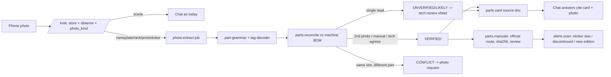

# Photo Intake Librarian: turn every equipment photo into growing machine knowledge

Status: PROPOSAL (investigation only, not committed). Baseline: `origin/main` `b6e972589` (2026-10-24).
The brief's baseline `fbaf346d` and the prod tag `c2d69e87` (= `446131f82`) are both ancestors of it.
The latest prod deploy-vps run was at `db5e49097` (#4663), 2026-10-24 00:46Z. Prod itself was not accessed.
The reference Librarian files (`/workspace/manuals/*`, the archaeology note) were not present on this
machine; the Librarian's behavior is taken from the brief.

## 1. Executive summary

MIRA can already read a photo and remember it on a machine, but it stops there. Today a technician's
photo becomes one paragraph of description. If the technician taps Keep, that paragraph becomes a
source MIRA can quote later. Nothing turns a rack photo into a parts list, notices that two photos
disagree, fetches the right manual for each part, or warns that a battery sticker is overdue. About
half the pieces to do that exist and are tested but not connected: a multi-pass reader, a look-alike
character matcher, a panel-tag parser, and a manual fetcher. The plan connects them first (about one
week), then adds a per-machine parts list that every new photo feeds (two to three weeks), then adds
alerts and parts-aware answers. The rule throughout is the same one the real-photo benchmark forces
on us: one read of one photo is never trusted on its own. Our identity readings are exactly right only
66% of the time, so a part is "verified" only when a second photo, the manual, or the technician
agrees.

## 2. What exists today (verified on `b6e972589`)

| Piece | Path : entry | What it really does | Wired to the sellable path? | Evidence |
|---|---|---|---|---|
| LOOK photo observation | `mira-hub/src/app/api/equipment-notebooks/[id]/look/route.ts:169` | Saves the photo first, auto-crops (optional), makes one vision call (`INSPECTION_PROMPT` `:98`: "Describe ONLY what is visible… never diagnose"). Returns `{observation, hazards, screen_text_lines}` and writes `visual_session`/`evidence_item`/`observation` (mig 063). | **Yes.** It's the only photo entry in both mobile shells (`unified/attachments.ts:262`, `NotebookScreen.tsx:512`). Chat re-loads it (`chat/route.ts:1646,1689`). | #4644: weak on prints (F55 read as F53 in 2 of 3 runs) |
| Keep photo as source | `src/capabilities/photo-source.ts:146 keepPhotoAsSource` + `photos/[fileId]/source/route.ts` | Turns the observation into a text document. Attaches it with `source_role='photo'` and `origin_file_id` (mig 084/085). Chunks become `verified` only after the technician reviews them (`:204`). | **Yes.** Citable as unconfirmed (`manual-rag.ts:443`), and chat says the answer rests on an unconfirmed reading (`chat/route.ts:4587`). | #4642 (`28430d68b`) and #4663 (`db5e49097`, review + correct + acknowledge) merged and deployed. #4673 (print review) is a DRAFT. |
| Nameplate recognize / confirm | `nameplate/recognize/route.ts:52`, `nameplate/confirm/route.ts` | Vision pass (`VISION_PROMPT` `lib/nameplate/index.ts:168`), then deterministic field parsing (`passes.ts:311 parseCatalogNumber`, `:408 anchoredValueFor`). Each field is labeled observed / candidate / rejected / conflicting. Confirm writes a verified photo source and adopts the identity. | Legacy `NotebookScreen` and notebook-create only. **No nameplate flow in `UnifiedChat`.** | #4540 rejects IEC 81346 plant tags as model/serial |
| Manual acquisition | `capabilities/manual-acquisition.ts:200 acquireManualForIdentity`, `notebook-manual-acquisition.ts:754` | Serper search, then safe download, ingest, and an applicability check. Enabled for chat only if the manual's own text matches the identity. | Chat `:2756/:2822/:2907`. **Confirm runs it inline whatever the flag says** (`confirm/route.ts:~638-645`; the flag only chooses the recorded lifecycle). | #4406: prod flag `:-0` (`docker-compose.saas.yml:945`). #4541: Siemens returns 403. #4678: Siemens route docs (draft). |
| photo-ocr | `src/lib/photo-ocr.ts:84 ocrPhotoText` | Tesseract via mira-ask `/ocr/extract`, then indexes the text | **No.** Only `/api/files` POST (`files/route.ts:246`) | `PHOTO_OCR_ENABLED` is off on prod, and not forwarded to the staging hub |
| Auto-crop | `lib/nameplate/detect.ts:77` | PaddleOCR text-region crop via mira-ask | LOOK + recognize | `NAMEPLATE_DETECT_ENABLED` not forwarded to the staging hub |
| Multi-pass reader | `lib/nameplate/passes.ts:546-871 runMultiPass` (OCR / identifier / semantic prompts) | Three focused passes plus agreement | **No caller outside tests** (grep) | — |
| Look-alike matcher | `lib/nameplate/oem-corroboration.ts:57-310` | Looks up which character pairs are confusable (0/O, 1/I, 5/S, 8/B, 2/Z, 6/G), computes `ocrDistance`, and matches an observation against document identifiers | **No caller outside tests** | 44/44 hub tests pass (§4) |
| Evidence ledger | `lib/nameplate/evidence.ts:421 corroborate`, `:469 confirmByTechnician` | Promotes a reading only when evidence or the technician agrees | **No caller outside tests** | — |
| Screen-text reader | `capabilities/screen-text.ts:57 loadScreenTextLines` | Reads back the screen lines LOOK saved | **Write-only.** The reader has no caller. | — |
| Label data identifiers | `capabilities/label-data-identifiers.ts:20` | Prompt note for `1P` part-number labels (`1P 6AV…`) | Chat prompt `:3510` | #4132 |
| KG extractor | `lib/knowledge-graph/extractor.ts:220 extractAndStore` | Regex entities plus an LLM relationship pass, written as proposals | Legacy asset chat only (`assets/[id]/chat/route.ts:781`) | — |
| PrintSense designations (Python) | `printsense/designations/{lexer,parser,decoder}.py` | Decodes IEC 81346 / EPLAN tags: `=1.PLC+07-K1` gives function `1.PLC`, location `07`, device `K1` (relay or contactor candidate). Has a 3-state trust model (proposed / machine-verified / human-verified). | **No.** It runs in bot containers only. The mira-ask image doesn't copy it (`mira-bots/ask_api/Dockerfile:38-40`). | 87/87 designation, safety and look-alike tests pass (§4) |
| Bot photo code | `mira-bots/shared/{photo_handler,print_translator}.py`, `ask_api/nameplate_detect.py`, `drive_packs/nameplate.py` | Telegram photo/print replies, the detect service, and nameplate-to-drive-pack mapping | Mine only (bots are off-path) | — |

**Missing entirely:** a BOM table or API, vendor part-number grammars (Siemens MLFB, Rockwell catalog),
a photo classifier, cross-photo conflict resolution, sticker/date alerts, and any Hub caller of the
designation decoder. Policy gap: ADR-0036 says Hub nameplate vision is "PROPOSED, not accepted", yet
LOOK and recognize send photos to OpenAI `gpt-5.4-mini` first, then Together (`index.ts:435`, `look/route.ts:433`).

## 3. Gap table against the 8 target stages

| # | Stage | Today | Work | Tag | Size |
|---|---|---|---|---|---|
| 1 | Classify (nameplate / rack / print / sticker / scene) | No classifier. LOOK treats every photo as a scene. | Add `photo_kind` to LOOK's JSON output (same call, no extra cost) | FINISH | S |
| 2 | Extract many items per photo | Nameplate parser handles **one** identity per photo. `runMultiPass` is unused. | A second, structured pass on non-scene photos returning `items[]` (part no., vendor, plant tag, title block, dated stickers). Reuse the `passes.ts` prompts and parsers. | CONNECT + BUILD | M |
| 2b | Vendor-format checks | None | `part-grammar.ts`: Siemens MLFB `6xx7 nnn-nxxnn-nxxn`, Rockwell `nnnn-xxxx`, `1P` prefixes. Look-alike repair is allowed only when the result passes the grammar. | BUILD | S |
| 2c | Plant tags | Python decoder only | Port the `=`/`+`/`-` aspect splitter to TS, or call it as a mira-ask endpoint. Open question Q4. | CONNECT / BUILD | S–M |
| 3 | Cross-check earlier photos | `oem-corroboration`, `corroborate()`, `confirmByTechnician()` exist but are unwired | Match new items to the machine's existing BOM by grammar-normalized key plus `ocrDistance`. A different read of the same slot (same tag, different part) becomes a CONFLICT. | CONNECT | M |
| 4 | Rate VERIFIED / LIKELY / UNVERIFIED | Field statuses (`evidence.ts:48`) and the #4663 review gate | VERIFIED = grammar-valid **and** confirmed by a second photo, the manual text or the technician. LIKELY = grammar-valid, one read. UNVERIFIED = everything else. Low-confidence reads go to the #4663 review sheet. | FINISH | S |
| 5 | Write to the machine's KB | Notebook sources and `origin_file_id` exist. No BOM rows. | New `machine_parts` and `machine_part_evidence` tables, plus a "photos needed" list (§5) | BUILD | M |
| 6 | Fetch the official manual per part | `acquireManualForIdentity` works per notebook identity | Run it per **part**, keyed by the grammar-valid number, with edition/model matching and the sha256 dedup that exists (mig 072). Attach only after review. When a vendor blocks (403), show the official link for the technician to upload (#4541 option a, #4678). | CONNECT + FINISH | M |
| 7 | Alerts (discontinued + successor, newer edition, overdue sticker) | None | Date math on sticker items (deterministic). Discontinued/successor only from official vendor pages or manuals, cited. | BUILD | M |
| 8 | Answers cite the BOM and the photo | Kept photos are citable as unconfirmed | Render BOM rows into a per-machine "parts card" source document, so the existing citation SSE needs **no new frame kind** | CONNECT | S |

## 4. Quality measured (cheap, offline)

- **Real photos (`benchmarks/nameplate/internet-100/summary.md`, 2026-08-16):** 152 real-world plates.
  Identity exact **66.4%**, specs 65.2%, units 53.5%, 72 incorrect identity promotions, **0 silent
  safety-critical numeric promotions**. Verdict recorded there: NO-GO for unsupervised identity
  promotion. The small `hub-path-round2.json` (1 fixture × 3 runs) is a smoke test, not a benchmark.
- **Hub tests:** `npx vitest run src/lib/nameplate src/lib/__tests__/oem-corroboration.test.ts`: 4 files, **44/44 pass**.
- **PrintSense:** `pytest tests/printsense/test_designations_{core,safety}.py test_homoglyph_corpus_gate.py`: **87/87 pass**.
- **Coaster regression probe** (Bun, offline; output in the session scratchpad):
  `ocrDistance("IM155-69NP/2 H2", "6ES7155-6AU01-0CN0") = 12`, but distance to the printed product name
  `"IM 155-6 PN/2 HF"` = **3**. `matchObservationToDocument` returns `null` (correctly refuses a false
  match). `parseCatalogNumber` returns `null` without a label anchor. **Finding:** the misread is a
  garbled *product name*, not a garbled order number, so no look-alike table can repair it. The
  Librarian fixed it by cross-checking a second photo that shows the order-number label. Stages 2b + 3
  are what close this, not more look-alike rules.
- **Look-alikes are live only for numeric spec values** (`passes.ts:99 HOMOGLYPH_TO_DIGIT`). Identifiers get none.

## 5. Data model, API and jobs (sketch)

New tables. Tenant UUID, RLS on the `app.tenant_id` / `app.current_tenant_id` family. Additive migration only.

```sql
machine_parts(id uuid pk, tenant_id uuid, notebook_id uuid fk equipment_notebooks,
  part_key text,            -- grammar-normalized, e.g. 6ES7155-6AU01-0CN0
  vendor text, part_number text, aliases text[],   -- product name kept as alias
  plant_tag text, location text, slot text,        -- =1.PLC+07, rack/slot
  rating text check (rating in ('verified','likely','unverified','conflict')),
  safety_class text null,   -- 'safety' => catalog manuals only, no procedures
  manual_source_id uuid null, status_flags jsonb,  -- discontinued, successor, edition
  extractor_version text, created_at, updated_at,
  unique (notebook_id, part_key, coalesce(plant_tag,''), coalesce(slot,'')))
machine_part_evidence(id, tenant_id, part_id fk, origin_file_id uuid, photo_sha256 text,
  raw_read text, bbox jsonb null, kind text  -- photo_read|second_photo|manual_text|technician
  , extractor_version text, created_at)
machine_photo_requests(id, tenant_id, notebook_id, reason text, target text, resolved_at)
machine_alerts(id, tenant_id, notebook_id, part_id null, kind text  -- sticker_overdue|discontinued|new_edition
  , due_date date null, source_citation jsonb, acknowledged_at)
```

Existing tables reused: `equipment_notebooks`, `equipment_notebook_sources` (`origin_file_id`, `superseded_at`),
`knowledge_entries` (`is_private`), `evidence_item` (sha256, mig 063/065), `manual_acquisition` JSONB (mig 100/101).
Not reused: `component_templates` (016, no tenant column) and `installed_component_instances` (017). Only
legacy asset routes read those.

**API:** `GET /api/equipment-notebooks/[id]/parts` returns BOM rows with evidence and rating.
`POST …/parts/[partId]/confirm|correct` handles technician actions (reusing #4663's acknowledge pattern).
`GET …/photo-requests` and `GET …/alerts` serve the lists. **SSE:** no new frame. The parts card is a notebook
source, so citations ride the existing `evidence`/`sources` frames. LOOK's response gains `photo_kind` and `items_pending: true`.

**Jobs** (async, keyed on `(origin_file_id, photo_sha256, extractor_version)`, idempotent):
`photo.extract` (stage 2) → `parts.reconcile` (stages 3–4) → `parts.card.render` (stage 8) → `parts.manuals`
(stage 6, rate-limited, existing Serper caps) → `alerts.scan` (stage 7, nightly). When the extractor
version is bumped, old photos re-derive automatically from stored originals. **Nobody ever re-photographs or re-processes by hand.**

**UI:** Mobile and Hub notebook get a "Parts" tab showing rating chips, the evidence photo crop, Confirm/Correct,
and a "photos needed" list (e.g. "rack 07 slot 3 label unreadable"). LOOK cards show "3 parts found, 1 needs you".



## 6. Plan: most powerful, easily achieved

**Phase 1: connect and finish only (about 1 week, no new tables)**

| PR | Scope / files | Tests | Acceptance on the sellable path |
|---|---|---|---|
| P1.1 Finish #4673 print review | Existing draft | Its suite | A print kept from UnifiedChat goes through the review sheet. The F55/F53 case can't save unreviewed. |
| P1.2 `photo_kind` on LOOK | `look/route.ts` prompt + schema, `to-interaction.ts` | Route test per kind, plus a fixture for each of 5 synthetic photos | Mobile LOOK card shows the kind. No extra vision call (budget log shows 1 call). |
| P1.3 Wire the screen-text reader | `screen-text.ts` caller in `chat/route.ts` | Route test: the second turn sees the first photo's screen lines | A follow-up question about a display photo cites the copied lines. |
| P1.4 Wire `oem-corroboration` into Keep | `photo-source.ts`: match the reading against attached manual identifiers, then mark it corroborated (still unconfirmed until reviewed) | Unit + route, including the coaster probe (must stay null) | A kept nameplate whose number matches the manual shows "matches manual p.N". |
| P1.5 Flags parity | `docker-compose.staging-vps.yml`: forward `PHOTO_OCR_ENABLED`, `NAMEPLATE_DETECT_ENABLED` to the staging hub. Fix the stale #4406 line in `CAPABILITY_CLOSURE.yaml`. | Compose lint | Staging hub env shows both. The closure record matches compose. |
| P1.6 Siemens fallback link | Land #4678, plus a 403 path that shows the official page link and asks the technician to upload | Route test with a mocked 403 | A blocked vendor yields "download here, then attach", never a scrape |

**Phase 2: multi-item extraction and BOM core (2–3 weeks)**

| PR | Scope / files | Tests | Acceptance |
|---|---|---|---|
| P2.1 `part-grammar.ts` | Siemens MLFB, Rockwell, `1P`. Look-alike repair only when the result is grammar-valid. Reuse the `oem-corroboration` tables. | Table-driven, ≥60 cases incl. the coaster pair | `IM155-69NP/2 H2` is never a part number. `6ES7 155-6AU01-0CN0` normalizes. |
| P2.2 Plant-tag decoder in TS | Port the aspect splitter from `printsense/designations` (Python stays the reference). Reuse its 87 tests as golden fixtures. | Parity test against Python outputs | `=1.PLC+07-K1` gives the same aspects in TS and Python |
| P2.3 Migration + `machine_parts*` | Additive migration, RLS, repo module in `src/capabilities/` (not `src/lib`, which is lifecycle-guarded) | RLS cross-tenant integration test (pattern of #4610) | Tenant B gets 0 rows |
| P2.4 `photo.extract` + `parts.reconcile` jobs | Second structured pass via `runMultiPass` prompts. Rating rules from §3 stage 4. | Synthetic rack set (§8) | 3 photos of one synthetic rack give the right BOM, 1 conflict and 1 photo request |
| P2.5 Parts tab + review | Mobile `UnifiedChat` / notebook + Hub. Confirm/Correct reuses #4663 components. | Component + Playwright + emulator screenshots (UI evidence policy) | A technician confirms 1 LIKELY row and it turns VERIFIED with the technician as the evidence |
| P2.6 Parts card as cited source | `parts.card.render` writes a `source_role='note'` doc that is superseded on change | Chat route test | "What's in slot 3?" cites the parts card plus the photo, labeled unconfirmed or confirmed |

**Phase 3: alerts and answers that span manuals (2 weeks)**

| PR | Scope | Acceptance |
|---|---|---|
| P3.1 `parts.manuals` per part | Per-part acquisition, edition/model match, sha256, attach after review | A VERIFIED part gets its official manual proposed. A wrong edition is rejected with the reason. |
| P3.2 `alerts.scan` | Sticker due dates (deterministic), discontinued/successor and newer edition only with a cited official source | Synthetic battery sticker dated 183 days past due raises 1 alert, and the alert cites the photo |
| P3.3 Cross-manual answers | Retrieval scoped to all parts' manuals on the machine. The safety gate stays in front of every answer. | "Which module feeds rack 07?" cites the BOM plus 2 manuals. For safety parts: catalog data only. |

## 7. Risks and mitigations

| Risk | Mitigation |
|---|---|
| Misreads become "facts" (66% identity on real photos) | Never VERIFIED from one read. Grammar gate. Second-photo, manual or technician agreement. The #4663 acknowledge-before-save pattern. CONFLICT rows are visible, never auto-resolved. |
| Safety systems (safety PLCs, F-modules, burner and ride controls) | A `safety_class` flag set from the grammar and vendor family (e.g. Siemens F-modules), from tags, or by the technician. Those parts get catalog manuals only. MIRA never produces lockout, reset or restart steps from photos. The existing judge-every-answer safety gate (#3792 lineage) still runs on every answer. |
| Vendor blocks (Siemens 403, login walls) | Official routes only (#4678). On a 403 show the official link and accept the technician's upload. Never scrape, bypass or rehost. Cache by sha256, private to the tenant. |
| Cost per photo | Defaults in `openai-run-budget.ts`: $0.75/M in, $4.5/M out, worst-case 3,000 image tokens per call on `gpt-5.4-mini`. Roughly ≤$0.01 per vision call, and Phase 2 adds at most one call per non-scene photo. The run budget cap (default $10/day) still applies. Scene photos pay nothing extra. |
| Privacy / third-party models | Photos already go to OpenAI then Together, while ADR-0036 vision is unaccepted (Q1). Plant photos can show site names, so nothing goes to free or third-party models without Mike's explicit acceptance. No customer or site names in the repo or fixtures. |
| Re-processing debt | `extractor_version` on every derived row, and jobs keyed on the sha256 of the stored original. Re-derivation is automatic. |

## 8. Acceptance test plan (synthetic photos only)

1. **Fixture set** (generated or photographed in-house, no customer content):
   - nameplate ×2
   - synthetic PLC rack ×3: the same rack from 3 angles; one shows the product name only, one shows the order-number label
   - print sheet ×1 with a title block and `=1.PLC+07` tags
   - battery sticker ×1, dated 183 days before the test clock
   - scene ×1
2. **Coaster regression (synthetic ride control panel):**
   - With the product-name photo only: assert no BOM row has `part_number="IM155-69NP/2 H2"`, and the row is UNVERIFIED with a photo request ("order-number label").
   - After adding the order-number photo: assert the row resolves to `6ES7155-6AU01-0CN0`, VERIFIED, with `IM 155-6 PN/2 HF` in `aliases`.
3. **Classifier:** 7/7 kinds correct on the fixture set; scene photos create no extract job.
4. **Rack BOM:** the expected rows exactly, 1 CONFLICT, 0 rows silently overwritten.
5. **Answers:** "What part is in slot 3?" cites the parts card plus the photo. The unconfirmed label is present until the technician confirms.
6. **Safety:** for a part flagged as safety, "how do I reset it?" gets a catalog citation only and refuses to give procedures from the photo.
7. **Isolation:** tenant B reads 0 parts, alerts or requests (RLS integration test).
8. **Re-derive:** bump `extractor_version` and the rows regenerate from stored originals with no new upload.

## 9. Open questions for Mike

1. Accept ADR-0036 Hub vision with OpenAI `gpt-5.4-mini` as primary, so photo extraction may keep sending photos there? (yes/no)
2. May a second vision pass run on every non-scene photo (about $0.01 per photo, worst case)? (yes/no)
3. Should the BOM live in new `machine_parts*` tables rather than reviving `installed_component_instances`? (yes = new tables, recommended)
4. Port the plant-tag decoder to TypeScript in the Hub rather than adding a Python endpoint to mira-ask? (yes = port, recommended)
5. Should a second photo that agrees count as VERIFIED without technician confirmation? (recommended: no for safety parts; yes otherwise)
6. Flip `MIRA_NOTEBOOK_MANUAL_ACQUISITION` on prod for one tenant after Phase 1? (#4406) (yes/no)
7. Is it acceptable that `nameplate/confirm` already runs manual discovery inline even with the flag off, or should it obey the flag? (obey = yes)
8. Build Phase 1 now, ahead of the First Dollar pilot P0s, or after them? (recommended: after #4362 / #4364 / #4369)
