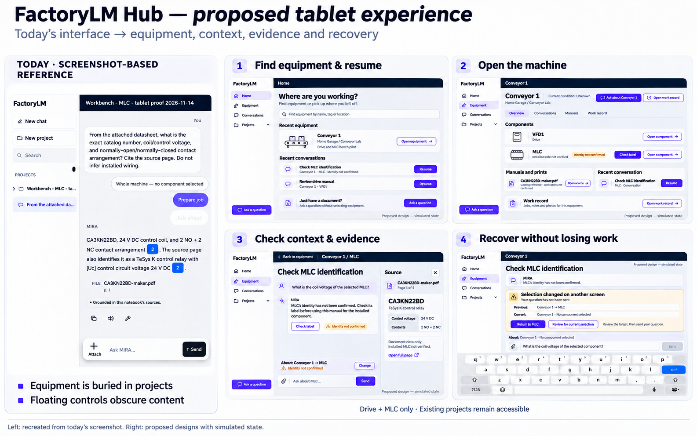
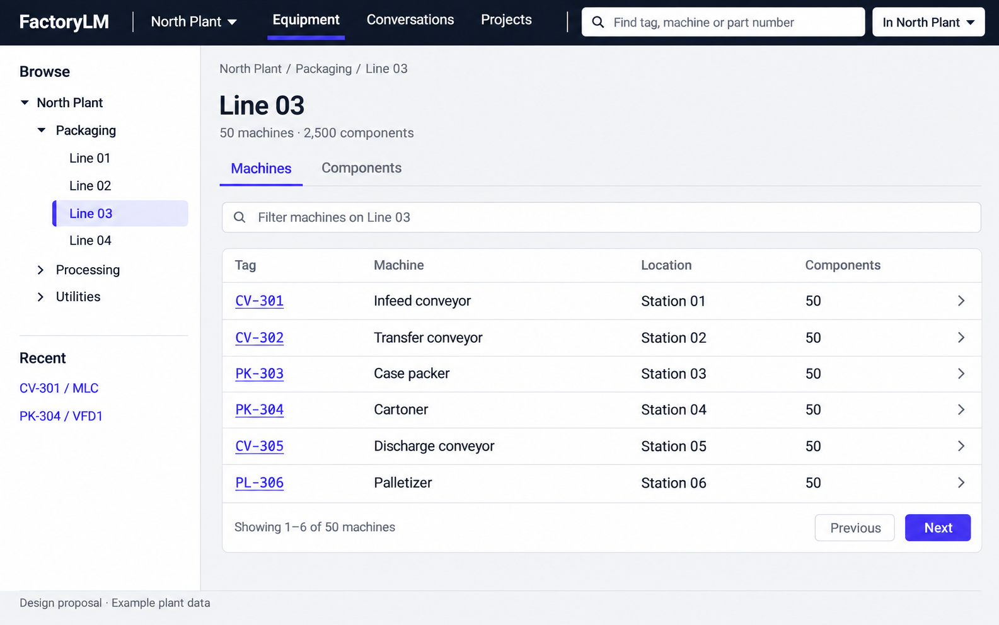
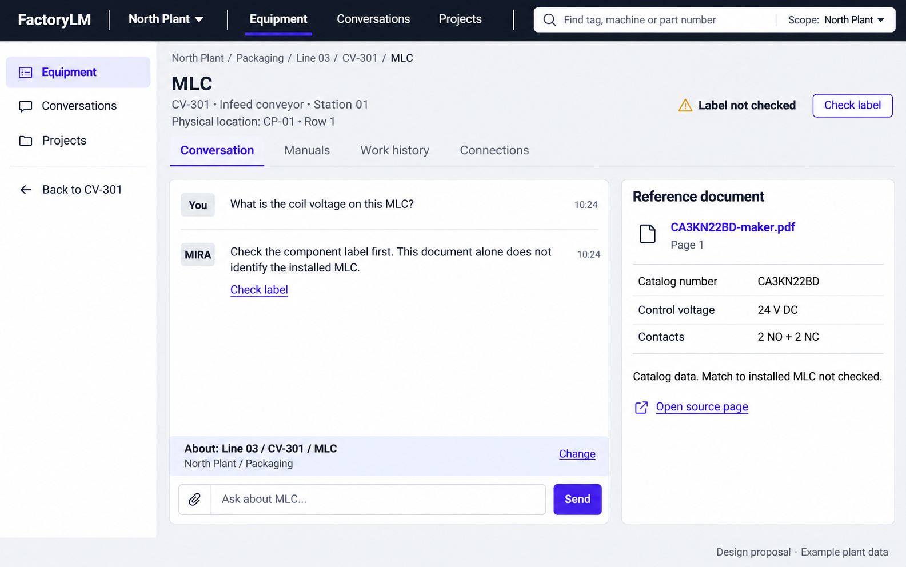

# Workbench pilot, equipment UI and UNS research

Published November 15, 2026 at Mike's request. This collection preserves the research and design artifacts produced in the November 14–15 planning chat. It brings the local materials into the repository; it does not merge product changes, adopt every proposal, alter the PLC or deploy the UI.

**Start here:** [UNS terminology and naming contract](2026-11-15/uns-naming/RESEARCH-AND-NAMING-CONTRACT.md), then [factory-scale design](2026-11-14/hub-machine-mockups/v2-factory-scale/DESIGN-NOTES.md) and [architecture estimate](2026-11-14/hub-machine-mockups/v2-factory-scale/ARCHITECTURE-PLAN.md).

| Material | Published artifact |
|---|---|
| Walker Reynolds, Litmus, Ignition, HighByte, PLC/OPC UA/MQTT/Sparkplug naming research | [Research and proposed naming contract](2026-11-15/uns-naming/RESEARCH-AND-NAMING-CONTRACT.md) |
| Bench pilot direction, UNS principles and staged expansion | [Workbench pilot plan](2026-11-14/workbench-pilot/WORKBENCH-PILOT-PLAN.md) |
| Fast drive + MLC verification loop | [Quick verification pilot](2026-11-14/workbench-pilot/QUICK-VERIFICATION-PILOT.md) |
| Actual bounded tablet observations and limitations | [Public tablet receipt](2026-11-14/workbench-pilot/tablet-first-proof/RESULT.md) |
| Tablet evidence packet for the established coordinator | [Mission Control handoff](2026-11-14/workbench-pilot/tablet-first-proof/MISSION-CONTROL-HANDOFF.md) |
| Technician workflow critique and EGM working hypothesis | [Concept brief](2026-11-14/hub-machine-rethink/concepts_brief.md) |
| Initial screenshot-based proposals | [Mockup notes](2026-11-14/hub-machine-mockups/README.md), [HTML gallery](2026-11-14/hub-machine-mockups/index.html) |
| Factory-scale hierarchy, search, identity and style | [Design notes](2026-11-14/hub-machine-mockups/v2-factory-scale/DESIGN-NOTES.md), [HTML gallery](2026-11-14/hub-machine-mockups/v2-factory-scale/index.html) |
| Effort estimate, reuse, API boundaries and staged delivery | [Architecture plan](2026-11-14/hub-machine-mockups/v2-factory-scale/ARCHITECTURE-PLAN.md) |
| Reconciliation with the five sessions' existing work | [Handoff reconciliation](2026-11-14/hub-machine-mockups/v2-factory-scale/HANDOFF-RECONCILIATION.md) |
| Five-session UI transition prompts | [Session goal prompts](2026-11-14/hub-machine-mockups/v2-factory-scale/SESSION-GOAL-PROMPTS.md) |
| Earlier bench pilot prompts | [Agent goal prompts](2026-11-14/workbench-pilot/AGENT-GOAL-PROMPTS.md) |
| Codex/Claude handoff and Mission Control installation research | [Installation receipt](2026-11-14/workbench-pilot/HANDOFF-SKILL-INSTALLATION.md) |
| Historical afternoon state | [14:38 ET](2026-11-14/workbench-pilot/STATUS-2026-11-14-1438-ET.md), [17:18 ET](2026-11-14/workbench-pilot/STATUS-2026-11-14-1718-ET.md), [17:22 ET](2026-11-14/workbench-pilot/STATUS-2026-11-14-1722-ET.md) |

## Read the dates and evidence boundaries

- The later naming memo refines terminology in the earlier UI drafts. Its proposed field names and signal conventions are not already deployed schema or universally mandated PLC syntax.
- The immediate pilot scope is drive + MLC. Broader inventory and factory-scale fixtures are expansion plans, not accepted bench coverage.
- The tablet receipt describes an agent-operated run on staging `eab62164d` on November 14. It is not a claim about today's build, independent technician acceptance or verified physical installation.
- The initial EGM brief is preserved as a preliminary hypothesis. It records its review status at writing; this archive does not turn that statement into a claim about any later reviewer sessions.
- The mockups are generated design illustrations. Their source panels and comparison-board reconstruction are not original manufacturer documents or raw device screenshots. The synthetic North Plant hierarchy does not rename CV-101.
- Prompts and historical handoffs preserve the instructions and authority boundaries at their preparation dates. Do not execute them blindly as current approval or treat old review/CI results as evidence for a changed commit.
- The handoff installation receipt is historical. This publication does not install skills or include the separately staged skill implementation.
- Current ownership and delivery evidence remain in [Mission Control / #5232](https://github.com/Mikecranesync/MIRA/issues/5232), with the [established integration record](https://github.com/Mikecranesync/MIRA/issues/5232#issuecomment-6870960483). This archive creates no new coordinator or implementation claim.

## Visual previews

Initial proposal, including a generated reconstruction of the observed interface:

Factory-scale revision, using synthetic equipment:

GitHub displays the Markdown and PNGs directly. Open the HTML galleries from a local checkout to browse the static galleries; GitHub's source view does not serve them as a deployed application.

## Provenance and publication checks

[SOURCE-MANIFEST.json](SOURCE-MANIFEST.json) records source and published SHA-256 hashes for all 32 imported artifacts, including nine unchanged generated PNGs. Publication edits add dated notices, make links portable and remove a private project deep link and three record identifiers. The original generation prompts, image manifests and token snapshot are retained.

The publication checks cover artifact completeness, JSON parsing, image hashes/dimensions, portable Markdown/HTML links, prompt length, whitespace and staged secret scanning. They do not rerun application tests or establish new device acceptance.

See [private evidence and exclusions](PRIVATE-EVIDENCE.md) for the raw tablet material intentionally retained outside this public repository. Other sessions' repair workspaces and private account data were not swept into this publication.
